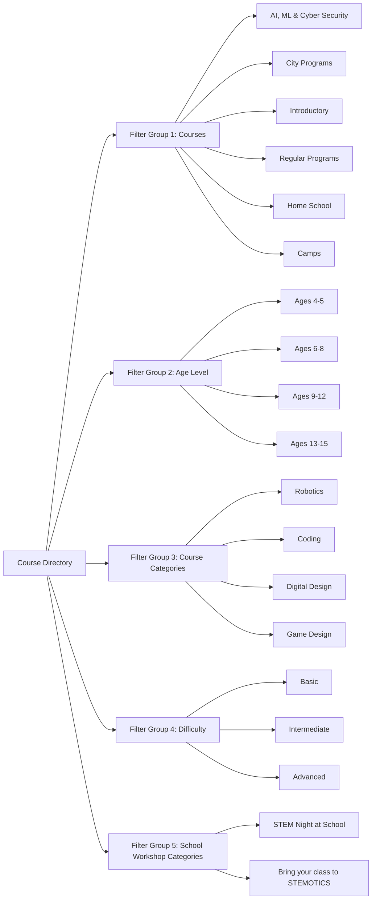

# Phase 01 — Reference Website Audit & Content Inventory

## 1. Executive Summary & Audit Scope

This document provides an exhaustive, section-by-section, and element-by-element audit of the reference website [STEMOTICS](https://stemotics.com/). Every page, section, text block, form, image, navigational structure, and functional feature was audited against the live site, Yoast XML sitemaps, and theme assets.

The master scope guarantees:
1. **Zero Content Omission:** Every piece of copy, program listing, camp theme, FAQ, policy term, and partner list from the live website is cataloged for verbatim preservation.
2. **Reconciliation with Client Requirements:** Integrating all new requirements from the client specifications (October 27, 2026), including automated medical forms, 9-student slot limits, weekday date pickers, camp theme management, Helcim/Stripe recurring subscriptions, and custom form builders.
3. **Identification of Broken/Deprecated Links:** Clarifying live redirects (such as `/summer-camp/` returning 404, with active camps served at `/product-category/camps/`), resolving inconsistencies, and defining the target site architecture.

---

## 2. Complete Website Page Inventory & URL Mapping

The live site audit identified the following complete inventory of pages, categories, and dynamic products:

### 2.1 Core Pages & Navigation Items

| # | Page Name | Reference URL | Status / Verification | Target Architecture Mapping |
|---|---|---|---|---|
| 1 | Homepage | `https://stemotics.com/` | Verified Active | Homepage (`/`) with modernized layout & CMS controls |
| 2 | Courses Catalog | `https://stemotics.com/courses/` | Verified Active | Filterable course directory (`/courses`) |
| 3 | Camps Directory | `https://stemotics.com/product-category/camps/` | Verified Active | Camps hub (`/camps`) |
| 4 | Competitions | `https://stemotics.com/product-category/competitions/` | Verified Active | Competitions hub (`/competitions`) |
| 5 | School Workshops | `https://stemotics.com/product-category/schools/` | Verified Active | School workshops directory (`/schools`) |
| 6 | Birthday Parties | `https://stemotics.com/product-category/birthday_party/` | Verified Active | Birthday party packages (`/birthday-parties`) |
| 7 | Image Gallery | `https://stemotics.com/image-gallery/` | Verified Active | Photo gallery (`/gallery/photos`) with date sorting |
| 8 | Video Gallery | `https://stemotics.com/video-gallery/` | Verified Active (Elementor Lightbox) | Video gallery (`/gallery/videos`) with date sorting |
| 9 | About Us | `https://stemotics.com/about-us/` | Verified Active | Static page (`/about-us`) |
| 10 | Contact Us | `https://stemotics.com/contact-us/` | Verified Active (CF7 Form) | Interactive Contact Page (`/contact-us`) |
| 11 | FAQ | `https://stemotics.com/faq/` | Verified Active (15 Accordion Q&As) | Searchable & Filterable FAQ (`/faq`) |
| 12 | Cancellation & Refund Policy | `https://stemotics.com/cancellation-refund-policy/` | Verified Active | Legal policy page (`/cancellation-refund-policy`) |
| 13 | Partner With Us | `https://stemotics.com/partner-with-us/` | Verified Active (Franchise Opportunities) | Partner/Franchise page (`/partner-with-us`) |
| 14 | School, Library & Community Center | `https://stemotics.com/school-library-community-center/` | Verified Active (Directory of Partners) | Institutional partners directory (`/community-partners`) |
| 15 | Medical & Photo Release Form | `https://stemotics.com/personal-information-medical-conditions-photo-release-stemotics-camps/` | Verified Active (16-field consent form) | Automated Medical Form Workflow (`/forms/medical-release`) |
| 16 | My Account / Parent Portal | `https://stemotics.com/my-account/` | Verified Active (WooCommerce Auth) | Authenticated Parent Portal (`/account`) |
| 17 | Shopping Cart | `https://stemotics.com/cart/` | Verified Active | Slide-over Cart Drawer + Full Cart Page (`/cart`) |
| 18 | Checkout | `https://stemotics.com/checkout/` | Verified Active | Modern Multi-step Checkout (`/checkout`) |
| 19 | Order Confirmation | `https://stemotics.com/thank-you/` | Verified Active | Dynamic Order Success & Next Steps (`/order-success`) |
| 20 | External Learning Portal (LMS) | `https://learn.stemotics.com/` | External Link | Maintained in Header & Admin (`https://learn.stemotics.com/`) |
| 21 | Summer Camp (Legacy) | `https://stemotics.com/summer-camp/` | Returns 404 (Orphan URL) | 301 Redirect to `/camps` |

---

## 3. Product Catalog & Category Inventory

The audit revealed 29 active product listings across 8 distinct product categories:

### 3.1 Product Categories

1. **Regular Programs** (`/product-category/regular-programs/`): Monthly recurring subscription courses for after-school and weekend learning.
2. **Camps** (`/product-category/camps/`): Single-purchase seasonal full-day camps (PD Day, Winter Break, March Break, Summer Camp).
3. **Competitions** (`/product-category/competitions/`): Competitive teams and training (FIRST LEGO League, World Robot Olympiad).
4. **Schools & Workshops** (`/product-category/schools/`): On-site and in-school workshops (STEM Night, Field Trips).
5. **Birthday Parties** (`/product-category/birthday_party/`): Specialized on-site and off-site robotics birthday parties.
6. **Homeschool Programs** (`/product-category/homeschool-programs/`): Daytime STEM and robotics classes tailored for homeschoolers.
7. **Introductory** (`/product-category/introductory/`): Free and paid trial classes, introductory robotics workshops.
8. **Off-site Locations** (`/product-category/off-site-locations/`): City-partnered programs across Southwestern Ontario.

### 3.2 Master Product Listing & Product Codes

| Product Title | Product Code | Category | Pricing Model | Custom Options / Fields Captured on Live Site |
|---|---|---|---|---|
| Introduction to Artificial Intelligence | `STAI4001` | Regular Programs | Monthly Recurring Fee | Start Date Picker, Day & Time slot (Mon-Sat), Child Full Name, Age (9-12) |
| Coding Pre-Junior | `STC1001` | Regular Programs | Monthly Recurring Fee | Start Date Picker, Day & Time slot, Child Name, Age (4-5) |
| Coding Junior | `STC2001` | Regular Programs | Monthly Recurring Fee | Start Date Picker, Day & Time slot, Child Name, Age (6-8) |
| Coding Senior | `STC3001` | Regular Programs | Monthly Recurring Fee | Start Date Picker, Day & Time slot, Child Name, Age (9-12) |
| Robotics Pre-Junior | `STR1001` | Regular Programs | Monthly Recurring Fee | Start Date Picker, Day & Time slot, Child Name, Age (4-5) |
| Robotics Junior | `STR2001` | Regular Programs | Monthly Recurring Fee | Start Date Picker, Day & Time slot, Child Name, Age (6-8) |
| Robotics Senior | `STR3001` | Regular Programs | Monthly Recurring Fee | Start Date Picker, Day & Time slot, Child Name, Age (9-12) |
| Digital Design Pre-Junior | `STD1001` | Regular Programs | Monthly Recurring Fee | Start Date Picker, Day & Time slot, Child Name, Age (4-5) |
| Digital Design Junior | `STD2001` | Regular Programs | Monthly Recurring Fee | Start Date Picker, Day & Time slot, Child Name, Age (6-8) |
| Digital Design Senior | `STD3001` | Regular Programs | Monthly Recurring Fee | Start Date Picker, Day & Time slot, Child Name, Age (9-12) |
| Game Design Junior | `STG2001` | Regular Programs | Monthly Recurring Fee | Start Date Picker, Day & Time slot, Child Name, Age (6-8) |
| Game Design Senior | `STG3001` | Regular Programs | Monthly Recurring Fee | Start Date Picker, Day & Time slot, Child Name, Age (9-12) |
| Homeschool Robotics | `STH1001` | Homeschool | Monthly Recurring Fee | Daytime slot selection, Child Name, Age |
| PD DAY Camp (2026-2027) | `CAMP-PD` | Camps | One-time per day | Date selection checkboxes (5 dates), Care options (Before/After care), Child Name, Age |
| Winter Break Camp | `CAMP-WINT` | Camps | One-time / Weekly | Week/Day selection, Theme selection, Care options, Camper Name, Age |
| March Break Camp (Cambridge) | `CAMP-MAR` | Camps | One-time / Weekly | Weekly registration, Theme, Extended care, Camper Name, Age |
| FIRST LEGO League 2026-2027 | `COMP-FLL` | Competitions | Registration + Monthly | Season session, Timing (Sat morning/afternoon), Child Full Name, Age (9-14) |
| World Robot Olympiad (WRO) | `COMP-WRO` | Competitions | Season Fee | Category/Team selection, Child Name, Age |
| STEM Night at School | `SCH-STEM` | Schools | Fixed package | Options A, B, C; Workshop module selections, School name, Dates |
| Field Trip to STEMOTICS | `SCH-TRIP` | Schools | Group Fee | Grade group, Student headcount, Preferred dates |
| BIRTHDAY PARTY (On-site) | `BTH-ONSITE` | Birthday Party | Package Base + Extras | Date, Time slot, Child Name, Age, Participant count |
| BIRTHDAY PARTY – Offsite | `BTH-OFFSITE` | Birthday Party | Package Base + Travel | Location address, Date, Time slot, Child Name, Headcount |
| Introductory Workshop | `INTRO-WS` | Introductory | Flat trial fee ($24.99) | Workshop date, Time, Child Name, Age |
| Free Trial Classes | `TRIAL-FREE` | Introductory | Free ($0.00) | Date, Time, Child Name, Age, Parent phone |
| Cambridge City Program | `CITY-CAM` | Off-site Locations | Per term / session | Community centre location, Schedule, Age group |
| Kitchener City Program | `CITY-KIT` | Off-site Locations | Per term / session | Community centre location, Schedule, Age group |
| Waterloo City Program | `CITY-WAT` | Off-site Locations | Per term / session | Community centre location, Schedule, Age group |
| Guelph City Program | `CITY-GUE` | Off-site Locations | Per term / session | Community centre location, Schedule, Age group |
| London City Program | `CITY-LON` | Off-site Locations | Per term / session | Community centre location, Schedule, Age group |
| Woodstock City Program | `CITY-WOO` | Off-site Locations | Per term / session | Community centre location, Schedule, Age group |

---

## 4. Section-by-Section Homepage Content Inventory

The reference homepage (`https://stemotics.com/`) contains 21 distinct structural sections:

### Section 1: Utility Top Bar & Header Navigation
- **Contact Info:** Call Us: `+1 519-957-1073` | Email: `info@stemotics.com`
- **Main Nav Items:**
  - Home (`/`)
  - Courses (`/courses/`)
  - Camps (`/product-category/camps/`)
  - Competitions (`/product-category/competitions/`)
  - Schools Workshops (`/product-category/schools/`)
  - Birthday Party (`/product-category/birthday_party/`)
  - Gallery (Dropdown: Image Gallery, Video Gallery)
  - Contact Us (Dropdown: About Us, Contact Us, FAQ, Cancellation & Refund Policy, Partner With Us)
  - Register & Login (`/my-account/`)
  - Learning Portal (`https://learn.stemotics.com/`)
- **Cart Widget:** Header cart icon displaying live count with flyout modal / drawer.

### Section 2: Hero Slider (5 Rotational Slides)
1. **Slide 1 — Brand Mission:**
   - Heading: `Excite | Inspire | Motivate Learning`
   - CTA Button: `Join Now` -> `https://stemotics.com/courses/`
2. **Slide 2 — Summer Camp:**
   - Heading: `SUMMER CAMP`
   - Description: `Our summer camp features activities for ages 4-12! Science & Technology, Coding Animation, Game Design, Robotics & Digital Design are among the camps provided. Outdoor play and activities every day`
   - CTA Button: `Join Now` -> `https://stemotics.com/product-category/camps/`
3. **Slide 3 — Regular Programs:**
   - Heading: `Regular After-School & Weekend Programs`
   - Description: `Promote the love of Science, Technology, Engineering, and Mathematics (STEM) through imagination and hands-on learning in a fun atmosphere.`
   - CTA Button: `Enrol Now` -> `https://stemotics.com/courses/`
4. **Slide 4 — PD Day Camp:**
   - Heading: `PD DAY CAMP`
   - Description: `STEM Activities to engage kids while school’s out for PD day!. Excite, Inspire, and Motivate young people about the fun, importance and impact of STEM Education.`
   - CTA Button: `Register Today` -> `https://stemotics.com/product/pd-day-camp/`
5. **Slide 5 — Competitions:**
   - Heading: `COMPETITIONS`
   - Description: `Train. Compete. Win—Robotics competition for kids. Helping kids build robots, gain confidence, and compete in worldwide robotics competitions.`
   - CTA Button: `Register Today` -> `https://stemotics.com/product-category/competitions/`

### Section 3: Educational Value Proposition
- **H1:** `STEM EDUCATION THROUGH PROJECT-BASED LEARNING`
- **Copy:** `The future holds challenges, where innovation, originality and ability to work in a team will serve as key competitive parameters. STEMOTICS gives children the opportunity to learn STEM through robotics.`

### Section 4: Featured Course Streams (4 Highlight Cards)
- **H2:** `STEMOTICS Courses`
- **Card 1:** `Over 35 Programs and Counting` — `Specialized programs available for all age groups.`
- **Card 2:** `Why Robotic Learning?` — `Develops logical, mathematical, analytic and creative thinking.`
- **Card 3:** `No Bookworms Stuffs` — `Practical training where you’ll work in teams and experiment in class.`
- **Card 4:** `Everything you need to learn` — `Project based teachings for step by step growth.`

### Section 5: High-Impact Call to Action Banner
- **H2:** `Don’t miss out on this incredible opportunity! Take the first step toward a brighter future.`
- **CTA Button:** `Join Today!` -> `/courses/`

### Section 6: Mission & Tech Leadership
- **Subtitle:** `Empowering Tomorrow’s Tech Leaders`
- **H2:** `Your Journey to Robotics Excellence Begins Here`
- **Body Copy:** Comprehensive introduction explaining hands-on mechanical, software, and hardware fundamentals taught through certified instructors.

### Section 7: Hands-on Hardware & Platforms Showcase
- **H2:** `Transform Your Passion Into Proficiency With Our Courses`
- **Platform 1 — Simple and Powered Machines:** Investigating gears, levers, pulleys, and structural dynamics using LEGO education sets.
- **Platform 2 — Sphero Robots:** Coding Sphero Indi and BOLT for collision avoidance, sensor navigation, and logic loops.
- **Platform 3 — Arduino Programming:** Circuit assembly, breadboarding, C++ coding, and micro-controller automation for advanced students.

### Section 8: Social Proof & Testimonials
- **H2:** `Feedback from Our Students & Their Parents`
- **Badge:** `EXCELLENT` Google Reviews Rating badge (via Trustindex).
- **Verified Reviews:** Verbatim parent reviews regarding summer camps, LEGO coding, instructor patience, and child excitement.

### Section 9: Client Updated Requirement — Homepage Metric Counters
*(From Client Requirements Summary Section 2.F)*
Staff can edit and display live numerical counters:
1. **Children Benefited Count:** `5,000+`
2. **Schools Served:** `20+` (referencing Waterloo, Cambridge, Kitchener, Mississauga schools)
3. **Community Centres Partnered:** `35+`
4. **Certified Teachers / Instructors:** `15+`

### Section 10: Call to Action — Real-World Problem Solving
- **H2:** `Equip Yourself With The Skills And Knowledge`
- **Subtext:** `To design and program robots that can tackle real-world challenges.`
- **CTA:** `Join Us At STEMOTICS Today` -> `/courses/`

### Section 11: Client Updated Requirement — Newsletter Signup Block
*(From Client Requirements Summary Section 2.F)*
- Interactive newsletter and promotional subscription form.
- Includes direct link to the LMS portal (`https://learn.stemotics.com/`).

### Section 12: Global 4-Column Footer
- **Column 1 — About Us:** `STEMOTICS is a specialized robotics center in Cambridge, Ontario. It aims to provide children and youngsters with the right skills to expedite their learning, especially in STEM-related fields, and express their creativity.` Link: `Read More`
- **Column 2 — Develop Your Skills:**
  - Investigating machines from engineering point of view
  - Focusing on mechanical software design in a team
  - Investigating machine mechanisms required to operate, using mathematics and physics
  - Finding solutions for programmatic-mechanical optimization problems
- **Column 3 — Robotic Values:**
  - Develop procedural logical and creative thinking
  - Ability to cope with malfunctions
  - Mathematical and programming skills
  - Motor skills and engineering analytics
  - Social aptitude, self-confidence and sense of capability
- **Column 4 — Quick Access & Contact Details:**
  - Quick Links: FAQ, Summer Camp, Video Gallery, Image Gallery, About Us, School-Library-Community Center
  - Address: `695 Bishop Street North, Cambridge, Ontario, N3H 2K8`
  - Copyright: `© Copyright 2026 STEMOTICS. All Rights Reserved.`
  - Social Links: Facebook (`stemoticscanada`), Twitter (`@stemotics`), LinkedIn (`stemotics`)

---

## 5. Course Directory & Filter System Audit

Reference URL: `https://stemotics.com/courses/`

The live site implements an AJAX-based multi-taxonomic filtering system. The new CMS must support the exact 5 client-listed filter groups with dynamic admin configuration:

---

## 6. Static Pages Verbatim Content Inventory

### 6.1 About Us (`/about-us/`)
- **Mission:** Providing children with the right skills to expedite learning in STEM fields and express creativity.
- **Main Goal & Idea:** Safe, fun, and interactive hands-on training using LEGO Mindstorms, WeDo, Spike Prime, Sphero, and Arduino.
- **Vision:** Inspiring future generations of Canadian innovators and engineers through practical team experimentation.
- **Services:** After-school classes, weekend workshops, PD day camps, summer camps, school field trips, and TOT (Training of Trainers) for educators.

### 6.2 Contact Us (`/contact-us/`)
- **Physical Address:** `695 Bishop Street North, Unit #4, 2nd Floor, Cambridge, ON – N3H 2K8`
- **Phone:** `519-957-1073`
- **Email:** `info@stemotics.com`
- **Form Fields:** Name (Required), Phone (Required), Email (Required), Message (Optional), Google reCAPTCHA v3.

### 6.3 FAQ (`/faq/`) — All 15 Verified Questions & Answers
1. **Q: What is the logic in having a 2nd grader sit in the same class as a 1st grader?**  
   *A:* In the course of STEMOTICS enrichment programs, children are exposed to educational materials they do not usually have access to in school at their age. The models come with parts that enable every child to build and invent according to their passions and ability.
2. **Q: Aren’t the lessons too long? Don’t the children lose interest?**  
   *A:* They really don’t. At the start of each lesson they are taught a subject, following which they are eager to get started with the construction so that they can play with the final product. When the lesson is over, most don’t even realize how much time has passed.
3. **Q: Can a 1st grader understand the substance of the lessons?**  
   *A:* Our enrichment programs are especially made for children of this age group. Our programs and workshops have been active for a number of years now, and all have enjoyed great success. Each lesson includes a familiar background story with corresponding live experiments.
4. **Q: My child is 3 and half (preschool), gifted and is interested in participating. Why isn’t it possible?**  
   *A:* Even though your child is gifted, they need to know reading and writing, and also a little more complex math than addition and subtraction. Therefore we recommend waiting an additional six months to avoid any frustration.
5. **Q: Do the children take the models home?**  
   *A:* Unfortunately, the kits used are very expensive and therefore must remain with the instructor, who will pass them from class to class. Children do however take home what they learn, which includes physics, mathematics and engineering.
6. **Q: How long are the programs and how often do they take place?**  
   *A:* The LEGO programs are mostly 90 to 120 minutes long.
7. **Q: Is it possible to attend a trial lesson?**  
   *A:* Certainly. Our trial sessions are $24.99. In the event that you decide to continue with the course, you’ll need to pay for the 8-weeks program [$199.99-$24.99=$175.99], which includes a charge for the trial lesson.
8. **Q: What happens if a lesson is cancelled due to a holiday?**  
   *A:* In such case, the complete course is extended for one week. We don’t charge more and vice versa.
9. **Q: Can I sit with my child during class?**  
   *A:* Staying with your child is not recommended. The goal of the program is for the children to manage by themselves, and try to deal with different tasks without parental dependency.
10. **Q: How big are your groups?**  
    *A:* Up to 10 children in a classroom (Client updated rule: Default capacity is 9 children per slot; staff can edit it).
11. **Q: Does each child receive a kit?**  
    *A:* Each child or pair receives a kit, depending on the type and complexity of the model constructed.
12. **Q: Who are the instructors?**  
    *A:* We hire instructors that have experience working with children. Each instructor has undertaken a special STEMOTICS training course, which includes live field training.
13. **Q: Are your instructors engineers?**  
    *A:* Yes, most of our instructors are engineers and certified robotics instructors.
14. **Q: Do I need to bring anything to class?**  
    *A:* Only a good mood. We provide the rest.
15. **Q: Is it possible to buy the enrichment programs kit?**  
    *A:* The kit itself is manufactured by LEGO® and other manufacturers. The kits can be purchased through their online stores.

### 6.4 Cancellation & Refund Policy (`/cancellation-refund-policy/`)
- **On-site Services:** Notice must be received three (3) full working days prior to camp commencement.
  - Requested >2 weeks before start date: 100% refund minus $35 admin fee.
  - Requested within 2 weeks of start date: 50% refund minus $35 admin fee.
  - Requested <3 working days: Non-refundable.
  - Inclement weather (PD Day Camps): 100% refund, no administration fee.
- **Competitive Robotics Teams (FLL/WRO):** Registration fees are strictly non-refundable.
- **Off-site Services:** 25% non-refundable deposit required.
- **Client Updated Recurring Subscriptions Cancellation Rule:**  
  *Cancellation of Regular Program subscriptions must be requested at least 4 weeks before the next recurring billing date. The parent portal and checkout must clearly display and enforce this 4-week rule.*

### 6.5 Partner With Us (`/partner-with-us/`)
- **Franchise Opportunity:** 12-year proven model, modest initial capital, high margins, low fixed overhead, proprietary STEMOTICS curriculum, comprehensive trainer certification, territorial exclusivity across Canadian provinces.

### 6.6 School, Library & Community Center Directory (`/school-library-community-center/`)
Preserving the complete roster of institutional partners:
- **Schools (20+):** Paris Central School, Cedar Creek Public School, Sandowne Public School, Saint Augustine Catholic School, St. Bernadette Catholic School, Linwood Public School, St. Vincent De Paul Catholic Elementary School, Edna Staebler Public School, Ayr Public School, St. Anne Catholic School, Resurrection Christian School, International School of Cambridge, MAC – Maple Grove School, Star Academy (Mississauga), St. John’s-Kilmarnock School, Central Public School, NorthStar Montessori Private School, Rockway Mennonite Collegiate, K-W Montessori School.
- **Libraries (14+):** Guelph Public Library, IDEA EXCHANGE (Old Post Office, Clemens Mills, Hespeler), Brant Library (Burford, Paris), Region of Waterloo Library (Kitchener, St. Jacobs, Elmira), Toronto Public Library (Brentwood, Albion, Humberwood), Region of Waterloo Museum.
- **Community Centres (35+):** Carling Heights (London), Chandler Mowat (Kitchener), Williamsburg, Kingsdale, Doon Pioneer Park, South Dumfries (St. George), Forest Heights, Stanley Park, Country Hills, Downtown Community Centre, City of Woodstock, Victoria Hills, Youth and Teen Centre (Cambridge), Branlyn (Brantford), Alison Neighbourhood, City of Waterloo Recreation, YMCA of Guelph, West End Community Centre, Preston Heights, Kiwanis Boys and Girls Club (Hamilton), Langs Community Centre, RIM Park (Waterloo), Argyle Family Centre (London).

### 6.7 Personal Information, Medical Conditions & Photo Release Form
Reference URL: `/personal-information-medical-conditions-photo-release-stemotics-camps/`
The live form captures 16 specific fields which will power the new automated medical information system:
1. Camper's First Name
2. Camper's Last Name
3. Full Street Address
4. Main Parent/Guardian Full Name
5. Parent/Guardian Email Address
6. Parent/Guardian Home Phone
7. Parent/Guardian Cell Phone
8. Emergency Contact Full Name
9. Emergency Contact Phone Number
10. Known Medical Conditions Status (Yes / No radio)
11. Allergies & Allergic Reactions (Text description)
12. Special Needs & Accommodations (Text description)
13. Child's Ability & Instructor Guidance notes
14. Additional Details / Behavioral Notes
15. Outdoor Program Parental Consent (Yes / No radio for 40-min off-premise park activity)
16. Consent for Image & Video Release (Yes / No radio for marketing/social media)

---

## 7. Audit Acceptance & Readiness Sign-Off

- [x] Every page and URL from the live site and sitemaps has been inventoried.
- [x] All 29 individual products across all 8 categories are cataloged.
- [x] All 5 homepage hero slides and 21 sections are documented.
- [x] All 5 filter taxonomies on `/courses/` are extracted.
- [x] All 15 FAQ questions and answers are preserved verbatim.
- [x] Cancellation policies (both legacy camp policies and new 4-week subscription rules) are detailed.
- [x] All 16 fields of the Medical & Photo Release form are documented.
- [x] Complete list of schools, libraries, and community centres is captured.
- [x] Client requirements from the October 27, 2026 brief are completely reconciled.
