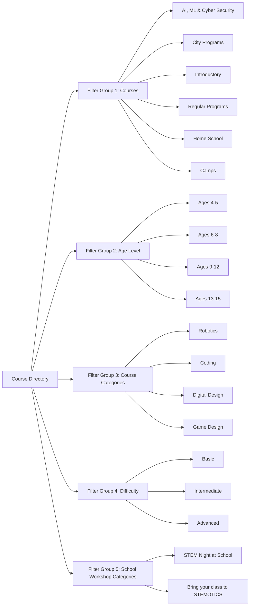

# Phase 01 — Reference Website Audit & Content Inventory

## 1. Executive Summary & Audit Scope

This document is a section-by-section audit of the reference website [STEMOTICS](https://stemotics.com/). Content facts below were re-checked against the live pages on **Nov 2, 2026**. Where this document summarises rather than copies text, it says so; the **live page is the source of truth for verbatim copy during content migration**.

Goals:
1. **Content Inventory:** Catalogue program listings, FAQ, policy terms and partner lists so nothing is lost in migration.
2. **Reconciliation with the Client Brief (Oct 27, 2026):** New requirements (shared time-slot capacity, medical form automation, camp themes, recurring billing, form builder) are marked as new, not as existing site content.
3. **Identification of Broken/Deprecated Links:** Clarifying live redirects (such as `/summer-camp/` returning 404, with active camps served at `/product-category/camps/`), resolving inconsistencies, and defining the target site architecture.

---

## 2. Complete Website Page Inventory & URL Mapping

The live site audit identified the following complete inventory of pages, categories, and dynamic products:

### 2.1 Core Pages & Navigation Items

| # | Page Name | Reference URL | Status / Verification | Target Architecture Mapping |
|---|---|---|---|---|
| 1 | Homepage | `https://stemotics.com/` | Verified Active | Homepage (`/`) with modernized layout & CMS controls |
| 2 | Courses Catalog | `https://stemotics.com/courses/` | Verified Active | Filterable course directory (`/courses`) |
| 3 | Camps Directory | `https://stemotics.com/product-category/camps/` | Verified Active | Camps hub (`/camps`) |
| 4 | Competitions | `https://stemotics.com/product-category/competitions/` | Verified Active | Competitions hub (`/competitions`) |
| 5 | School Workshops | `https://stemotics.com/product-category/schools/` | Verified Active | School workshops directory (`/schools`) |
| 6 | Birthday Parties | `https://stemotics.com/product-category/birthday_party/` | Verified Active | Birthday party packages (`/birthday-parties`) |
| 7 | Image Gallery | `https://stemotics.com/image-gallery/` | Verified Active | Photo gallery (`/gallery/photos`) with date sorting |
| 8 | Video Gallery | `https://stemotics.com/video-gallery/` | Verified Active (Elementor Lightbox) | Video gallery (`/gallery/videos`) with date sorting |
| 9 | About Us | `https://stemotics.com/about-us/` | Verified Active | Static page (`/about-us`) |
| 10 | Contact Us | `https://stemotics.com/contact-us/` | Verified Active (CF7 Form) | Interactive Contact Page (`/contact-us`) |
| 11 | FAQ | `https://stemotics.com/faq/` | Verified Active (15 Accordion Q&As) | Searchable & Filterable FAQ (`/faq`) |
| 12 | Cancellation & Refund Policy | `https://stemotics.com/cancellation-refund-policy/` | Verified Active | Legal policy page (`/cancellation-refund-policy`) |
| 13 | Partner With Us | `https://stemotics.com/partner-with-us/` | Verified Active (Franchise Opportunities) | Partner/Franchise page (`/partner-with-us`) |
| 14 | School, Library & Community Center | `https://stemotics.com/school-library-community-center/` | Verified Active (Directory of Partners) | Institutional partners directory (`/community-partners`) |
| 15 | Medical & Photo Release Form | `https://stemotics.com/personal-information-medical-conditions-photo-release-stemotics-camps/` | Verified Active (16-field consent form) | Automated Medical Form Workflow (`/forms/medical-release`) |
| 16 | My Account / Parent Portal | `https://stemotics.com/my-account/` | Verified Active (WooCommerce Auth) | Authenticated Parent Portal (`/account`) |
| 17 | Shopping Cart | `https://stemotics.com/cart/` | Verified Active | Slide-over Cart Drawer + Full Cart Page (`/cart`) |
| 18 | Checkout | `https://stemotics.com/checkout/` | Verified Active | Modern Multi-step Checkout (`/checkout`) |
| 19 | Order Confirmation | `https://stemotics.com/thank-you/` | Verified Active | Dynamic Order Success & Next Steps (`/order-success`) |
| 20 | External Learning Portal (LMS) | `https://learn.stemotics.com/` | External Link | Maintained in Header & Admin (`https://learn.stemotics.com/`) |
| 21 | Summer Camp (Legacy) | `https://stemotics.com/summer-camp/` | Returns 404 (Orphan URL) | 301 Redirect to `/camps` |

---

## 3. Product Catalog & Category Inventory

The `/courses/` listing shows **29 products** (3 pages: 12 + 12 + 5). Categories on the live site:

### 3.1 Product Categories

1. **Regular Programs** (`/product-category/regular-programs/`): After-school and weekend courses. Currently a one-time "Monthly [4 weeks]" payment at registration with manual follow-up charges in Helcim (Brief §5); moving to automatic monthly billing.
2. **Camps** (`/product-category/camps/`): Currently 3 camp products — PD Day, Winter Break, Cambridge March Break. **There is no Summer Camp product**, although the homepage slider still advertises one.
3. **Competitions** (`/product-category/competitions/`): Competitive teams and training (FIRST LEGO League, World Robot Olympiad).
4. **Schools & Workshops** (`/product-category/schools/`): On-site and in-school workshops (STEM Night, Field Trips).
5. **Birthday Parties** (`/product-category/birthday_party/`): Specialized on-site and off-site robotics birthday parties.
6. **Homeschool Programs** (`/product-category/homeschool-programs/`): Daytime STEM and robotics classes tailored for homeschoolers.
7. **Introductory** (`/product-category/introductory/`): Free and paid trial classes, introductory robotics workshops.
8. **Off-site Locations** (`/product-category/off-site-locations/`): City-partnered programs across Southwestern Ontario.

### 3.2 Master Product Listing & Product Codes

Product titles are exactly as shown on `/courses/`. Codes in **bold** exist on the live site. Codes in *italics* are **[Proposed]** new SKUs for products that have none today. Listing pages show no prices; only Coding Junior's product page was checked in detail.

| # | Live Product Title | Code | Category | Notes |
|---|---|---|---|---|
| 1 | Introduction to Artificial Intelligence [STAI4001] | **STAI4001** | Regular Programs | |
| 2 | Coding Pre-Junior [STC1001] | **STC1001** | Regular Programs | |
| 3 | Coding Junior [STC2001] | **STC2001** | Regular Programs | Verified: **$129.99 "Monthly [4 weeks]"**, 12 weeks per level, 1 hour/week, ages 6–8. Fields: Select Starting Date, Day & Time (Mon–Fri 5–8 PM and Sat 10 AM–3 PM in 1-hour slots), Child's Full Name, Age, **Course Selection: Level 1–4 (`STC2001`–`STC2004`)**, Quantity. States a 1:3 instructor ratio. |
| 4 | Coding Senior [STC3001] | **STC3001** | Regular Programs | |
| 5 | Robotics Pre-Junior [STR1001] | **STR1001** | Regular Programs | |
| 6 | Robotics Junior [STR2001] | **STR2001** | Regular Programs | |
| 7 | Robotics Senior [STR3001] | **STR3001** | Regular Programs | |
| 8 | Digital Design Pre Junior [STD1001] | **STD1001** | Regular Programs | |
| 9 | Digital Design Junior [STD2001] | **STD2001** | Regular Programs | |
| 10 | Digital Design Senior [STD3001] | **STD3001** | Regular Programs | |
| 11 | Game Design Junior [STG2001] | **STG2001** | Regular Programs | |
| 12 | Game Design Senior [STG3001] | **STG3001** | Regular Programs | |
| 13 | Free Trial Classes – [Robotics & Coding Workshop] | *TRIAL* | Regular Programs / Introductory | FAQ states trial sessions cost **$24.99**, credited against the 8-week program ($199.99 − $24.99). Pricing to be confirmed with client. |
| 14 | Homeschool Robotics & Coding Programs | *HOME* | Home School | |
| 15 | PD DAY Camp [2026-2027] | *CAMP-PD* | Camps | |
| 16 | Winter Break Camp [2026-2027] | *CAMP-WIN* | Camps | |
| 17 | Cambridge – March Break Camp [2027] | *CAMP-MAR* | Camps | |
| 18 | FIRST LEGO League 2026-2027 | *COMP-FLL* | Competitions | |
| 19 | World Robotics Olympiad | *COMP-WRO* | Competitions | |
| 20 | STEM Night | *SCH-STEM* | Schools | |
| 21 | Field Trip to STEMOTICS | *SCH-TRIP* | Schools | |
| 22 | BIRTHDAY PARTY | *BTH-ON* | Birthday Party | |
| 23 | BIRTHDAY PARTY – Offsite | *BTH-OFF* | Birthday Party | |
| 24–29 | Cambridge · Guelph · Kitchener · London · Waterloo · Woodstock | *CITY-xxx* | City Programs | Product titles are just the city name. |

**Important for the data model:**
- Regular programs have **levels with their own sub-codes** (e.g. Coding Junior Level 1–4 = `STC2001`–`STC2004`). The new Course model must support levels.
- The same weekday/time slots (e.g. Monday 5–6 PM) are offered by many programs. Brief §1 requires capacity to be counted **per slot across all programs** — see [Phase 04 §2](Phase-04-Course-Camp-Management.md).
- Option details for products other than Coding Junior (care options, camp dates, party packages, etc.) must be captured from each product page during content migration; they were not verified for this audit.

---

## 4. Section-by-Section Homepage Content Inventory

The reference homepage (`https://stemotics.com/`) has roughly 20 headings, grouped below into header, slider, content sections and footer. Sections 9 and 11 do **not** exist on the live site; they are new requirements from Brief §7.

### Section 1: Utility Top Bar & Header Navigation
- **Contact Info:** Call Us: `+1 519-957-1073` | Email: `info@stemotics.com`
- **Main Nav Items:**
  - Home (`/`)
  - Courses (`/courses/`)
  - Camps (`/product-category/camps/`)
  - Competitions (`/product-category/competitions/`)
  - Schools Workshops (`/product-category/schools/`)
  - Birthday Party (`/product-category/birthday_party/`)
  - Gallery (Dropdown: Image Gallery, Video Gallery)
  - Contact Us (Dropdown: About Us, Contact Us, FAQ, Cancellation & Refund Policy, Partner With Us)
  - Register & Login (`/my-account/`)
  - Learning Portal (`https://learn.stemotics.com/`)
- **Cart Widget:** Header cart icon displaying live count with flyout modal / drawer.

### Section 2: Hero Slider (5 Real Slides + 3 Placeholders)

> The live slider also contains **3 unfinished placeholder slides** ("Slide 1/2/3 Heading", "Lorem ipsum dolor sit amet…", "Click Here"). **Do not migrate them.** This is an example of the "hard to update" slider pain point in Brief §7.

1. **Slide 1 — Brand Mission:**
   - Heading: `Excite | Inspire | Motivate Learning`
   - CTA Button: `Join Now` -> `https://stemotics.com/courses/`
2. **Slide 2 — Summer Camp:**
   - Heading: `SUMMER CAMP`
   - Description: `Our summer camp features activities for ages 4-12! Science & Technology, Coding Animation, Game Design, Robotics & Digital Design are among the camps provided. Outdoor play and activities every day`
   - CTA Button: `Join Now` -> `https://stemotics.com/product-category/camps/`
3. **Slide 3 — Regular Programs:**
   - Heading: `Regular After-School & Weekend Programs`
   - Description: `Promote the love of Science, Technology, Engineering, and Mathematics (STEM) through imagination and hands-on learning in a fun atmosphere.`
   - CTA Button: `Enrol Now` -> `https://stemotics.com/courses/`
4. **Slide 4 — PD Day Camp:**
   - Heading: `PD DAY CAMP`
   - Description: `STEM Activities to engage kids while school’s out for PD day!. Excite, Inspire, and Motivate young people about the fun, importance and impact of STEM Education.`
   - CTA Button: `Register Today` -> `https://stemotics.com/product/pd-day-camp/`
5. **Slide 5 — Competitions:**
   - Heading: `COMPETITIONS`
   - Description: `Train. Compete. Win—Robotics competition for kids. Helping kids build robots, gain confidence, and compete in worldwide robotics competitions.`
   - CTA Button: `Register Today` -> `https://stemotics.com/product-category/competitions/`

### Section 3: Educational Value Proposition
- **H1:** `STEM EDUCATION THROUGH PROJECT-BASED LEARNING`
- **Copy:** `The future holds challenges, where innovation, originality and ability to work in a team will serve as key competitive parameters. STEMOTICS gives children the opportunity to learn STEM through robotics.`

### Section 4: Featured Course Streams (4 Highlight Cards)
- **H2:** `STEMOTICS Courses`
- **Card 1:** `Over 35 Programs and Counting` — `Specialized programs available for all age groups.`
- **Card 2:** `Why Robotic Learning?` — `Develops logical, mathematical, analytic and creative thinking.`
- **Card 3:** `No Bookworms Stuffs` — `Practical training where you’ll work in teams and experiment in class.`
- **Card 4:** `Everything you need to learn` — `Project based teachings for step by step growth.`

### Section 5: High-Impact Call to Action Banner
- **H2:** `Don’t miss out on this incredible opportunity! Take the first step toward a brighter future.`
- **CTA Button:** `Join Today!` -> `/courses/`

### Section 6: Mission & Tech Leadership
- **Subtitle:** `Empowering Tomorrow’s Tech Leaders`
- **H2:** `Your Journey to Robotics Excellence Begins Here`
- **Body Copy:** Comprehensive introduction explaining hands-on mechanical, software, and hardware fundamentals taught through certified instructors.

### Section 7: Hands-on Hardware & Platforms Showcase
- **H2:** `Transform Your Passion Into Proficiency With Our Courses`
- **Platform 1 — Simple and Powered Machines:** Investigating gears, levers, pulleys, and structural dynamics using LEGO education sets.
- **Platform 2 — Sphero Robots:** Coding Sphero Indi and BOLT for collision avoidance, sensor navigation, and logic loops.
- **Platform 3 — Arduino Programming:** Circuit assembly, breadboarding, C++ coding, and micro-controller automation for advanced students.

### Section 8: Social Proof & Testimonials
- **H2:** `Feedback from Our Students & Their Parents`
- **Badge:** `EXCELLENT` Google Reviews Rating badge (via Trustindex).
- **Verified Reviews:** Verbatim parent reviews regarding summer camps, LEGO coding, instructor patience, and child excitement.

### Section 9: NEW (Brief §7) — Impact Section
*Not on the live site.* Brief §7 asks the homepage to show a running count of children benefited, schools served, community centres, and teachers & staff (photos and details). **No figures are given in the brief** — real values are pending [Decision D-5](README.md#5-pending-decisions). The live homepage body text mentions "a maximum of 8 students per instructor" and the partner page names 19 schools and ~35 community centres; these are possible sources but must be confirmed by STEMOTICS.

### Section 10: Call to Action — Real-World Problem Solving
- **H2:** `Equip Yourself With The Skills And Knowledge`
- **Subtext:** `To design and program robots that can tackle real-world challenges.`
- **CTA:** `Join Us At STEMOTICS Today` -> `/courses/`

### Section 11: NEW (Brief §7) — Newsletter Signup Block
*Not on the live site.*
- Interactive newsletter and promotional subscription form.
- Includes direct link to the LMS portal (`https://learn.stemotics.com/`).

### Section 12: Global 4-Column Footer
- **Column 1 — About Us:** `STEMOTICS is a specialized robotics center in Cambridge, Ontario. It aims to provide children and youngsters with the right skills to expedite their learning, especially in STEM-related fields, and express their creativity.` Link: `Read More`
- **Column 2 — Develop Your Skills:**
  - Investigating machines from engineering point of view
  - Focusing on mechanical software design in a team
  - Investigating machine mechanisms required to operate, using mathematics and physics
  - Finding solutions for programmatic-mechanical optimization problems
- **Column 3 — Robotic Values:**
  - Develop procedural logical and creative thinking
  - Ability to cope with malfunctions
  - Mathematical and programming skills
  - Motor skills and engineering analytics
  - Social aptitude, self-confidence and sense of capability
- **Column 4 — Quick Access & Contact Details:**
  - Quick Links: FAQ, Summer Camp, Video Gallery, Image Gallery, About Us, School-Library-Community Center
  - Address: `695 Bishop Street North, Cambridge, Ontario, N3H 2K8`
  - Copyright notice (make the year dynamic in the new build)
  - Social Links: Facebook (`https://www.facebook.com/stemoticscanada/`), Twitter (`https://twitter.com/stemotics`), LinkedIn (`https://www.linkedin.com/in/stemotics`)

> **Class-size wording conflicts on the live site:** the homepage says "maximum of 8 students per instructor", product pages say "1:3" instructor ratio, and the FAQ says "Up to 10 children in a classroom". The new rule (Brief §1) is a **default of 9 children per time slot**. Staff should align this copy during content migration.

---

## 5. Course Directory & Filter System Audit

Reference URL: `https://stemotics.com/courses/`

The live site implements an AJAX-based multi-taxonomic filtering system. The new CMS must support the exact 5 client-listed filter groups with dynamic admin configuration:

---

## 6. Static Pages Verbatim Content Inventory

### 6.1 About Us (`/about-us/`) — summary; copy verbatim from the live page
- **Mission:** To "excite, inspire, and motivate young people" about robotics and hands-on exploration.
- **Vision:** A culture "where young people dream of becoming science and technology leaders".
- **Goals / values:** Same lists as the footer "Develop Your Skills" and "Robotic Values" columns.
- **Hardware named:** LEGO Mindstorms EV3 and LEGO WeDo (plus unnamed "mobile educational robots"). Sphero and Arduino appear on the homepage, not here.
- **Services:** Robotics programs for children and youth; Training of Trainers (TOT) and consultancy for schools; teacher seminars on EV3/WeDo; competition coaching (FIRST LEGO League, World Robotics Olympiad, WorldSkills).
- **No team/instructor directory and no statistics** on the live page. Teachers & staff profiles are a new requirement (Brief §7).

### 6.2 Contact Us (`/contact-us/`)
- **Physical Address:** `695 Bishop Street North, Unit #4, 2nd Floor, Cambridge, ON – N3H 2K8`
- **Phone:** `519-957-1073`
- **Email:** `info@stemotics.com`
- **Form Fields:** Name (Required), Phone (Required), Email (Required), Message (Optional), Google reCAPTCHA v3.

### 6.3 FAQ (`/faq/`) — 15 Questions

Questions are exact. Several answers below are **abridged** (Q3, Q4, Q9, Q11, Q13 have extra sentences on the live page); copy the full text from the live page during migration.

1. **Q: What is the logic in having a 2nd grader sit in the same class as a 1st grader?**  
   *A:* In the course of STEMOTICS enrichment programs, children are exposed to educational materials they do not usually have access to in school at their age. The models come with parts that enable every child to build and invent according to their passions and ability.
2. **Q: Aren’t the lessons too long? Don’t the children lose interest?**  
   *A:* They really don’t. At the start of each lesson they are taught a subject, following which they are eager to get started with the construction so that they can play with the final product. When the lesson is over, most don’t even realize how much time has passed.
3. **Q: Can a 1st grader understand the substance of the lessons?**  
   *A:* Our enrichment programs are especially made for children of this age group. Our programs and workshops have been active for a number of years now, and all have enjoyed great success. Each lesson includes a familiar background story with corresponding live experiments.
4. **Q: My child is 3 and half (preschool), gifted and is interested in participating. Why isn’t it possible?**  
   *A:* Even though your child is gifted, they need to know reading and writing, and also a little more complex math than addition and subtraction. Therefore we recommend waiting an additional six months to avoid any frustration.
5. **Q: Do the children take the models home?**  
   *A:* Unfortunately, the kits used are very expensive and therefore must remain with the instructor, who will pass them from class to class. Children do however take home what they learn, which includes physics, mathematics and engineering.
6. **Q: How long are the programs and how often do they take place?**  
   *A:* The LEGO programs are mostly 90 to 120 minutes long.
7. **Q: Is it possible to attend a trial lesson?**  
   *A:* Certainly. Our trial sessions are $24.99. In the event that you decide to continue with the course, you’ll need to pay for the 8-weeks program [$199.99-$24.99=$175.99], which includes a charge for the trial lesson.
8. **Q: What happens if a lesson is cancelled due to a holiday?**  
   *A:* In such case, the complete course is extended for one week. We don’t charge more and vice versa.
9. **Q: Can I sit with my child during class?**  
   *A:* Staying with your child is not recommended. The goal of the program is for the children to manage by themselves, and try to deal with different tasks without parental dependency.
10. **Q: How big are your groups?**  
    *A:* Up to 10 children in a classroom.  
    *(Migration note, not site copy: conflicts with the new default of 9 per time slot — staff to update.)*
11. **Q: Does each child receive a kit?**  
    *A:* Each child or pair receives a kit, depending on the type and complexity of the model constructed.
12. **Q: Who are the instructors?**  
    *A:* We hire instructors that have experience working with children. Each instructor has undertaken a special STEMOTICS training course, which includes live field training.
13. **Q: Are your instructors engineers?**  
    *A:* Yes, most of our instructors are engineers and certified robotics instructors.
14. **Q: Do I need to bring anything to class?**  
    *A:* Only a good mood. We provide the rest.
15. **Q: Is it possible to buy the enrichment programs kit?**  
    *A:* The kit itself is manufactured by LEGO® and other manufacturers. The kits can be purchased through their online stores.

### 6.4 Cancellation & Refund Policy (`/cancellation-refund-policy/`) — summary; copy verbatim from the live page
- **PD Day Camp weather cancellation:** 100% refund, no administration fee.
- **On-site programs:** Cancellation must reach the Registration Office at least three full working days before the camp starts (email, phone, fax, mail or in person).
  - Two or more weeks before start: registration fee refunded minus a $35 administration fee.
  - Within two weeks of start: 50% refunded minus a $35 administration fee.
  - Within three full working days of start: no refund.
  - After the program starts: not refundable, but the camper can exchange into another session, workshop or camp on a different date.
  - Competitive robotics team registration fees: non-refundable.
- **Off-site programs:**
  - 25% deposit based on estimated students or the minimum of 10 campers per day, applied to the total fee after the sessions.
  - If attendance is lower than the deposit covers, the difference is refunded.
  - Cancellation two or more weeks before start: **full deposit refunded**. Within two weeks: **50% of the deposit refunded**.
- **Transfers:** Written request at least three full working days before the camp starts; subject to space and fee difference.
- **NEW (Brief §5) — Recurring Regular Program subscriptions:** The live policy has **no** recurring-billing clause. A new clause is required: a subscription must be cancelled at least 4 weeks before the next billing date, otherwise the upcoming month is still charged. Final wording pending [Decision D-9](README.md#5-pending-decisions).

### 6.5 Partner With Us (`/partner-with-us/`)
- Franchise/partnership opportunity page. **Not re-checked in this audit** — capture verbatim copy from the live page during migration.

### 6.6 School, Library & Community Center Directory (`/school-library-community-center/`)
Partner names as listed on the live page (several lists end with "& many more"):
- **Schools (19):** Paris Central School (Paris), Cedar Creek Public School (Ayr), Sandowne Public School (Waterloo), Saint Augustine Catholic School (Cambridge), St. Bernadette Catholic School (Kitchener), Linwood Public School (Linwood), St. Vincent De Paul Catholic Elementary School, Edna Staebler Public School, Ayr Public School (Ayr), St. Anne Catholic School (Kitchener), Resurrection Christian School, International School of Cambridge, MAC – Maple Grove School (Kitchener), Star Academy (Mississauga), St. John’s-Kilmarnock School (Breslau), Central Public School (Cambridge), NorthStar Montessori Private School, Rockway Mennonite Collegiate, K-W Montessori School.
- **Libraries (13, incl. one museum):** Guelph Public Library; IDEA EXCHANGE (Old Post Office, Clemens Mills, Hespeler); Brant Library (Burford); County of Brant Public Library (Paris); Region of Waterloo Library (Kitchener, St. Jacobs, Elmira); Toronto Public Library (Brentwood, Albion, Humberwood); Region of Waterloo Museum (Kitchener).
- **Community centres & partners (36 entries, ~33 unique):** Carling Heights Community Centre (London, listed twice with different spelling); Chandler Mowat, Williamsburg, Kingsdale, Doon Pioneer Park, Forest Heights, Stanley Park, Victoria Hills (listed twice), Centre Ville Chicopee (Kitchener); South Dumfries (St. George); Country Hills; Downtown Community Centre; City of Woodstock; City of Woodstock Summer Camp; Youth and Teen Centre, Alison Neighbourhood, Preston Heights, Grow Community Center, Langs / Lang's Community Centre (listed twice), Hespeler Village Neighborhood Association (Cambridge); Branlyn, Woodman Cultural Center, Back to School Carnival (Brantford); City of Waterloo Recreation Facility Services, RIM Park (Waterloo); YMCA of Guelph, West End Community Center (Guelph); Kiwanis Boys and Girls Club (Hamilton); Argyle Family Centre (London); STEM Camps (Scarborough, Vaughan Mills, Toronto); Festival of Trees, Club Scout (Kitchener); St. Teresa of Avila Church (Elmira).

> Clean-up for migration: remove duplicates and decide whether events (e.g. Back to School Carnival, Festival of Trees) belong in the directory.

### 6.7 Personal Information, Medical Conditions & Photo Release Form
Reference URL: `/personal-information-medical-conditions-photo-release-stemotics-camps/`
The live form has 16 fields (labels exactly as shown; no fields are marked required on the live form). This list is the **single source of truth** for the medical form in [Phase 06](Phase-06-Forms-Communication.md) and [Phase 09](Phase-09-MERN-Architecture.md):

| # | Live Label | Type |
|---|---|---|
| 1 | Camper's First Name | Text |
| 2 | Camper's Last Name | Text |
| 3 | Address | Text |
| 4 | Main Parent/Guardian Full Name | Text |
| 5 | Parent/Guardian Email Address | Email |
| 6 | Parent/Guardian Home Phone | Phone |
| 7 | Parent/Guardian Cell Phone | Phone |
| 8 | Emergency Contact Name | Text |
| 9 | Emergency Contact Phone | Phone |
| 10 | Do you have any known medical conditions? | Radio (Yes/No) |
| 11 | Allergies / Allergic reactions | Text |
| 12 | Special needs | Text |
| 13 | Please share information regarding your child's need or ability to assist our instructors | Textarea |
| 14 | Additional details on child's need or ability | Textarea |
| 15 | Outdoor Program Parental Consent (off-premises outdoor class, "40 min/Day 11:40 - 12:20") | Radio (Yes/No) |
| 16 | Consent for Image/Video Release | Radio (Yes/No) |

---

## 7. Audit Acceptance Checklist

- [ ] Every page and URL from the live site and sitemaps inventoried (product option details still to be captured per product).
- [ ] All 29 products catalogued with options, levels and prices from each product page.
- [ ] Homepage slides and sections documented; placeholder slides excluded.
- [ ] All 5 filter groups on `/courses/` extracted.
- [ ] Full verbatim FAQ, About Us, Partner With Us and policy text exported from the live site.
- [ ] Recurring-billing policy clause approved by STEMOTICS (D-9).
- [ ] All 16 medical form fields documented.
- [ ] Partner directory cleaned up and approved by STEMOTICS.
