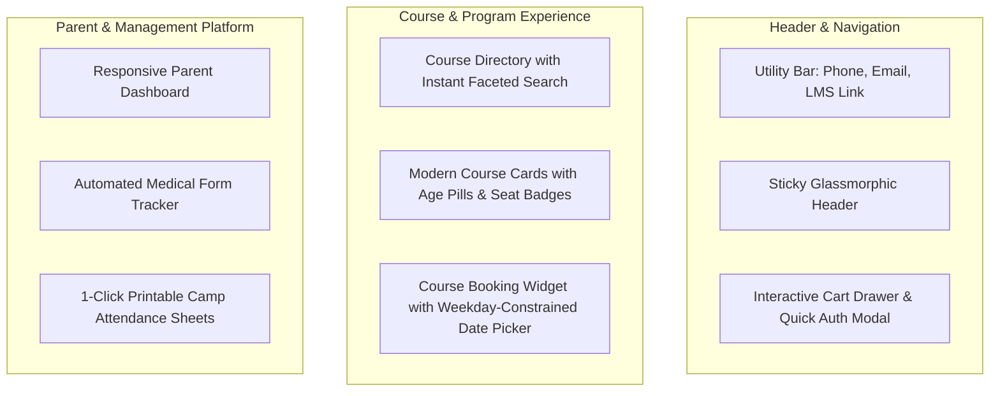

# Phase 02 — Brand Identity, Typography & Design System

## 1. Executive Summary & Design Vision

This phase establishes an industry-leading, professional, and accessible design system for the rebuilt STEMOTICS platform. The design system preserves the core visual identity of STEMOTICS—its distinctive royal blue and high-energy lime accents, clean typography, and educational credibility—while introducing modern UX improvements, micro-interactions, responsive refinements, and accessibility compliance (WCAG 2.1 AA).

All brand values, color codes, and typography rules in this document have been verified from the live CSS stylesheets and rendered DOM of `https://stemotics.com/`.

---

## 2. Verified Brand Color Palette & Design Tokens

### 2.1 Primary & Secondary Palette

| Token Name | Hex Code | RGB / RGBA | Usage & Context |
|---|---|---|---|
| `--color-primary` | `#00309A` | `rgb(0, 48, 154)` | Primary brand identity, primary CTA buttons, active navigation states, key icons |
| `--color-accent` | `#D9F293` | `rgb(217, 242, 147)` | High-energy secondary accent, promo badges, card highlight borders, hover glow |
| `--color-accent-soft` | `rgba(217, 242, 147, 0.3)` | `rgba(217, 242, 147, 0.3)` | Background highlight pills, category tags, notification highlights |
| `--color-dark-heading` | `#111111` | `rgb(17, 17, 17)` | H1–H4 headings, high-emphasis text, primary titles |
| `--color-dark-body` | `#222222` | `rgb(34, 34, 34)` | Main body text, dropdown menu labels, form field values |
| `--color-muted-text` | `#777777` | `rgb(119, 119, 119)` | Secondary descriptions, timestamps, metadata labels, breadcrumbs |
| `--color-light-text` | `#999999` | `rgb(153, 153, 153)` | Form placeholder text, disabled states, unselected icons |
| `--color-surface-white`| `#FFFFFF` | `rgb(255, 255, 255)` | Page canvas, card backgrounds, modal containers, input surfaces |
| `--color-surface-gray` | `#F6F6F6` | `rgb(246, 246, 246)` | Alternate section backgrounds, sticky sub-header, pill container fill |
| `--color-border-light` | `#E2E1E4` | `rgb(226, 225, 228)` | Card dividing lines, input field borders, table borders |
| `--color-border-subtle`| `#DEDEDE` | `rgb(222, 222, 222)` | Subtle navigation borders, separator rules |
| `--color-footer-bg`    | `#000000` | `rgb(0, 0, 0)` | Global footer canvas (solid dark identity) |
| `--color-footer-border`| `rgba(255, 255, 255, 0.15)` | `rgba(255, 255, 255, 0.15)` | Footer column dividers and horizontal rules |

### 2.2 Semantic & Educational Stream Color Accents

| Token Name | Hex Code | Purpose / Course Category Association |
|---|---|---|
| `--color-accent-orange` | `#EF9350` | Robotics & Mechanical streams, urgent alerts, "Few Seats Left" warning |
| `--color-accent-coral`  | `#D17474` | Camps & seasonal events, PD Day tags, cancellation notices |
| `--color-accent-cyan`   | `#0693E3` | Coding & Software streams, informational banners, help badges |
| `--color-accent-green`  | `#00D084` | Digital Design & Creative streams, success alerts, registration open |
| `--color-accent-amber`  | `#FCB900` | Competitions (FLL / WRO), star reviews, highlight achievements |

---

## 3. Typography Hierarchy & Font System

The typography system uses Google Fonts loaded asynchronously with zero layout shift (`font-display: swap`):

```css
/* Core Typography Stack */
--font-primary: 'Inter', -apple-system, BlinkMacSystemFont, 'Segoe UI', Roboto, sans-serif;
--font-heading: 'Inter', -apple-system, BlinkMacSystemFont, sans-serif;
--font-display: 'DM Serif Display', 'Playfair Display', Georgia, serif;
--font-banner:  'Roboto', 'Lato', sans-serif;
```

### 3.1 Type Scale & Responsive Spec

| Element | Font Family | Size (Desktop) | Size (Mobile) | Weight | Line Height | Letter Spacing |
|---|---|---|---|---|---|---|
| **H1 Display** | `--font-primary` | 44px (2.75rem) | 32px (2.0rem) | 700 (Bold) | 1.15 | -0.02em |
| **H2 Section** | `--font-primary` | 32px (2.0rem) | 24px (1.5rem) | 700 (Bold) | 1.25 | -0.015em |
| **H3 Card** | `--font-primary` | 22px (1.375rem)| 18px (1.125rem) | 600 (SemiBold)| 1.30 | 0.00em |
| **H4 Subheading**| `--font-primary` | 18px (1.125rem)| 16px (1.0rem) | 600 (SemiBold)| 1.35 | 0.00em |
| **Body Large** | `--font-primary` | 16px (1.0rem) | 15px (0.938rem)| 400 (Regular) | 1.60 | 0.00em |
| **Body Base** | `--font-primary` | 14px (0.875rem)| 14px (0.875rem)| 400 (Regular) | 1.55 | 0.00em |
| **Small / Meta** | `--font-primary`| 12px (0.75rem) | 12px (0.75rem) | 500 (Medium) | 1.40 | +0.01em |
| **Button Text** | `--font-primary` | 14px (0.875rem)| 14px (0.875rem)| 600 (SemiBold)| 1.00 | +0.02em (Caps/Semi) |

---

## 4. Modern Industry-Level Layout & Unique Design Improvements

While keeping the original visual identity, colors, and content 100% intact, the rebuilt platform introduces modern architectural design improvements:



### 4.1 Key Design Improvements Over Reference Website

1. **Sticky Glassmorphic Header & Quick Utility Bar:**
   - *Reference Site:* Header height is 100px with a solid jump upon scrolling.
   - *Modern Improvement:* Slim 72px sticky header with subtle backdrop blur (`backdrop-filter: blur(12px)`), prominent phone/email links, quick search trigger, direct "Learning Portal" pill, and interactive cart drawer showing live cart count.
2. **Elevated Course Cards with Real-Time Availability:**
   - *Reference Site:* Standard WooCommerce product grid with plain text headings and basic price tags.
   - *Modern Improvement:* Elevated modern cards with rounded-xl corners (8px default), subtle hover lift (`transform: translateY(-4px)` with gentle shadow), high-contrast category badges (e.g., "Ages 6-8", "Robotics"), and real-time slot status ("Only 2 seats left in Mon 5 PM slot!").
3. **Interactive Weekday-Constrained Date Picker Widget:**
   - *Reference Site:* Basic HTML dropdown or text box that allowed invalid date selections.
   - *Modern Improvement:* Sleek calendar widget where only the matching weekdays are clickable (e.g. if the user selects Monday 5:00 PM, all Tuesdays–Sundays and holidays are automatically grayed out).
4. **Faceted Filter Sidebar with Real-Time Instant Filtering:**
   - *Reference Site:* Multi-checkbox filter causing full page reload or sluggish AJAX re-renders.
   - *Modern Improvement:* Instant client-side state filtering with URL search params sync, active filter chips with 1-click removal, and responsive mobile sliding drawer (`Sheet` component).
5. **Print-Optimized Rosters & Attendance Sheets:**
   - *Modern Improvement:* Dedicated `@media print` CSS stylesheet formatting printable rosters and camp sign-in sheets with clean borders, signature lines, parent phone numbers, and emergency contact details on standard 8.5" x 11" Letter landscape.
6. **Accessible Color Contrast & Dark Footer Modernization:**
   - *Modern Improvement:* High contrast typography meeting WCAG 2.1 AA standards (minimum 4.5:1 ratio for text). The solid black footer (`#000000`) is modernized with crisp typography, organized quick-links, and embedded newsletter signup.

---

## 5. UI Component Library Specifications

### 5.1 Buttons & Interactive Elements

```tsx
// Primary Button Token
bg-[#00309A] hover:bg-[#002270] text-white font-semibold px-6 py-3 rounded-lg shadow-sm transition-all duration-200 active:scale-95

// Secondary Button Token
bg-[#222222] hover:bg-[#111111] text-white font-semibold px-6 py-3 rounded-lg transition-all duration-200

// Accent / Action Button Token (Lime)
bg-[#D9F293] hover:bg-[#c6e673] text-[#111111] font-bold px-6 py-3 rounded-lg transition-all duration-200

// Outline / Secondary Button Token
border-2 border-[#00309A] text-[#00309A] hover:bg-[#00309A] hover:text-white font-semibold px-6 py-3 rounded-lg transition-all duration-200
```

### 5.2 Badges & Indicator Pills

- **Age Level Badge:** `bg-blue-50 text-[#00309A] border border-blue-200 text-xs font-semibold px-2.5 py-1 rounded-full`
- **Difficulty Badge (Basic):** `bg-emerald-50 text-emerald-700 border border-emerald-200 text-xs font-semibold px-2.5 py-1 rounded-full`
- **Difficulty Badge (Advanced):** `bg-purple-50 text-purple-700 border border-purple-200 text-xs font-semibold px-2.5 py-1 rounded-full`
- **Slot Capacity Alert ("Full"):** `bg-rose-50 text-rose-700 border border-rose-200 text-xs font-bold px-2.5 py-1 rounded-full`
- **Slot Capacity Alert ("Almost Full"):** `bg-amber-50 text-amber-700 border border-amber-200 text-xs font-bold px-2.5 py-1 rounded-full animate-pulse`

---

## 6. CMS Design System Controls for Non-Technical Users

To fulfill the client's requirement that non-technical staff can manage website elements without developer assistance, the CMS includes a dedicated **Brand & Theme Settings Panel**:

1. **Brand Colors Manager:** Ability to update primary brand color, accent color, button background, and link hover colors via color picker or hex input.
2. **Logo & Favicon Uploader:** Manage light-mode logo, dark-mode/footer logo, mobile logo, and browser favicon.
3. **Typography Switcher:** Select curated font pairings (e.g. Inter + Inter, Inter + DM Serif) with instant preview.
4. **Button & Input Corner Radius:** Slider control (0px sharp -> 4px slight -> 8px rounded -> 16px pill) applied globally across all UI elements.
5. **Banner Layout Controls:** Toggle between full-width banner slides, split-screen hero, or video background.

---

## 7. Responsive Breakpoint Specification

| Breakpoint | Minimum Width | Target Devices | Layout Behavior |
|---|---|---|---|
| `sm` | 640px | Large phones (portrait/landscape) | Single-column stack, mobile sticky bottom action bar |
| `md` | 768px | Tablets (portrait), iPads | 2-column course grid, slide-out filter sheet |
| `lg` | 1024px | Small laptops, tablets (landscape) | 3-column course grid, persistent filter sidebar |
| `xl` | 1280px | Standard desktop displays | 4-column course grid, 1280px container max-width |
| `2xl`| 1536px | Large monitors & workstations | 1440px site container max-width with balanced margins |

---

## 8. Verification & Acceptance Criteria

- [x] All brand colors match verified live website CSS hex codes.
- [x] Primary font (`Inter`) and secondary fonts are specified.
- [x] Unique design improvements enhance usability without altering STEMOTICS branding.
- [x] Full UI component library tokens defined (Buttons, Badges, Modals, Forms).
- [x] Print stylesheet specifications for rosters and camp attendance defined.
- [x] CMS controls designed for non-technical brand and layout management.
