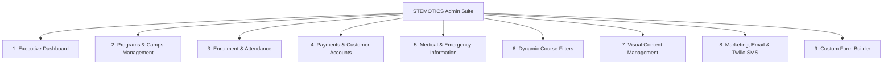
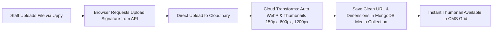

# Phase 03 — CMS Architecture & Admin Dashboard

## 1. Executive Summary & CMS Philosophy

A central requirement from the client specifications is that **staff must be able to maintain all website content, courses, operational settings, forms, attendance, and marketing without developer intervention**.

This document defines the architecture of the Content Management System (CMS) and Admin Platform. It groups the 12 sections of the client brief into **9 admin modules**, describes a section-based content editor for non-technical users, direct-to-cloud media uploads, and Role-Based Access Control (RBAC).

---

## 2. Consolidated Admin Modules (Client-Specified Mapping)

### Module Breakdown & Capabilities

| Module | Brief | Purpose & Core Capabilities | User Persona & Access |
|---|---|---|---|
| **1. Dashboard** | [Proposed] | Summary widgets: full/near-full time slots, today's camp headcount, pending medical forms, failed payments. | Super Admin, Program Manager |
| **2. Programs & Camps** | §3, §6 | CRUD courses (with levels), **time slots** (shared across programs), the **3 camps** (PD Day, Winter, March Break) and their themes (4 each today; add/edit/rename), pricing. | Super Admin, Program Manager |
| **3. Enrollment & Attendance** | §1, §2, §3 | Per-slot capacity (default 9, editable per slot), **per-slot roster across all programs**, printable camp attendance sheets (filter by day/week, theme, age group) with sign-in/sign-out time and signature columns. | Super Admin, Program Manager, Camp Coordinator |
| **4. Payments & Customers** | §5, §10 | Helcim/Stripe transaction logs, monthly subscription management, 4-week cancellation rule, failed-charge handling, refunds. | Super Admin, Financial Admin |
| **5. Medical Forms** | §4 | Per-child form status (Complete / Pending), notification log, emergency contacts and allergies. | Super Admin, Program Manager, Camp Coordinator |
| **6. Course Filters** | §6 | **Add/remove filter groups** and their options (5 groups today), tag products. | Super Admin, Content Editor |
| **7. Content Management** | §7, §8, §9 | Homepage slider (slides, links, text), featured programs, impact figures, teachers & staff profiles, testimonials, gallery (ascending date), static pages (About, Contact, FAQ, Cancellation & Refund Policy, Partner With Us). | Super Admin, Content Editor |
| **8. Marketing & Notifications** | §3, §7, §10 | Camp bulk email (filter by theme, age group, date), newsletters and promotions to subscribers, order SMS and opt-in marketing SMS, LMS link. | Super Admin, Marketing Lead |
| **9. Custom Form Builder** | §11 | Staff-built forms (e.g. School Student Registration, medical form for off-site programs), shareable links, submission viewer. | Super Admin, Program Manager |

---

## 3. High-Performance Visual Content Editor for Non-Technical Users

To ensure non-technical staff can update any page without breaking layout or styling, and to prevent media upload slowdowns, the platform provides a **Section-Based Visual Editor**:

### 3.1 Core Editor Features

Required by the brief (§7, §9): staff can edit text, links, images and slides on the homepage and static pages without a developer.

1. **Side-Panel Form Editing:** Each page section is edited through a structured form (headline, body, image, button label, button link). Structured forms are simpler and safer for non-technical staff than free canvas editing.
2. **TipTap Rich Text:** `@tiptap/react` with a limited toolbar (Bold, Italic, Lists, Links). Output is sanitised server-side before storage.
3. **Direct-to-Cloud Media Upload (Uppy):** Files upload from the browser straight to Cloudinary using a server-issued signature, so large photos do not pass through the Node.js server.
4. **Button Management:** Label, style (from the design-system button styles), and target (internal page picker or external URL).
5. **Section Visibility Toggle:** Show/hide a section (e.g. a seasonal camp banner).
6. [Proposed] **Section drag-reorder** on a page.
7. [Proposed] **Device preview** (desktop / tablet / mobile).
8. [Proposed] **Revision history & rollback** — a snapshot on each publish, restorable by staff. Recommended at least for static pages, since staff will edit policy text.

### 3.2 Pre-Configured Content Blocks

The visual CMS includes purpose-built blocks reflecting the reference website:
- **Hero Slider Block:** Add/reorder slides, configure background image, title, subtext, button text, and button link.
- **Icon / Feature Cards Block:** Title, description, icon picker (Lucide React), optional badge.
- **Course Grid Block:** Select category or query rules (e.g. "Show latest Regular Programs"), set card count, toggle price visibility.
- **Metric Counter Block:** Number, suffix (e.g. `+`), label, animated count-up toggle. Real figures pending [D-5](README.md#5-pending-decisions).
- **Team Block (Brief §7):** Teachers & staff with photo, name, role and short bio.
- **Testimonials Carousel Block:** Select verified parent reviews, show/hide star rating, author name, review source.
- **Accordion / FAQ Block:** Reorderable questions and TipTap rich-text answers with collapsible behavior.
- **Media Gallery Block:** Image grid or video embed grid with title, date, and lightbox behavior (ascending date order, Brief §8).
- **Call-to-Action Banner Block:** High-contrast background with custom headline, body, and button actions.

---

## 4. Header, Navigation & Footer Management

Staff can manage global site chrome through dedicated settings panels:

### 4.1 Header & Navigation Manager
- **Utility Top Bar:** Toggle display, update phone number (`+1 519-957-1073`), email address (`info@stemotics.com`), and LMS portal link (`https://learn.stemotics.com/`).
- **Main Menu Builder:** Tree-view interface to add, edit, reorder, indent (sub-menus/dropdowns), or delete navigation links.
- **Mobile Menu Settings:** Configure mobile drawer layout, CTA button ("Register / Login"), and social media shortcuts.

### 4.2 Footer Content Manager
- **Column 1 (About Us):** Edit description text and "Read More" target.
- **Column 2 (Develop Your Skills):** Manage list of bullet points and engineering goals.
- **Column 3 (Robotic Values):** Manage value bullet points.
- **Column 4 (Quick Access & Contact):** Edit physical address, contact telephone, copyright text, and social URLs (Facebook, Twitter/X, LinkedIn, Instagram).
- **Newsletter Block:** Toggle newsletter form on/off, customize heading and privacy disclaimer.

---

## 5. Media Library & Asset Storage Architecture

The CMS uses Cloudinary for media storage and delivery via a unified Media Library. Videos are embedded from YouTube by default (uploading video files to Cloudinary is possible but costs more storage and bandwidth).

- **Folder Organization:** Separate folders for `Courses`, `Camps`, `Banners`, `Gallery-Photos`, `Gallery-Videos`, `Staff-Avatars`, `Documents`.
- **Media Metadata:** Title, Alt Text (for SEO & Accessibility), Caption, Upload Date, File Size, Dimensions.
- **Bulk Operations:** Multi-file drag upload, bulk tag assignment, and orphaned file cleanup detection.

---

## 6. Role-Based Access Control (RBAC) & Permissions

To protect sensitive children's information and financial records, permissions are strictly partitioned:

| Role | Dashboard | Programs & Camps | Enrollment & Rosters | Payments & Billing | Medical Forms | Website Content | Marketing & SMS | Form Builder |
|---|---|---|---|---|---|---|---|---|
| **Super Admin** | Full | Full | Full | Full | Full | Full | Full | Full |
| **Program Manager** | Full | Full | Full | View Orders | Full | Full | Full | Full |
| **Camp Coordinator / Lead Instructor** | Read-Only | View | Full (Attendance & Rosters) | No Access | View Only (Emergency contacts/allergies) | No Access | Send Camp Email | View Submissions |
| **Content Editor** | View Stats | View | No Access | No Access | No Access | Full (Pages & Gallery) | Compose Newsletters | No Access |
| **Instructor** [Proposed] | No Access | No Access | View rosters for **assigned slots/camps only** | No Access | View emergency card for **assigned children only** | No Access | No Access | No Access |

Permissions are enforced on the **API** (every admin route checks role and, for instructors, the assigned slots/camps), never only by hiding UI.

---

## 7. Verification & Acceptance Criteria

- [ ] Each brief section (§1–§12) maps to a working admin module.
- [ ] Staff can edit homepage slides, links, text and all 5 static pages without a developer.
- [ ] Rich text is sanitised server-side; pasted content cannot break page layout.
- [ ] Direct-to-Cloudinary uploads work for large photos.
- [ ] Navigation and footer managers cover all reference elements.
- [ ] RBAC enforced at the API for medical and payment data.
