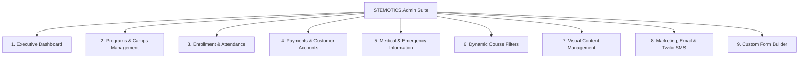
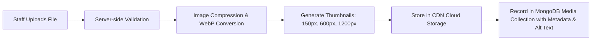

# Phase 03 — CMS Architecture & Admin Dashboard

## 1. Executive Summary & CMS Philosophy

A central requirement from the client specifications is that **staff must be able to maintain all website content, courses, operational settings, forms, attendance, and marketing without developer intervention**.

This document defines the complete architecture of the Content Management System (CMS) and Admin Platform. It organizes the system into **9 consolidated modules** matching the client's requirements table, implements an intuitive visual block builder for non-technical users, and provides granular Role-Based Access Control (RBAC).

---

## 2. Consolidated Admin Modules (Client-Specified Mapping)

### Module Breakdown & Capabilities

| Module | Purpose & Core Capabilities | User Persona & Access |
|---|---|---|
| **1. Executive Dashboard** | High-level KPI widgets: Active students, current term revenue, slot capacity alert widget, camp headcount today, pending medical forms count, quick action shortcuts. | Super Admin, Program Manager |
| **2. Programs & Camps** | CRUD courses, programs, camp themes (PD Day, Winter, March Break, Summer), age levels, pricing models, schedule timings, and syllabus details. | Super Admin, Program Manager |
| **3. Enrollment & Attendance** | Slot capacity configuration (default 9; editable per slot), live roster lists, 1-click printable PDF rosters, camp sign-in/sign-out sheets with signature blocks. | Super Admin, Program Manager, Camp Coordinator |
| **4. Payments & Customers** | Stripe & Helcim transaction logs, recurring monthly subscription management, 4-week cancellation enforcement, failed charge retries, refund processing. | Super Admin, Financial Admin |
| **5. Medical Forms** | Real-time medical form status per child (Complete / Pending / Overdue), automated notification log, view/print emergency contacts and allergies. | Super Admin, Instructor, Camp Coordinator |
| **6. Course Filters** | Manage the 5 filter groups (Courses, Age Level, Course Categories, Difficulty, School Workshop Categories) and dynamic options without code changes. | Super Admin, Content Editor |
| **7. Content Management** | Visual visual block editor for Homepage, banner slides, stats counters, testimonials, staff profiles, gallery (photos/videos with date sorting), and static pages. | Super Admin, Content Editor |
| **8. Marketing & Notifications** | Bulk email engine with camp/program filters, Twilio SMS order alerts and marketing blasts, newsletter composer, LMS link integration. | Super Admin, Marketing Lead |
| **9. Custom Form Builder** | Drag-and-drop builder for custom registration forms (e.g., School Student Registration, STEM Night Inquiries), shareable public URLs, submission viewer. | Super Admin, Program Manager |

---

## 3. Visual Page Builder for Non-Technical Users

To ensure non-technical staff can update any page without breaking layout or styling, the platform provides a **Section-Based Visual Editor**:

### 3.1 Core Visual Editor Features

1. **Inline & Side-Panel Text Editing:** Staff click any text block or heading directly on the canvas or via an intuitive side-panel to update wording, formatting, and links.
2. **Media Replacement with Auto-Optimization:** Image replacement with drag-and-drop upload, automatic WebP conversion, thumbnail generation, and alt-text field.
3. **Button Management:** Staff can change button label, button style (Primary Blue, Secondary Dark, Lime Accent, Outline), and target URL (internal page picker or external link).
4. **Section Reordering & Visibility:** Drag-and-drop handle to reorder sections vertically on any page, with a 1-click eye toggle (`Show / Hide`) to disable seasonal sections (e.g. hiding Winter Camp after January).
5. **Live Device Preview:** Instant toggle between Desktop (1440px), Tablet (768px), and Mobile (375px) viewports before publishing.
6. **Revision History & Rollback:** Automatic version snapshot created on every publish. Staff can preview and revert to any historical version with 1 click.

### 3.2 Pre-Configured Content Blocks

The visual CMS includes purpose-built blocks reflecting the reference website:
- **Hero Slider Block:** Add/reorder slides, configure background image, title, subtext, button text, and button link.
- **Icon / Feature Cards Block:** Title, description, icon picker (FontAwesome / Lucide), optional badge.
- **Course Grid Block:** Select category or query rules (e.g. "Show latest Regular Programs"), set card count, toggle price visibility.
- **Metric Counter Block:** Number, prefix/suffix (e.g. `5,000+`), label, animated count-up toggle.
- **Testimonials Carousel Block:** Select verified parent reviews, show/hide star rating, author name, review source.
- **Accordion / FAQ Block:** Reorderable questions and rich-text answers with collapsible behavior.
- **Media Gallery Block:** Image grid or video embed grid with title, date, and lightbox behavior.
- **Call-to-Action Banner Block:** High-contrast background with custom headline, body, and button actions.

---

## 4. Header, Navigation & Footer Management

Staff can manage global site chrome through dedicated settings panels:

### 4.1 Header & Navigation Manager
- **Utility Top Bar:** Toggle display, update phone number (`+1 519-957-1073`), email address (`info@stemotics.com`), and LMS portal link (`https://learn.stemotics.com/`).
- **Main Menu Builder:** Tree-view interface to add, edit, reorder, indent (sub-menus/dropdowns), or delete navigation links.
- **Mobile Menu Settings:** Configure mobile drawer layout, CTA button ("Register / Login"), and social media shortcuts.

### 4.2 Footer Content Manager
- **Column 1 (About Us):** Edit description text and "Read More" target.
- **Column 2 (Develop Your Skills):** Manage list of bullet points and engineering goals.
- **Column 3 (Robotic Values):** Manage value bullet points.
- **Column 4 (Quick Access & Contact):** Edit physical address, contact telephone, copyright text, and social URLs (Facebook, Twitter/X, LinkedIn, Instagram).
- **Newsletter Block:** Toggle newsletter form on/off, customize heading and privacy disclaimer.

---

## 5. Media Library & Asset Storage Architecture

The CMS integrates with secure object storage (Cloudinary / AWS S3) via a unified Media Library:

- **Folder Organization:** Separate folders for `Courses`, `Camps`, `Banners`, `Gallery-Photos`, `Gallery-Videos`, `Staff-Avatars`, `Documents`.
- **Media Metadata:** Title, Alt Text (for SEO & Accessibility), Caption, Upload Date, File Size, Dimensions.
- **Bulk Operations:** Multi-file drag upload, bulk tag assignment, and orphaned file cleanup detection.

---

## 6. Role-Based Access Control (RBAC) & Permissions

To protect sensitive children's information and financial records, permissions are strictly partitioned:

| Role | Dashboard | Programs & Camps | Enrollment & Rosters | Payments & Billing | Medical Forms | Website Content | Marketing & SMS | Form Builder |
|---|---|---|---|---|---|---|---|---|
| **Super Admin** | Full | Full | Full | Full | Full | Full | Full | Full |
| **Program Manager** | Full | Full | Full | View Orders | Full | Full | Full | Full |
| **Camp Coordinator / Lead Instructor** | Read-Only | View | Full (Attendance & Rosters) | No Access | View Only (Emergency contacts/allergies) | No Access | Send Camp Email | View Submissions |
| **Content Editor** | View Stats | View | No Access | No Access | No Access | Full (Pages & Gallery) | Compose Newsletters | No Access |

---

## 7. Verification & Acceptance Criteria

- [x] All 9 client-specified admin modules are fully defined and architected.
- [x] Visual block builder allows complete page edits without developer assistance.
- [x] Navigation and footer managers cover all reference elements.
- [x] Media library handles image compression, WebP formatting, and folder sorting.
- [x] Version rollback and draft preview modes protect against accidental publishing errors.
- [x] Granular RBAC safeguards sensitive child medical records and payment credentials.
