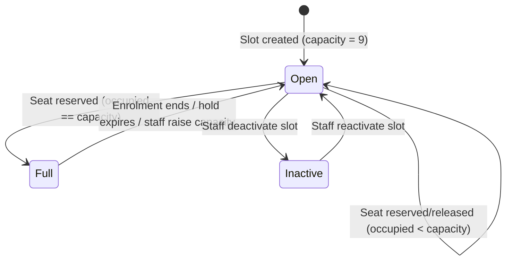
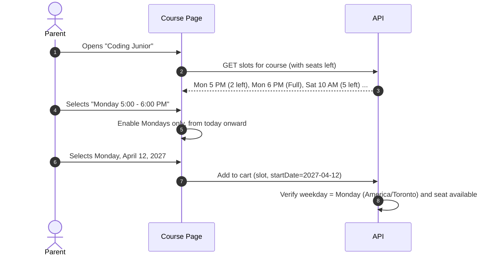

# Phase 04 — Course, Time Slot & Camp Management

## 1. Executive Summary & Operational Scope

This phase covers the operational core of STEMOTICS: regular programs and their **shared time slots**, per-slot rosters, camps and camp themes, camp attendance sheets, camp bulk email, dynamic course filters, and the weekday-constrained start date picker.

Requirements come from the client brief (Oct 27, 2026): §1 (capacity), §2 (rosters), §3 (camps), §6 (filters) and §12 (date picker). Items not in the brief are marked **[Proposed]**.

---

## 2. Regular Programs — Shared Time-Slot Capacity (Brief §1)

### 2.1 The Rule

> "Track enrollment count per time slot (e.g. 'Mondays 4:00–5:00 PM'), combining **ALL regular programs** that run in that slot — not just one program's own roster." — Brief §1

A **time slot** is a weekday + time range at the STEMOTICS centre (e.g. Monday 5:00–6:00 PM). Many programs run in the same slot: Coding Junior, Robotics Senior and Game Design Junior may all be offered on Monday at 5 PM, in the same room with the same staff. Capacity belongs to the **slot**, not to the program.

**Example:** Monday 5–6 PM has capacity 9. Five children enrol in Coding Junior and four in Robotics Senior for that slot. The slot is now full, so **every** program offered on Monday 5–6 PM shows that slot as "Full", including programs nobody from that slot has enrolled in yet.

### 2.2 Capacity Behaviour

- **Default capacity:** 9 children per time slot when a slot is created.
- **Staff-editable per slot:** e.g. raise Saturday 10 AM to 11 when extra space is available. Lowering capacity below the current count is allowed; the slot simply stays full until enough children leave.
- **Automatic close:** when occupied seats reach capacity, the slot becomes unselectable on every regular program's registration form.
- **Automatic reopen:** when a child withdraws (enrolment ends) or staff raise capacity, the slot becomes selectable again with no manual step.
- **Regular Programs only.** Camps do not use time-slot capacity (Brief §1). The end of that sentence in the brief is cut off — see [Decision D-3](README.md#5-pending-decisions).
- **When a seat counts as taken:** from the moment the booking is paid until the enrolment ends (end of the final paid month after cancellation). Pending [Decision D-7](README.md#5-pending-decisions).
- **No overbooking under concurrency:** seats are reserved with an atomic database update during checkout and held for 15 minutes while payment completes. If payment fails or times out, the hold is released. See [Phase 09 §4.2](Phase-09-MERN-Architecture.md).
- [Proposed] **Waitlist:** "Full — join waitlist" with staff notification when a seat opens. Not in the brief.



### 2.3 Printable Roster per Time Slot (Brief §2)

One printable sheet **per time slot**, listing every child expected in that slot **across all programs**.

**Required columns (Brief §2):**
1. Child's name
2. Age
3. Program enrolled in (and level, e.g. `Coding Junior — Level 2 [STC2002]`)
4. Start date

**Header:** slot (e.g. `Monday 5:00 PM – 6:00 PM`), date printed, seats used / capacity.

[Proposed] extra columns: parent phone, medical form status, allergy alert flag.

**Format:** a print-optimised HTML page (`@media print`, Letter landscape). Staff print it from the browser with "Print" or "Save as PDF". Server-side PDF generation is only needed if rosters must be emailed automatically [Proposed].

---

## 3. Camps & Camp Themes (Brief §3)

### 3.1 Camps in Scope

The brief lists **three camps**:
1. **PD Day Camp** — single-day bookings on school PD days.
2. **Winter Camp** — school winter break.
3. **March Break Camp** — the March Break week.

Summer Camp is **not** in the brief. The live homepage still has a Summer Camp slide, but there is no Summer Camp product. Adding Summer Camp later should need no code change: camps are records staff create, not hard-coded types.

### 3.2 Camp Themes

> "Each camp currently has 4 themes, and staff need to be able to add/edit/rename themes later without needing a developer." — Brief §3

- Each camp holds a list of themes (4 per camp today). Staff can add, rename, edit, reorder, and retire themes.
- Theme fields: name, description, applicable age group(s), active flag.
- Retiring a theme hides it from new registrations but keeps it on existing registrations and past attendance sheets.
- The real theme names are needed to seed the CMS — [Decision D-4](README.md#5-pending-decisions).

### 3.3 Camp Attendance Sheets

Printable sheet per camp, **filterable/grouped** by:
- Day of camp **or** week of camp
- Theme
- Age group

**Columns per child (Brief §3):**

| # | Column | Source |
|---|---|---|
| 1 | Child name | Registration |
| 2 | Age | Calculated from date of birth at the camp date (or age entered at registration) |
| 3 | Theme | Registration |
| 4 | Parent phone number | Parent account / order |
| 5 | Parent email address | Parent account / order |
| 6 | Sign-in time | Blank, filled by hand |
| 7 | Sign-in signature | Blank line |
| 8 | Sign-out time | Blank, filled by hand |
| 9 | Sign-out signature | Blank line |

[Proposed] extra columns: emergency contact, allergy alert flag, before/after-care.

```
+------------------------------------------------------------------------------------------------------------------------+
| STEMOTICS — MARCH BREAK CAMP 2027 | DAY: Tue, March 16, 2027 | THEME: <theme name> | AGES: 6-8                          |
+----------------+-----+--------------+--------------+---------------------+----------+-------------+----------+-------------+
| Child Name     | Age | Theme        | Parent Phone | Parent Email        | In Time  | In Signature| Out Time | Out Sig.    |
+----------------+-----+--------------+--------------+---------------------+----------+-------------+----------+-------------+
| (child name)   | 7   | (theme)      | 519-555-0142 | parent@example.com  | ___:___  | ___________ | ___:___  | ___________ |
+----------------+-----+--------------+--------------+---------------------+----------+-------------+----------+-------------+
```

### 3.4 Camp Bulk Email

Staff can email all parents registered for a given camp, optionally filtered by:
- Theme
- Age group
- Date (camp day or week)

Requirements:
- Recipient preview (count and list) before sending.
- Rich-text body, optional attachment.
- One email per parent even if they registered several children.
- Sent through the transactional email provider; send log stored per message.
- [Proposed] Saved templates (welcome / what to bring, weather cancellation, medical form reminder) and filter by medical-form status.
- [Proposed] Open/bounce analytics (depends on the email provider's webhooks).

Operational camp emails about a registration the parent made are transactional under CASL; they still identify STEMOTICS and include contact details. Promotional content belongs in the newsletter tool ([Phase 07 §7](Phase-07-Gallery-Content-Management.md)).

---

## 4. Dynamic Course Filters (Brief §6)

### 4.1 Requirement

- Staff can **add and remove filter groups** and the **options** within each group, without a developer.
- When creating/editing a product, staff tick the options that apply from each group.
- The course listing shows only products matching the visitor's selected options across all groups, and stays in sync automatically.

Filters are therefore **data** (`FilterGroup` and `FilterOption` records), not hard-coded lists in the code. See [Phase 09 §4.4](Phase-09-MERN-Architecture.md).

### 4.2 Seed Data (current live filters, Brief §6)

| Group | Options |
|---|---|
| Courses | AI, ML & Cyber Security · City Programs · Introductory · Regular Programs · Home School · Camps |
| Age Level | Ages 4-5 · Ages 6-8 · Ages 9-12 · Ages 13-15 |
| Course Categories | Robotics · Coding · Digital Design · Game Design |
| Difficulty | Basic · Intermediate · Advanced |
| School Workshop Categories | STEM Night at School · Bring your class to STEMOTICS |

### 4.3 Filter Logic

- **Within one group:** OR (Robotics **or** Coding).
- **Across groups:** AND (Robotics or Coding **and** Ages 6-8).
- No selection in a group = no restriction from that group.
- Selected filters are kept in the URL query string so filtered views can be shared and bookmarked.
- Deleting a group or option removes it from the sidebar and from all product tags. Staff are asked to confirm and shown how many products are affected.

### 4.4 Business Type vs. Display Filters

The "Courses" filter group is for **display only**. Business behaviour (does this product use time slots and monthly billing? is it a camp?) comes from a separate, fixed **product type** field on each product (`regular_program`, `camp`, `one_time`). This way staff can freely rename or delete filter options without breaking billing or capacity.

---

## 5. Start Date Picker Matches the Course Day (Brief §12)

### 5.1 Rules

1. On a regular program page, the parent first chooses a **time slot** (e.g. "Monday 5:00–6:00 PM"). Full slots are disabled.
2. The date picker then enables **only that slot's weekday** (only Mondays for a Monday slot). All other weekdays are disabled.
3. Past dates are disabled.
4. The server re-checks the weekday on submit; the client-side picker is a convenience, not the enforcement.
5. Weekday checks use the **`America/Toronto`** time zone, and dates are stored as calendar dates (`YYYY-MM-DD`) so they cannot shift by a day across time zones.
6. The chosen start date is the **billing anchor** for the monthly subscription ([Phase 05 §3](Phase-05-Registration-Checkout.md)).
7. [Proposed] Staff-managed studio closure dates (e.g. Good Friday) are also disabled. The FAQ says that when a holiday cancels a lesson, "the complete course is extended for one week". How that maps to monthly billing needs a client decision before this is built.



Reference dates for testing: Good Friday 2027 = March 26; Easter Monday 2027 = March 29; Victoria Day 2027 = May 24.

---

## 6. Verification & Acceptance Criteria

- [ ] Capacity is counted per time slot across **all** regular programs; default 9, editable per slot.
- [ ] A full slot is unselectable on every program offering it; it reopens automatically on withdrawal or capacity increase.
- [ ] Concurrent checkouts cannot overbook a slot.
- [ ] Printable roster per time slot shows child name, age, program, and start date across all programs.
- [ ] 3 camps supported with staff-managed themes (add/edit/rename/retire).
- [ ] Camp attendance sheet filters by day/week, theme and age group, and shows name, age, theme, parent phone, parent email, and sign-in/sign-out time and signature columns.
- [ ] Camp bulk email filters by theme, age group and date.
- [ ] Staff can add/remove filter groups and options; listing uses OR within a group and AND across groups.
- [ ] Date picker allows only the selected slot's weekday; the server re-validates.
