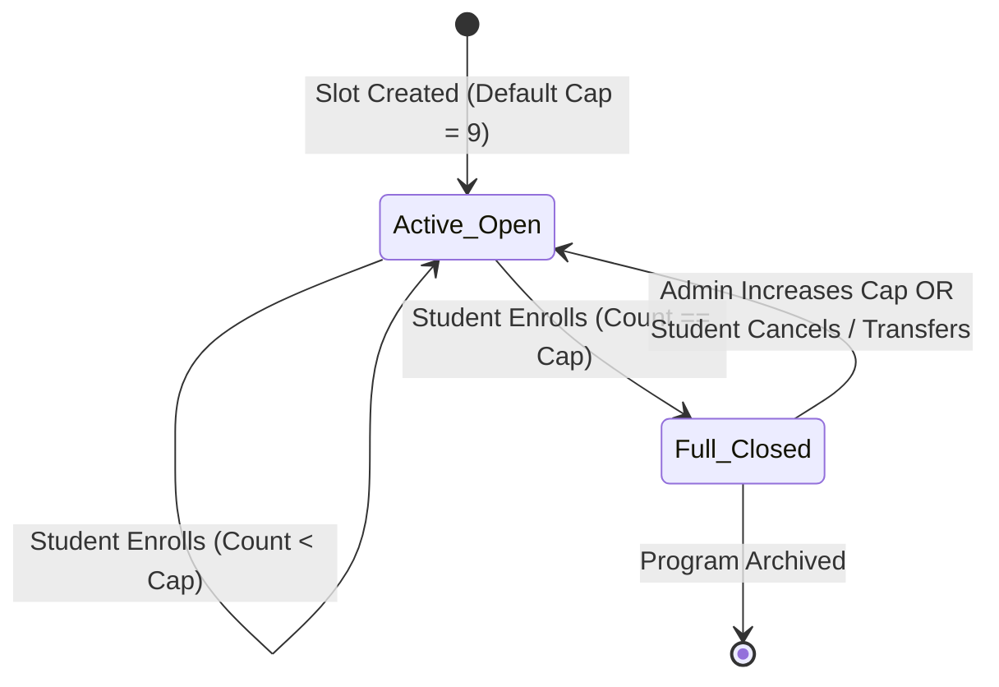
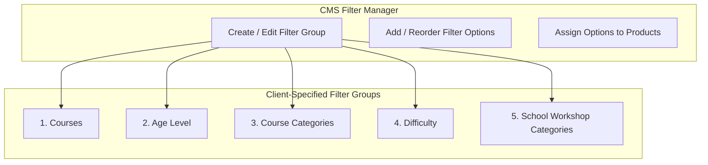
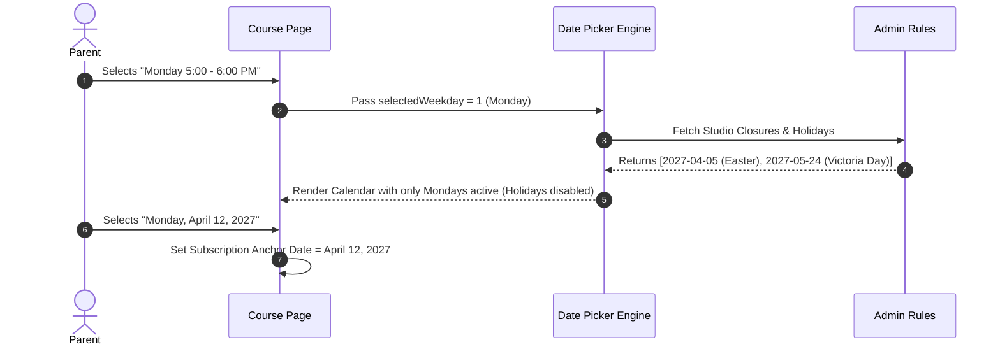

# Phase 04 — Course, Program & Camp Management

## 1. Executive Summary & Operational Scope

This phase governs the core operational engine of STEMOTICS: regular after-school and weekend programs, seasonal camps, competitions, school workshops, dynamic filter groups, capacity tracking, and printable attendance sheets.

All operational rules in this document incorporate the client's specifications dated October 27, 2026, specifically the **9-child default slot limit, automatic registration open/close triggers, camp theme management, printable attendance sheets with signature columns, camp bulk email filters, and dynamic course filter groups**.

---

## 2. Regular Programs Management & 9-Child Slot Capacity

Regular programs operate on monthly recurring subscriptions with weekly time slots.



### 2.1 Time Slot Capacity Engine

- **Default Slot Limit:** Every newly created time slot defaults to **9 children**.
- **Admin Customization:** Staff can adjust capacity per individual time slot (e.g., set a Saturday slot to 8, or an advanced AI class to 10).
- **Automated Open/Close Logic:**
  - When active registrations reach the capacity limit, the slot is immediately marked **FULL** on the website frontend.
  - The slot selection radio/button becomes disabled with a visible badge: `"Full — Join Waitlist"`.
  - If a parent cancels or transfers to another time, or if staff increase capacity, the slot **automatically reopens** for public registration.
- **Weekday Restriction Validation:** The system binds each slot to its designated day of the week (e.g. Monday 5:00 PM). The frontend date picker will restrict selection exclusively to Mondays.

### 2.2 Printable Rosters for Regular Programs

Staff can generate clean, print-optimized PDF rosters formatted for 8.5" x 11" Letter landscape.

**Roster Data Fields:**
1. Program Title & Course Code (e.g., `Introduction to AI [STAI4001]`)
2. Day & Time Slot (e.g., `Monday 5:00 PM – 6:00 PM`)
3. Instructor Name & Classroom / Room Number
4. Child Full Name
5. Child Age & Date of Birth
6. Enrollment Start Date
7. Parent/Guardian Name & Primary Phone
8. Medical Form Status (`Complete` / `Pending Alert`)
9. Critical Allergies / Medical Notes Summary

---

## 3. Camps Management & Theme Architecture

Camps operate as seasonal, full-day or half-day intensive workshops. The platform provides full management for:
1. **PD Day Camp** (Single-day bookings across scheduled school board dates)
2. **Winter Break Camp** (Daily and multi-day holiday break options)
3. **March Break Camp** (Full week intensive robotics camp)
4. **Summer Camp** (Weekly seasonal themes from July through August)

### 3.1 Dynamic Camp Themes

Staff can create, edit, rename, or retire camp themes dynamically without developer assistance:
- **Theme Name:** (e.g., "Battle Bots Arena", "Space Exploration with SPIKE Prime", "Minecraft Game Design")
- **Description & Key Learning Outcomes:** Full syllabus and daily project highlights.
- **Applicable Age Brackets:** (e.g. Ages 4–6, Ages 7–9, Ages 10–12).
- **Assigned Camp Seasons:** Assign to PD Day, Winter Break, March Break, or Summer Camp.

### 3.2 Camp Attendance Sheets & Sign-In/Sign-Out Log

A major operational requirement from the client brief is the ability to generate printable daily attendance sheets with physical signature lines for parent drop-off and pickup.

**Printable Attendance Sheet Features:**
- **Filtering Options:** Filterable by:
  - Camp Day / Date
  - Camp Week
  - Assigned Theme
  - Age Group / Classroom
- **Printed Table Columns:**
  1. Student Full Name
  2. Age
  3. Registered Camp Theme
  4. Parent / Guardian Name
  5. Primary Contact Phone & Email
  6. Emergency Contact Name & Phone
  7. Drop-off Sign-In Time (Blank for manual entry)
  8. Drop-off Parent Signature (Line)
  9. Pick-up Sign-Out Time (Blank for manual entry)
  10. Authorized Pick-up Signature (Line)
  11. Staff Initial Check

```
+--------------------------------------------------------------------------------------------------------------------------------------------------------------------+
| STEMOTICS CAMP ATTENDANCE & SIGN-IN SHEET — DATE: March 16, 2027 | THEME: Robotics & AI Junior | INSTRUCTOR: ______________________                               |
+-------------------+-----+-------------------+---------------------+------------------+------------------+---------------------+-------------------+------------+
| Child Full Name   | Age | Theme / Level     | Parent Name         | Contact Phone    | Sign-In Time     | Parent Signature    | Sign-Out Time     | Parent Sig |
+-------------------+-----+-------------------+---------------------+------------------+------------------+---------------------+-------------------+------------+
| Oliver Thompson   | 7   | SPIKE Junior      | Sarah Thompson      | 519-555-0142     | _____ : _____ AM | ___________________ | _____ : _____ PM  | __________ |
| Maya Patel        | 8   | SPIKE Junior      | Rajesh Patel        | 519-555-0189     | _____ : _____ AM | ___________________ | _____ : _____ PM  | __________ |
+-------------------+-----+-------------------+---------------------+------------------+------------------+---------------------+-------------------+------------+
```

### 3.3 Bulk Email Engine for Camps

Staff can send targeted broadcast emails directly to parents registered for camps:

- **Filter Criteria:**
  - By Camp Event (e.g., March Break Camp 2027)
  - By Specific Date / Week
  - By Registered Theme
  - By Age Group
  - By Medical Form Completion Status (e.g., "Send only to parents with pending medical forms")
- **Template System:**
  - Pre-Camp Welcome & What to Bring (Lunch guidelines, indoor shoes)
  - Emergency Weather Cancellation Notice
  - Medical Form Completion Reminder
  - Post-Camp Photo Gallery & Re-enrollment Offer
- **Delivery Logging:** Real-time dashboard showing sent count, delivery status, opens, and bounce tracking.

---

## 4. Dynamic Course Filter System

The public course catalog at `/courses/` relies on a multi-attribute filter system. Staff can configure groups and options via the **Course Filters Module**:



### 4.1 Filter Groups & Standard Options

1. **Courses Group:**
   - AI, ML & Cyber Security
   - City Programs
   - Introductory
   - Regular Programs
   - Home School
   - Camps
2. **Age Level Group:**
   - Ages 4–5
   - Ages 6–8
   - Ages 9–12
   - Ages 13–15
3. **Course Categories Group:**
   - Robotics
   - Coding
   - Digital Design
   - Game Design
4. **Difficulty Group:**
   - Basic
   - Intermediate
   - Advanced
5. **School Workshop Categories Group:**
   - STEM Night at School
   - Bring your class to STEMOTICS

### 4.2 Non-Technical CMS Filter Controls

- **Add New Filter Group:** Staff can create a new taxonomy group (e.g. "Location / City") without touching code.
- **Add / Reorder Options:** Drag-and-drop ordering for display in the frontend sidebar.
- **Product Tagging UI:** Multi-select checklist on each course editing screen to easily tag courses with their respective filters.
- **Automatic Instant Filtering:** When a visitor clicks any combination of filters on the frontend, the course grid updates instantly without a full page reload.

---

## 5. Course Start Date Picker & Weekday Enforcement

To prevent parent confusion and scheduling conflicts, the platform enforces strict weekday alignment:

### 5.1 Business Rules & Logic

1. When editing a course, staff designate the course's operating day (e.g., "Monday").
2. On the course product page, when a parent selects a Monday slot (e.g. "Monday – 5:00 to 6:00 PM"):
   - The interactive calendar date picker unlocks **only future Mondays**.
   - All Tuesdays, Wednesdays, Thursdays, Fridays, Saturdays, and Sundays are grayed out and unclickable.
   - Statutory holidays and studio closure dates (configured by staff in CMS holiday settings) are automatically disabled.
3. The selected start date becomes the **anchor billing date** for the student's monthly recurring subscription.



---

## 6. Verification & Acceptance Criteria

- [x] Default capacity of 9 children per slot enforced with staff override capability.
- [x] Automatic slot closure when capacity reached, and automatic reopening when seats free up.
- [x] Printable PDF rosters for Regular Programs with child, parent, and medical notes.
- [x] Full support for PD Day, Winter Break, March Break, and Summer Camps.
- [x] Dynamic camp theme creation, renaming, and editing in CMS.
- [x] Printable camp attendance sheets with parent sign-in and sign-out signature lines.
- [x] Bulk camp email tool with filters by date, theme, and age group.
- [x] Dynamic management of the 5 client-specified course filter groups.
- [x] Weekday-constrained start date picker logic fully specified.
