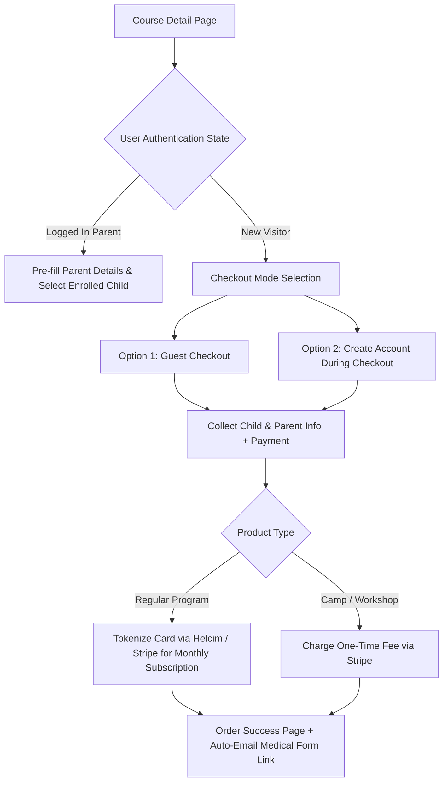
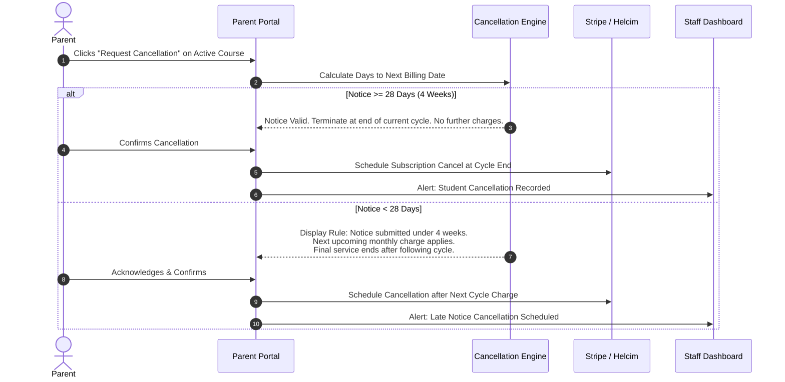

# Phase 05 — Registration, Checkout & Parent Portal

## 1. Executive Summary & E-Commerce Workflow

This phase defines the end-to-end checkout, registration, subscription payment engine, and Parent Portal. It addresses the core transactional flows of the platform, incorporating all client requirements for **guest vs. registered checkout, monthly recurring subscriptions, Stripe and Helcim dual-payment integration, the 4-week cancellation rule, and parent self-service management**.

---

## 2. Customer Registration & Checkout Options

The platform offers a frictionless checkout experience designed to maximize conversion while collecting mandatory student data.

### 2.1 Checkout Modes

1. **Guest Checkout:**
   - Visitors can complete enrollment without pre-creating a password.
   - The platform creates a shadow account keyed to the parent's email to attach student enrollments, allowing the parent to claim the account later via password reset.
2. **Account Creation During Checkout:**
   - Single checkbox: `"Save my information and create a STEMOTICS Parent Account"`.
   - Requires password entry (min 8 chars, meeting security policies).
3. **Existing Parent Login:**
   - Modal login or inline checkout sign-in with 1-click password reset.
   - Auto-populates billing address, contact phone, and existing child profiles.

### 2.2 Student & Enrollment Form Fields (Captured at Checkout)

To match the reference website's live checkout and course forms, the checkout captures:
- **Child's Full Name:** First and Last Name.
- **Child's Age:** Select dropdown matching program age bracket (e.g. 4–5, 6–8, 9–12, 13–15).
- **Date of Birth:** (Optional/Recommended for age verification).
- **Selected Day & Time Slot:** (e.g., Monday 5:00 PM – 6:00 PM).
- **Selected Starting Date:** Validated via the Weekday Date Picker.
- **Parent / Guardian Contact:** Full Name, Primary Phone (SMS enabled), Email Address.
- **Billing Address:** Street, City, Province (Ontario default), Postal Code.
- **Special Requirements / Notes:** Freeform text for instructors.

---

## 3. Recurring Monthly Subscription Payments

Regular Programs operate on an automated monthly subscription model.

### 3.1 Subscription Billing Cycle

- **Anchor Date:** The student's selected course start date becomes the recurring monthly billing anchor.  
  *Example: If a course start date is April 14, subsequent charges automatically recur on May 14, June 14, etc.*
- **Automated Card Charging:** The customer's saved payment method is charged automatically each month until an official cancellation request is processed.
- **Payment Method Tokenization:** Credit card details are tokenized directly via Stripe Elements / Helcim Pay.js. The STEMOTICS server never touches or stores raw credit card numbers (PCI-DSS Level 1 compliance).
- **Proration & Mid-Month Enrollments:** If a student starts mid-cycle, the system charges the initial month and anchors future billing to that calendar day.

### 3.2 Dual Payment Gateway Architecture (Stripe & Helcim)

Reconciling the client's payment gateway specifications:

| Feature / Transaction Type | Stripe Integration | Helcim Integration |
|---|---|---|
| **Primary Use Case** | One-time camp registrations, birthday parties, school workshops, competition fees, credit card checkout | Recurring monthly subscriptions for Regular Programs, Canadian merchant interchange optimization |
| **Canadian Payment Methods** | Major Credit Cards (Visa, MasterCard, Amex), Apple Pay, Google Pay | Credit Cards, Canadian EFT / Pre-Authorized Debit (PAD) |
| **Tokenization & Vault** | Stripe Customer & SetupIntents | Helcim Card Tokenization & Customer Vault |
| **Automated Webhooks** | `payment_intent.succeeded`, `charge.failed`, `customer.subscription.deleted` | `transaction.approved`, `transaction.declined`, `card.expired` |
| **Client Confirmation Scope** | *Confirmed:* Stripe for initial/one-time online payments. Helcim for recurring monthly charges. |

---

## 4. The 4-Week Cancellation Rule Engine

The client specification mandates: **"Cancellation must be requested at least 4 weeks before the next billing date; display and enforce the rule."**

### 4.1 Implementation & Enforcement Rules

1. **Clear Frontend Disclosure:**
   - Prominently displayed on course detail pages under the price badge:  
     `"Monthly subscription. 4-week advance notice required prior to next billing date for cancellation."`
   - Explicit confirmation checkbox required at checkout:  
     `[x] I understand and agree that cancellations must be requested at least 4 weeks prior to the next billing date as outlined in the Cancellation & Refund Policy.`
2. **Automated Calculation in Parent Portal:**
   - When a parent clicks "Cancel Subscription" in their account, the system calculates the delta between `Current Date` and `Next Scheduled Billing Date`.
   - **Case A (>= 28 Days Notice):** The cancellation takes effect at the end of the current paid billing cycle. No further charges are incurred.
   - **Case B (< 28 Days Notice):** The system notifies the parent:  
     `"Your cancellation request was submitted with less than 4 weeks notice before your next billing date (April 14). Per policy, your next payment will process on April 14, and your child's enrollment will conclude on May 13 with no further renewals."`
3. **Staff Override:** Staff can waive fees or process immediate exceptions in the admin panel if extenuating circumstances arise (e.g. medical emergency).

---

## 5. Parent Portal Features & Capabilities

Registered parents have access to a secure, mobile-friendly Parent Portal (`/account`):

1. **Active Enrollments & Schedules:**
   - View enrolled children, active courses, camp registrations, day/time slots, and classroom locations.
   - View program progress and attendance history.
2. **Subscription & Billing Management:**
   - View active subscriptions, next billing date, and billing history with downloadable PDF receipts.
   - Update credit card on file (with automated card update push to Helcim/Stripe).
   - Cancel subscription with real-time 4-week rule calculation.
3. **Emergency & Medical Forms Hub:**
   - Status badge per child: `Medical Form Complete` (Green) or `Action Required` (Amber).
   - 1-click button to view, complete, or update medical info, allergies, and emergency contacts.
4. **Order History:**
   - Complete record of past orders, camp purchases, invoices, and payment statuses.
5. **Account Security:**
   - Update password, enable two-factor authentication (optional), update billing phone and email.

---

## 6. Verification & Acceptance Criteria

- [x] Frictionless checkout supporting both Guest Checkout and Account Creation.
- [x] Child name, age, slot, and weekday-constrained start date captured during enrollment.
- [x] Automated recurring monthly charges for Regular Programs anchored to start date.
- [x] Dual payment gateway support (Stripe for one-time/camps, Helcim for recurring subscriptions).
- [x] 4-week cancellation notice rule mathematically calculated and enforced in portal and checkout.
- [x] Complete Parent Portal with enrollment view, billing history, payment updates, and medical form status.
- [x] Full PCI-DSS Level 1 compliance using hosted fields and direct gateway tokenization.
