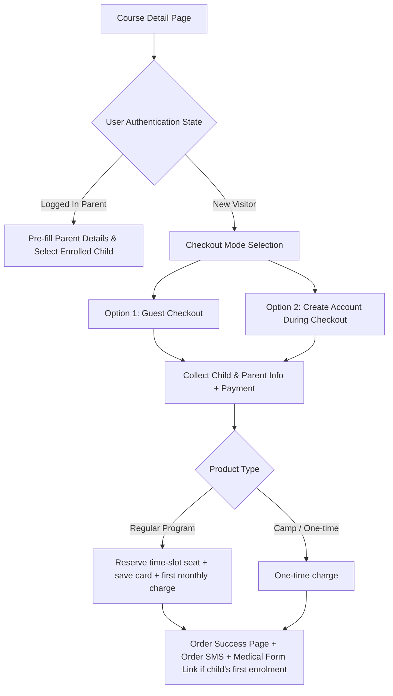
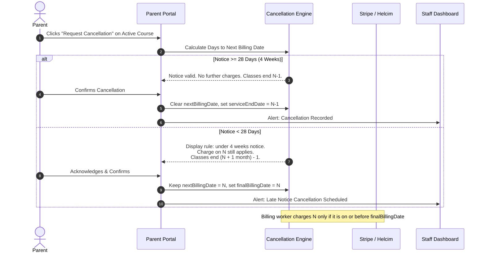

# Phase 05 — Registration, Checkout & Parent Portal

## 1. Executive Summary & E-Commerce Workflow

This phase defines the end-to-end checkout, registration, subscription payment engine, and Parent Portal. It addresses the core transactional flows of the platform, incorporating all client requirements for **guest vs. registered checkout, monthly recurring subscriptions, Stripe and Helcim dual-payment integration, the 4-week cancellation rule, and parent self-service management**.

---

## 2. Customer Registration & Checkout Options

The platform offers a frictionless checkout experience designed to maximize conversion while collecting mandatory student data.

Which processor handles I and J is pending [Decision D-1](README.md#5-pending-decisions) — see §3.2.

### 2.1 Checkout Modes (Brief §10)

1. **Guest Checkout:**
   - Visitors can complete an order without creating a password.
   - The order is still linked to a parent record keyed to the email address, so staff can find it and the parent can claim an account later through "set password" (email verification required).
   - A guest who buys a **monthly subscription** must still be able to cancel it (Brief §10). The confirmation email therefore includes a "Manage subscription" link that lets the guest claim their account.
2. **Account Creation During Checkout:**
   - Single checkbox: `"Save my information and create a STEMOTICS Parent Account"`.
   - Requires password entry (min 8 chars, meeting security policies).
3. **Existing Parent Login:**
   - Modal login or inline checkout sign-in with 1-click password reset.
   - Auto-populates billing address, contact phone, and existing child profiles.

### 2.2 Student & Enrollment Form Fields (Captured at Checkout)

To match the reference website's live checkout and course forms, the checkout captures:
- **Child's Full Name:** First and Last Name.
- **Child's Age:** Select dropdown matching program age bracket (e.g. 4–5, 6–8, 9–12, 13–15).
- **Date of Birth:** Recommended — lets rosters and attendance sheets show the correct age over time.
- **Level / Course Selection:** e.g. Coding Junior Level 1–4 (`STC2001`–`STC2004`), as on the live product pages.
- **Selected Day & Time Slot:** (e.g., Monday 5:00 PM – 6:00 PM). Full slots are disabled (shared capacity, Brief §1).
- **Selected Starting Date:** Only the slot's weekday is selectable (Brief §12).
- **Parent / Guardian Contact:** Full Name, Primary Phone (SMS enabled), Email Address.
- **Billing Address:** Street, City, Province (Ontario default), Postal Code.
- **Special Requirements / Notes:** Freeform text for instructors.

---

## 3. Recurring Monthly Subscription Payments

Regular Programs move from today's one-time "Monthly [4 weeks]" payment (with staff manually entering later charges into Helcim) to automatic **monthly** billing (Brief §5).

### 3.1 Subscription Billing Cycle

- **Anchor Date:** The chosen start date is the billing anchor. The first charge happens at checkout for the first month starting on that date; later charges recur on the same day each month.  
  *Example: start date April 14 → charges on April 14 (at checkout), May 14, June 14, …*
- **Short months:** If the anchor day does not exist in a month (29th–31st), the charge runs on the last day of that month and returns to the anchor day afterwards (Jan 31 → Feb 28 → Mar 31).
- **Time zone:** All billing dates are calendar dates in `America/Toronto`.
- **Automatic charging:** The saved card is charged each month until the subscription ends under the cancellation rule (§4).
- **Failed charges:** The subscription becomes `past_due`; the parent gets an email (and SMS) with a link to update the card; the charge is retried [Proposed: after 3 and 7 days]; staff see it on the dashboard. What happens to the seat after repeated failures is a client decision.
- **Card data:** Collected only in the processor's hosted fields (HelcimPay.js / Stripe Elements). STEMOTICS servers never see or store card numbers, which keeps STEMOTICS in the simplest PCI self-assessment (SAQ A — confirm eligibility with the processor).
- **Who runs the schedule:** Our billing worker decides when to charge and calls the processor with the saved card token ([Phase 09 §6](Phase-09-MERN-Architecture.md)). Alternatively Helcim's own Recurring/Payment Plan feature can run the schedule; the trade-off is less control over the 4-week rule and anchor-day handling. Decide during D-1.

### 3.2 Payment Processors — Open Question (Brief §5, Decision D-1)

The brief says: *"we use Helcim for recurring billing and Stripe for online payments. The new system needs to integrate both."* It then asks, as an **open question**, for STEMOTICS to confirm the split — e.g. Stripe for the first/one-time payment at registration and Helcim for the recurring monthly charges. **This is not confirmed yet.**

**Technical constraint:** a card saved in Stripe cannot be used by Helcim (and vice versa). If Stripe takes the first payment and Helcim the monthly charges, the parent must enter the card twice, or staff must collect it manually again — the problem the brief is trying to remove.

| Option | How it works | Assessment |
|---|---|---|
| **A (recommended)** | Regular Programs: first payment **and** monthly charges on **Helcim**. One-time purchases (camps, parties, workshops, trials): **Stripe**. | One card entry per purchase. Both processors are used, as the brief asks. A cart mixing a camp and a regular program needs two payment steps — or split it into two checkouts. |
| B | Everything on Helcim. | Simplest: one processor, one card entry, one reconciliation. Stripe dropped. |
| C | Everything on Stripe (Stripe Billing for subscriptions). | Simplest technically, but moves recurring billing away from Helcim, which STEMOTICS uses today. |
| D (as worded in the brief) | Stripe first payment, Helcim recurring. | Card entered twice. Not recommended. |

Webhook/event names and payment-method support (e.g. Pre-Authorized Debit on Helcim) must be confirmed from each processor's current API documentation during implementation; earlier drafts listed event names that were not verified.

**Camps stay one-time payments** unless STEMOTICS says otherwise ([Decision D-2](README.md#5-pending-decisions), open question in Brief §5).

---

## 4. The 4-Week Cancellation Rule Engine

Brief §5: *"a subscription must be cancelled at least 4 weeks before the next billing date, or the parent will still be charged for the upcoming month. The system should enforce/display this rule when a parent requests cancellation."*

### 4.0 Calculation

Let **R** = the date the parent requests cancellation and **N** = the next billing date (both calendar dates in `America/Toronto`). Notice = N − R in days.

| Case | Condition | Charges | Last day of classes (service end) |
|---|---|---|---|
| **A — enough notice** | N − R ≥ 28 days | No further charges. | N − 1 day |
| **B — late notice** | N − R < 28 days | **One** more charge on N, then none. | (N + 1 month) − 1 day |

On a monthly cycle, Case A only happens when the parent cancels within the first few days after a charge; most cancellations will be Case B. That is the client's policy as written. Both cases must be shown to the parent **before** they confirm.

The time-slot seat stays occupied until the service end date, then is released automatically (the slot reopens, Brief §1).

### 4.1 Implementation & Enforcement Rules

1. **Clear Frontend Disclosure:**
   - Prominently displayed on course detail pages under the price badge:  
     `"Monthly subscription. 4-week advance notice required prior to next billing date for cancellation."`
   - Required confirmation checkbox at checkout (unticked by default; checkout blocked until ticked):  
     `[ ] I understand and agree that cancellations must be requested at least 4 weeks prior to the next billing date as outlined in the Cancellation & Refund Policy.`
2. **Automated Calculation in Parent Portal:**
   - When a parent clicks "Cancel Subscription" in their account, the system calculates the delta between `Current Date` and `Next Scheduled Billing Date`.
   - **Case A (>= 28 Days Notice):** The cancellation takes effect at the end of the current paid billing cycle. No further charges are incurred.
   - **Case B (< 28 Days Notice):** The system notifies the parent:  
     `"Your cancellation request was submitted with less than 4 weeks notice before your next billing date (April 14). Per policy, your next payment will process on April 14, and your child's enrollment will conclude on May 13 with no further renewals."`
3. **Staff Override [Proposed]:** Staff can cancel immediately (no further charges) or issue a refund in the admin panel for exceptional cases. Every override is logged with the staff member and reason.

---

## 5. Parent Portal Features & Capabilities

Registered parents have a mobile-friendly Parent Portal (`/account`).

**Required by Brief §10:**
1. **View orders** — past orders, camp registrations and payment status.
2. **Cancel subscriptions** — with the 4-week rule calculation shown before confirming (§4).
3. **Place new orders** — saved parent and child details pre-filled.
4. **Recover / reset password** — emailed single-use, time-limited reset link.

**[Proposed] additions:**
- Children and their active enrolments (program, level, slot, start date).
- Next billing date and receipts.
- Update card on file (through the processor's hosted fields).
- Medical form status per child, with a link to complete or update the form.
- Optional two-factor authentication.

---

## 6. Verification & Acceptance Criteria

- [ ] Guest checkout and account creation both work; a guest can later claim the account and cancel a subscription.
- [ ] Child name, age, level, slot and weekday-constrained start date captured; slot seat reserved atomically.
- [ ] Monthly charges recur on the anchor day, including 29th–31st anchors in short months.
- [ ] Payment processor split implemented as recorded in Decision D-1.
- [ ] 4-week rule: Case A and Case B calculated, shown before confirmation, and enforced by the billing worker.
- [ ] Parent portal: view orders, cancel subscriptions, place new orders, reset password.
- [ ] No card data reaches STEMOTICS servers (hosted fields only).
