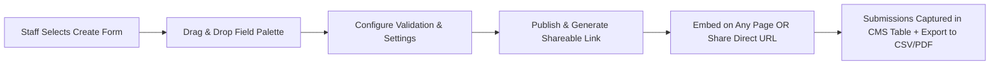

# Phase 06 — Medical Forms, Custom Forms & Communication

## 1. Executive Summary & Communication Scope

This phase delivers three connected capabilities:
1. **Automated Medical & Emergency Information Workflow:** Automatically sending, tracking and storing medical/emergency information for enrolled children.
2. **Custom Drag-and-Drop Form Builder:** Allowing non-technical staff to create custom forms (e.g. School Student Registrations, STEM Night inquiries) and generate public shareable links.
3. **Multi-Channel Communication Engine:** Transactional and marketing email broadcasts, combined with Twilio SMS notifications tailored to Canadian telecommunications regulations.

---

## 2. Automated Medical & Emergency Form Workflow

Brief §4: *"The first time a child is signed in at any program (regular program or camp), the system should automatically email the parent a link to complete a medical/emergency information form — emergency contacts, allergies, medical notes, etc. Staff should be able to see, per child, whether this form has been completed."*

**Interpretation:** "signed in" is read as **first enrolment** (paid registration), so the form arrives before the first class. Pending confirmation — [Decision D-6](README.md#5-pending-decisions). The form is sent **once per child**; the brief requires no renewal. Annual renewal is [Proposed] only.

```mermaid
sequenceDiagram
    autonumber
    actor Parent
    participant Web as Enrollment Engine
    participant DB as MongoDB
    participant Mail as Transactional Email Service
    participant Staff as Staff Rosters

    Parent->>Web: Completes paid enrolment for a child
    Web->>DB: Does this child already have a medical form record?
    alt No record (child's first enrolment)
        Web->>DB: Create medical form record (status = pending, hashed token, expiry)
        Web->>Mail: Send "Please complete your child's medical & emergency form"
        Mail-->>Parent: Email with secure link /forms/medical/{token}
        Web->>Staff: Child shows [PENDING] on rosters
    else Record exists (pending or complete)
        Web->>Staff: Child shows current status; no new email
    end

    Parent->>Web: Opens link, fills in form, submits
    Web->>DB: Validate, encrypt sensitive fields, status = complete
    Web->>Staff: Child shows [COMPLETE] on rosters
```

**Link security:** the token is random (≥ 128 bits), stored only as a hash, expires (e.g. 30 days; staff can resend), and opens only that child's form. Logged-in parents can also reach the form from the portal.

### 2.1 Medical Form Fields

The fields are exactly the 16 fields of the live form, as listed in [Phase 01 §6.7](Phase-01-Website-Audit.md) (single source of truth). Two improvements are [Proposed]:
- A "Please describe" text field shown when "known medical conditions" = Yes (the live form has only the Yes/No).
- Emergency contact **relationship**.

**Medical form vs. form builder (Brief §11, [Decision D-11](README.md#5-pending-decisions)):** the brief says the form builder "could be the tool that creates" the medical form, which is also needed for camps **and off-site programs**. Recommendation: the medical form is a **system form** built on the form builder, with its 16 core fields **locked** (staff can edit labels/help text and add extra questions, but cannot delete core fields). Rosters, the per-child status and encryption depend on knowing exactly which field holds allergies and emergency contacts.

### 2.2 Staff Tracking

- **Status per child** (Brief §4), shown on time-slot rosters, camp attendance sheets and the child's admin page:
  - `Complete` (green): form submitted.
  - `Pending` (amber): link sent, not yet submitted.
  - [Proposed] `Overdue` (red): pending and the child's first class/camp day is within 48 hours.
- **Pending list:** filterable list of all children with pending forms.
- **Resend link:** staff can resend the email (and [Proposed] SMS) for a pending child.
- [Proposed] **Automatic reminders:** a reminder email 3 days before the child's first class/camp day if still pending — not a daily email.
- [Proposed] **Emergency card:** high-contrast view of contacts, allergies and medical notes for staff during an incident, visible only to roles allowed to see medical data.

---

## 3. Custom Drag-and-Drop Form Builder

Staff can construct custom forms and generate public shareable links without developer intervention.



### 3.1 Field Palette (Supported Form Elements)
- **Standard Inputs:** Single-line text, Multi-line paragraph, Number, Email, Phone number (with format masking), Date picker.
- **Choice Inputs:** Dropdown select, Radio buttons, Multi-select checkboxes, Toggle switches.
- **Specialty Inputs:** File/Document upload (PDF/images), Digital signature pad, Section divider with descriptive text, Consent checkbox with terms link.
- **Hidden / Metadata Fields:** Auto-capture UTM campaign tags, referral sources, and submission timestamps.

### 3.2 Forms Named in the Brief (§11)
1. **Medical information / emergency contact form** — for camps and off-site programs; also the §4 automated form (system form with locked core fields, see §2.1).
2. **School student registration form** — a school uses it to enrol its students in STEMOTICS programs (school name, teacher contact, student names, grades, program).

[Proposed] templates: STEM Night inquiry, general contact form (`/contact-us`).

Form builder submissions that contain medical data are encrypted and access-controlled the same way as the system medical form. File uploads are limited by type and size and stored privately (not on the public CDN).

### 3.3 Form Submission Management
- Searchable, filterable table of all responses in the admin panel.
- Export submissions to CSV / Microsoft Excel or formatted printable PDF.
- Optional email notification to staff when a new submission is received.

---

## 4. Multi-Channel Communication: Email & Twilio SMS

### 4.1 Transactional & Broadcast Email Engine
- **Transactional Triggers:**
  - Order / Enrollment Confirmation & Payment Receipt.
  - Automated Medical Form Link dispatch.
  - Monthly Subscription Successful Charge & Receipt.
  - Monthly Subscription Failed Charge Notice (with card update link).
  - Cancellation Confirmation (showing Case A/B outcome, last charge date and last class date).
  - Password reset.
- **Camp bulk email (Brief §3):** see [Phase 04 §3.4](Phase-04-Course-Camp-Management.md) — filter by camp, theme, age group, date.
- **Newsletters & promotions (Brief §7):** see [Phase 07 §7](Phase-07-Gallery-Content-Management.md).
- **Sending:** through a transactional email provider (SendGrid / Amazon SES / Resend) with SPF, DKIM and DMARC set up on `stemotics.com` so emails are not flagged as spam.

### 4.2 Twilio SMS Integration & Canadian Compliance

The platform integrates Twilio's Messaging API for both automated order updates and opt-in promotional messages.

| Message Category | Trigger & Content Example | Opt-In / Legal Requirement |
|---|---|---|
| **Order SMS (Brief §10)** | *"STEMOTICS: Order #1234 confirmed — Robotics Junior, Mon 5 PM, starting Apr 12. Details in your email. Reply STOP to opt out."* | Transactional message about a purchase. Does not need marketing consent, but must identify STEMOTICS and honour STOP. |
| **Marketing SMS (Brief §10)** | *"STEMOTICS: March Break Camp registration is open! stemotics.com/camps Reply STOP to unsubscribe."* | **CASL:** only to customers who ticked an **unticked-by-default** opt-in box (`[ ] I agree to receive promotional text messages from STEMOTICS`). Store when, where and how consent was given. Include sender identification and an unsubscribe method in every message. |
| [Proposed] **Urgent operational SMS** | *"STEMOTICS: Today's PD Day Camp is cancelled due to weather. Details by email."* | Operational notice to registered parents. |

**SMS compliance and setup:**
- `STOP` / `UNSUBSCRIBE` / `CANCEL` / `HELP` handling (Twilio Advanced Opt-Out) and sync of opt-outs back to the customer record.
- Phone numbers stored in E.164 format (`+15195551234`).
- **Sender registration:** Canadian/US carriers filter unregistered business traffic. Plan for Twilio sender registration (e.g. toll-free number verification) before launch; it can take days to weeks.
- Cost estimate per Twilio's Canada SMS pricing (as referenced in Brief §10) and expected monthly volume, shared with STEMOTICS before launch.

---

## 5. Verification & Acceptance Criteria

- [ ] Medical form link emailed automatically on a child's first enrolment (per D-6), and not re-sent on later enrolments.
- [ ] All 16 live-form fields collected; sensitive fields encrypted.
- [ ] Staff see Complete/Pending per child on rosters, attendance sheets and a pending list.
- [ ] Staff can resend the link.
- [ ] Staff can build forms and get a shareable link without coding.
- [ ] Medical form (camps and off-site) and school student registration form available.
- [ ] Order SMS sent for every order; marketing SMS only to opted-in customers; STOP honoured.
- [ ] Twilio sender registration approved before launch.
