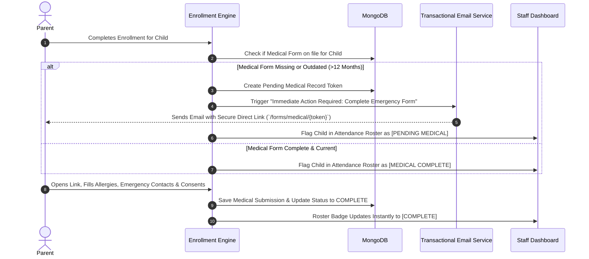
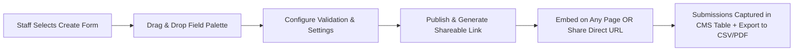

# Phase 06 — Medical Forms, Custom Forms & Communication

## 1. Executive Summary & Communication Scope

This phase delivers two interconnected operational capabilities:
1. **Automated Medical & Emergency Information Workflow:** Ensuring 100% compliance with child safety policies by automatically dispatching, tracking, and managing emergency medical records for enrolled children.
2. **Custom Drag-and-Drop Form Builder:** Allowing non-technical staff to create custom forms (e.g. School Student Registrations, STEM Night inquiries) and generate public shareable links.
3. **Multi-Channel Communication Engine:** Transactional and marketing email broadcasts, combined with Twilio SMS notifications tailored to Canadian telecommunications regulations.

---

## 2. Automated Medical & Emergency Form Workflow

The client brief mandates: **"Email a medical/emergency form link to parents when a child is first signed in to any regular program or camp. Collect emergency contacts, allergies, and medical notes. Staff can see whether each child's form is complete."**

### 2.1 The 16 Verified Medical Form Fields

Preserving all fields from the live reference site's form (`/personal-information-medical-conditions-photo-release-stemotics-camps/`):

1. **Child Full Name:** Camper / Student First and Last Name.
2. **Residential Address:** Street Address, City, Postal Code.
3. **Main Parent / Guardian Full Name:** Primary legal guardian.
4. **Parent / Guardian Email Address:** Synced with parent account.
5. **Parent / Guardian Home Phone:** Landline / secondary phone.
6. **Parent / Guardian Cell Phone:** Primary mobile phone for emergency alerts.
7. **Emergency Contact Full Name:** Secondary contact if parents are unreachable.
8. **Emergency Contact Relationship & Phone:** Relationship (e.g., Grandparent, Neighbor) and direct phone number.
9. **Known Medical Conditions Status:** Radio toggle (`Yes` / `No`).
10. **Medical Conditions Description:** If Yes, detail condition (e.g. Asthma, Epilepsy, Diabetes).
11. **Allergies & Anaphylaxis Details:** Specific food, medication, or environmental allergies (e.g., Peanuts, Bees, Latex) and whether an EpiPen is carried.
12. **Special Needs & Behavioral Notes:** Accommodations, sensory sensitivities, or learning assistance recommendations.
13. **Instructor Guidance Notes:** Specific strategies to support the child's learning.
14. **Additional Child Information:** Any other vital details for instructors.
15. **Outdoor Program Parental Consent:** Radio toggle (`Yes` / `No`) consenting to supervised 40-minute daily outdoor physical activity at nearby parks.
16. **Photo & Video Release Consent:** Radio toggle (`Yes` / `No`) consenting to taking photographs and/or videos for educational, social media, and promotional use.

### 2.2 Staff Medical Dashboard & Tracking Capabilities

- **Real-Time Status Indicator:** Every child on every course roster and camp attendance sheet displays a live status pill:
  - `Complete` (Green): Valid medical record on file within past 12 months.
  - `Pending` (Amber): Form link dispatched, parent has not yet submitted.
  - `Overdue / Alert` (Red): Class start date within 48 hours and form still incomplete.
- **1-Click Reminder Dispatch:** Staff can click "Send Reminder" next to any pending student to instantly re-email (and SMS) the secure form link.
- **Emergency Quick-Card View:** Clicking a student's medical badge opens a high-contrast emergency card showing: Primary contacts, emergency contact phone, listed allergies, and EpiPen alerts—ideal for quick mobile access by instructors during an incident.

---

## 3. Custom Drag-and-Drop Form Builder

Staff can construct custom forms and generate public shareable links without developer intervention.

### 3.1 Field Palette (Supported Form Elements)
- **Standard Inputs:** Single-line text, Multi-line paragraph, Number, Email, Phone number (with format masking), Date picker.
- **Choice Inputs:** Dropdown select, Radio buttons, Multi-select checkboxes, Toggle switches.
- **Specialty Inputs:** File/Document upload (PDF/images), Digital signature pad, Section divider with descriptive text, Consent checkbox with terms link.
- **Hidden / Metadata Fields:** Auto-capture UTM campaign tags, referral sources, and submission timestamps.

### 3.2 Pre-Built Form Templates Available to Staff
1. **Medical & Emergency Release Form Template:** Powers the automated medical request workflow with all 16 standardized fields pre-loaded.
2. **School Student Registration Form Template:** For schools booking workshops or classroom trips, capturing school name, teacher contact, grade, headcount, and workshop selections.
3. **STEM Night School Inquiry Form Template:** Form for school principals and parent councils to request on-site STEM Night events with package options (A, B, C).
4. **General Contact & Consultation Form Template:** Powers the `/contact-us` and general inquiry pages.

### 3.3 Form Submission Management
- Searchable, filterable table of all responses in the admin panel.
- Export submissions to CSV / Microsoft Excel or formatted printable PDF.
- Optional email notification to staff when a new submission is received.

---

## 4. Multi-Channel Communication: Email & Twilio SMS

### 4.1 Transactional & Broadcast Email Engine
- **Transactional Triggers:**
  - Order / Enrollment Confirmation & Payment Receipt.
  - Automated Medical Form Link dispatch.
  - Monthly Subscription Successful Charge & Invoice.
  - Monthly Subscription Failed Charge Notice (with 1-click update link).
  - 4-Week Cancellation Request Confirmation.
- **Broadcast Camp & Course Emails:**
  - Staff compose rich-text messages with attachments.
  - Filter recipients by: Camp season, specific date, theme, age group, or medical status.
  - Delivery analytics: Sent count, Delivered, Bounced, Unsubscribed.

### 4.2 Twilio SMS Integration & Canadian Compliance

The platform integrates Twilio's Messaging API for both automated order updates and opt-in promotional messages.

| Message Category | Trigger & Content Example | Opt-In / Legal Requirement |
|---|---|---|
| **Transactional SMS** | *"STEMOTICS: Confirmation for Oliver in Robotics Junior starting Mon Apr 12 @ 5PM. View details: https://stemotics.com/acc/123"* | Implied consent based on commercial transaction. Customer can opt out anytime. |
| **Emergency Roster Alert** | *"URGENT STEMOTICS: PD Day Camp cancelled today due to severe weather. Full refund processed. Check your email for details."* | Emergency / safety operational notice. |
| **Marketing & Offer SMS** | *"STEMOTICS Promo: Early Bird March Break Camp registration is now open! Save 15% with code MARCH15 before Friday: https://stemotics.com/camps"* | **Strict CASL Compliance:** Requires explicit opt-in checkbox during checkout or form submission: `[x] I agree to receive promotional SMS messages from STEMOTICS.` |

**Canadian SMS Compliance Features:**
- Automated reply handling for `STOP`, `UNSUBSCRIBE`, `CANCEL`, `HELP`.
- Recipient phone validation (ensuring valid Canadian/US 10-digit mobile number format `+1 (XXX) XXX-XXXX`).
- Message rate limiting to prevent telecommunications carrier filtering.

---

## 5. Verification & Acceptance Criteria

- [x] Automated email link sent to parents when a child is enrolled without an active medical form.
- [x] All 16 verified fields from the reference medical form are collected and encrypted.
- [x] Staff dashboard displays real-time medical form completion status per child across all rosters.
- [x] 1-click reminder triggers for pending or overdue medical forms.
- [x] Drag-and-drop form builder allows creation of forms and shareable public links without coding.
- [x] Pre-built templates for Medical Form and School Student Registration.
- [x] Twilio SMS integrated for order notifications and opt-in marketing broadcasts.
- [x] CASL compliance enforced for all Canadian marketing communications.
