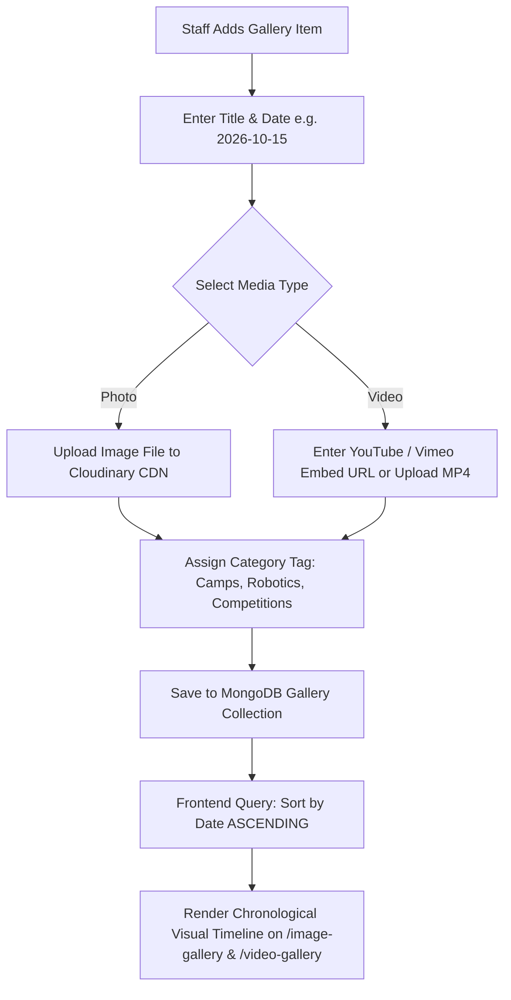
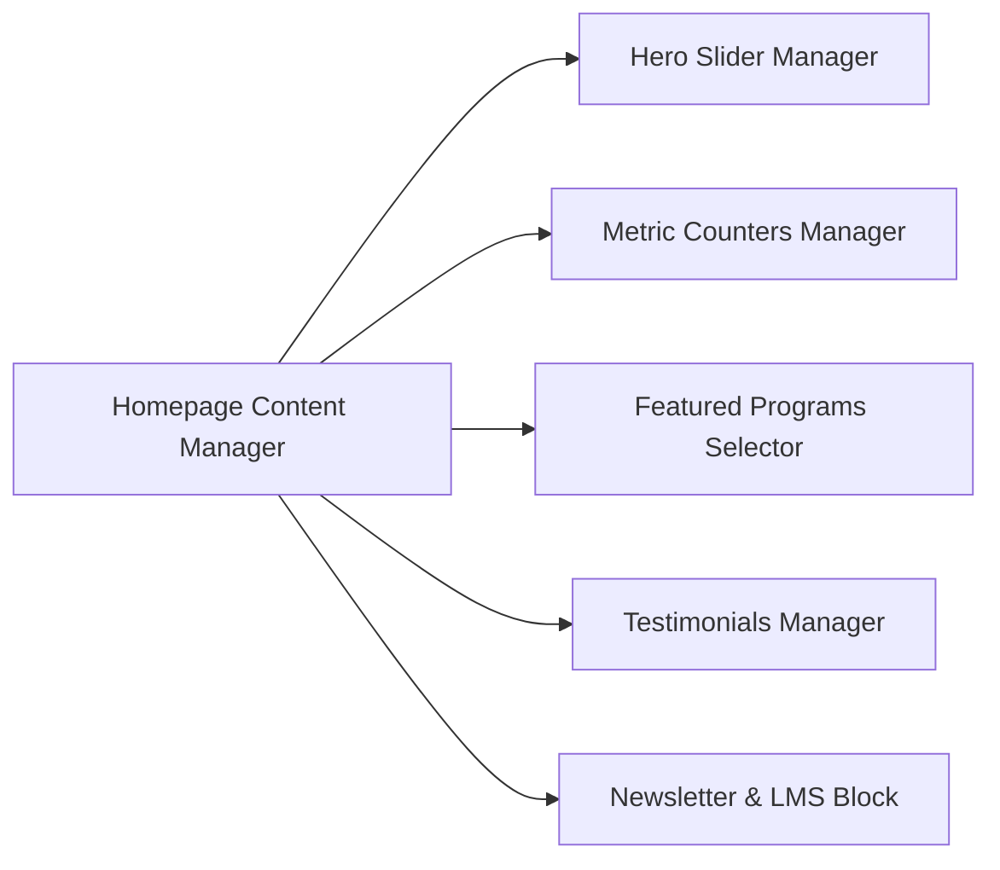

# Phase 07 — Gallery, Testimonials, Newsletter & Homepage Content

## 1. Executive Summary & Content Operations Scope

This phase governs the multimedia and dynamic content elements of the STEMOTICS platform:
1. **Gallery Management:** Enabling staff to publish photo and video galleries with title and date, enforcing the client requirement for **ascending date order display**.
2. **Homepage Content Controls:** Non-technical editing of hero banner slides, feature cards, and calls to action.
3. **Verified Metric Counters:** Real-time editable counters for children benefited, schools served, community centres, and certified instructors.
4. **Testimonials & Social Proof:** Verified Google and parent review management.
5. **Newsletter & Marketing Communications:** Newsletter signup, broadcast email tool, and direct links to the external LMS (`https://learn.stemotics.com/`).

---

## 2. Gallery Management (Photos & Videos in Ascending Date Order)

The client brief mandates: **"Staff can add photos/videos without developer help. Each entry has a title and date; display entries in ascending date order."**

### 2.1 Gallery Data Schema & Content Fields
Each gallery entry contains:
- **Title:** Descriptive title (e.g., "Cambridge Summer Camp Robot Battles", "FLL Team Presentation").
- **Date:** Entry date (e.g. `2026-07-22`). **System sorts entries by date in ascending order (`date: 1`), creating an authentic chronological progression.**
- **Media Type:** `Image` or `Video`.
- **Media Asset:** High-resolution image asset (with auto-generated WebP thumbnails) OR video URL (YouTube embed or Vimeo).
- **Category / Filter Tag:** `All`, `Summer Camps`, `Competitions`, `Robotics Workshops`, `School STEM Nights`.
- **Caption / Description:** Short educational narrative describing the activity.

### 2.2 Public Gallery UX & Viewer
- **Image Gallery (`/image-gallery/`):** Responsive justified masonry grid with lazy loading. Clicking an image opens a full-screen, high-resolution lightbox with caption, date, and keyboard arrow navigation.
- **Video Gallery (`/video-gallery/`):** Video thumbnail grid with play icon overlay. Clicking opens a modal video player (embedding YouTube/Vimeo with zero third-party tracking cookies until played).

---

## 3. Homepage Content & Hero Slider Administration

Staff can control every visual section of the homepage from the CMS without touching code:

### 3.1 Hero Slider Manager
- **Slide Ordering:** Drag-and-drop ordering of the 5 verified slides (and custom future slides).
- **Per-Slide Fields:**
  1. Slide Headline (e.g., `Excite | Inspire | Motivate Learning`)
  2. Subtext / Description
  3. Background Image or Video (desktop 1920x1080, mobile 750x1000)
  4. Button CTA Label (e.g., `Join Now`, `Register Today`)
  5. Button Link Target (internal page selector or external URL)
  6. Slide Active / Inactive Toggle (schedule seasonal slides in advance)

### 3.2 Featured Programs & Educational Stream Cards
- Staff can feature up to 8 priority courses on the homepage.
- Quick toggle to showcase current seasonal offerings (e.g. prioritize PD Day Camp in September, or March Break Camp in January).

---

## 4. Homepage Statistics & Metric Counters

The client specification mandates: **"Homepage includes featured programs, children benefited count, schools served, community centres, teachers/staff, testimonials, and newsletter signup."**

Staff can edit these four key impact metrics directly in the admin panel:

| Metric Name | Default Value (From Reference Audit) | Source Verification & Context | Admin Edit Control |
|---|---|---|---|
| **Children Benefited Count** | `5,000+` | Total children trained across 12 years of operations | Numerical input + Suffix (`+`) |
| **Schools Served** | `20+` | Waterloo, Kitchener, Cambridge, Mississauga school boards | Numerical input + Suffix (`+`) |
| **Community Centres Partnered**| `35+` | London, Kitchener, Waterloo, Brantford, Hamilton community hubs | Numerical input + Suffix (`+`) |
| **Certified Teachers & Staff** | `15+` | Certified engineering instructors and STEM educators | Numerical input + Suffix (`+`) |

**Frontend Display:** Animated count-up counter that triggers smoothly when scrolled into the viewport.

---

## 5. Testimonials & Google Reviews Management

Staff can curate testimonials to maximize parent trust:
- **Verified Google Reviews:** Display live Trustindex rating badge (`EXCELLENT` with 5-star rating) and sync top verified parent reviews.
- **Manual Testimonial Entry:** Staff can add written reviews from physical camp feedback forms:
  - Parent / Student Name
  - Program Attended (e.g., "Parent of 6-year-old — LEGO & Coding Camp")
  - Review Body Text
  - Star Rating (1 to 5 stars)
  - Student Project Image / Parent Avatar (optional)
  - Display Order & Feature on Homepage toggle

---

## 6. Staff & Instructor Directory Management

To reassure parents of instructor qualifications:
- **Instructor Profiles:** Staff can add/edit instructor profiles displayed on the About Us page or dedicated Team section.
- **Fields:** Full Name, Role / Title (e.g. "Senior Robotics Instructor", "STEM Curriculum Lead"), Educational Background (e.g., "B.Eng Mechatronics"), Bio, Photo, Specializations (LEGO SPIKE, Arduino, Python).

---

## 7. Newsletter Broadcasts & LMS Link Integration

The client brief mandates: **"Admin can send newsletters/promotional offers; include a link to the LMS."**

### 7.1 Newsletter Subscription Management
- **Frontend Form:** Prominent newsletter subscription widget in the homepage footer and dedicated banner.
- **Subscriber Database:** List of verified email subscribers with opt-in timestamp, source page, and CASL compliance status.
- **Export / Sync:** Export subscriber list to CSV or sync with transactional email providers.

### 7.2 Admin Newsletter Composer & Broadcast Tool
- **Visual Composer:** Staff can draft rich HTML newsletters with images, course links, promo discount codes, and seasonal schedules.
- **LMS Link Inclusion:** Every newsletter template and footer automatically incorporates a prominent button:  
  `"Access STEMOTICS Learning Portal (LMS)"` -> `https://learn.stemotics.com/`
- **Broadcast Execution:** Send to:
  - All newsletter subscribers
  - Past camp parents
  - Active regular program parents
  - Filtered segments

---

## 8. Verification & Acceptance Criteria

- [x] Staff can upload photos and videos without developer intervention.
- [x] All gallery entries have title and date, and display in ascending date order.
- [x] Lightbox modal for photo gallery and embed video player for video gallery.
- [x] Hero slider slides fully manageable (text, image, button label, button link, active state).
- [x] Homepage statistics counters (children benefited, schools, community centres, teachers) editable in CMS.
- [x] Testimonials manager supports verified Google reviews and manual parent feedback.
- [x] Staff / instructor profiles manageable in CMS.
- [x] Newsletter signup on homepage and broadcast tool in admin with direct link to LMS (`https://learn.stemotics.com/`).
