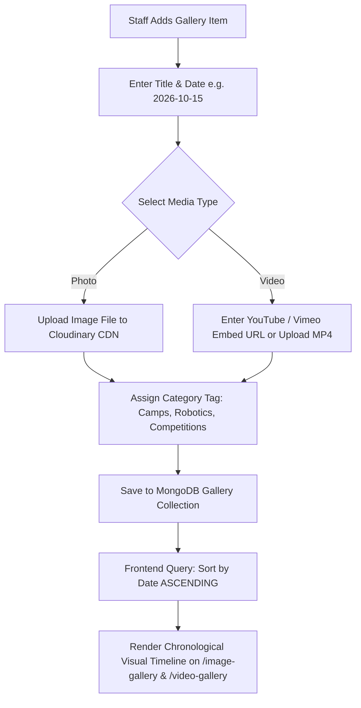
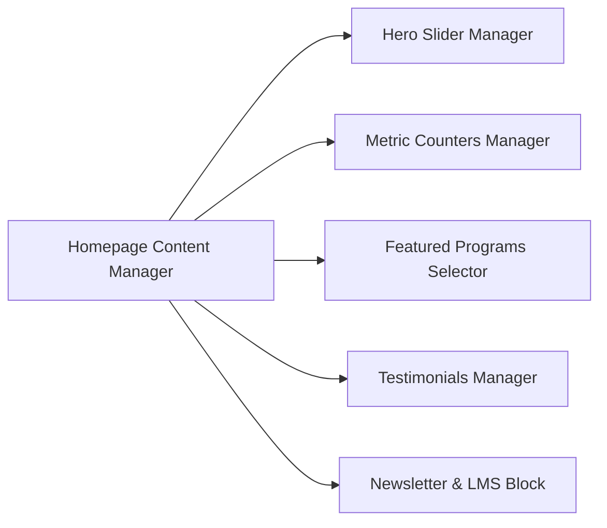

# Phase 07 — Gallery, Testimonials, Newsletter & Homepage Content

## 1. Executive Summary & Content Operations Scope

This phase governs the multimedia and dynamic content elements of the STEMOTICS platform:
1. **Gallery Management:** Enabling staff to publish photo and video galleries with title and date, enforcing the client requirement for **ascending date order display**.
2. **Homepage Content Controls:** Non-technical editing of hero banner slides, feature cards, and calls to action.
3. **Impact Section:** Editable running count of children benefited, schools served, community centres, and teachers & staff (Brief §7).
4. **Testimonials:** Parent/client testimonials (Brief §7).
5. **Newsletter & Marketing Communications:** Newsletter signup, broadcast email tool, and direct links to the external LMS (`https://learn.stemotics.com/`).

---

## 2. Gallery Management (Photos & Videos in Ascending Date Order)

Brief §8: *"An easier way for staff to add photos and videos to the website gallery, without needing a developer. Each gallery entry should have a title and a date. Gallery entries should display in ascending order (by date)."*

Ascending = **oldest first**, as the brief states. If entries share a date, they are ordered by creation time.

### 2.1 Gallery Data Schema & Content Fields
Each gallery entry contains:
- **Title:** Descriptive title (e.g., "Cambridge Summer Camp Robot Battles", "FLL Team Presentation").
- **Date:** Entry date (e.g. `2026-07-22`). **System sorts entries by date in ascending order (`date: 1`), creating an authentic chronological progression.**
- **Media Type:** `Image` or `Video`.
- **Media Asset:** High-resolution image asset (with auto-generated WebP thumbnails) OR video URL (YouTube embed or Vimeo).
- **Category / Filter Tag:** `All`, `Summer Camps`, `Competitions`, `Robotics Workshops`, `School STEM Nights`.
- **Caption / Description:** Short educational narrative describing the activity.

### 2.2 Public Gallery UX & Viewer
- **Image Gallery (`/image-gallery/`):** Responsive justified masonry grid with lazy loading. Clicking an image opens a full-screen, high-resolution lightbox with caption, date, and keyboard arrow navigation.
- **Video Gallery (`/video-gallery/`):** Video thumbnail grid with play icon overlay. Clicking opens a modal player. YouTube embeds use `youtube-nocookie.com` and load only after the visitor clicks play.
- **Pagination:** the gallery loads in pages (e.g. 24 items) so it stays fast as entries grow.

---

## 3. Homepage Content & Hero Slider Administration

Staff can control every visual section of the homepage from the CMS without touching code:

### 3.1 Hero Slider Manager (Brief §7)
- **Slide Ordering:** Drag-and-drop ordering of slides. Seed with the 5 real live slides; the 3 "Lorem ipsum" placeholder slides on the live site are **not** migrated.
- **Per-Slide Fields:**
  1. Slide Headline (e.g., `Excite | Inspire | Motivate Learning`)
  2. Subtext / Description
  3. Background Image or Video (desktop 1920x1080, mobile 750x1000)
  4. Button CTA Label (e.g., `Join Now`, `Register Today`)
  5. Button Link Target (internal page selector or external URL)
  6. Slide Active / Inactive Toggle (schedule seasonal slides in advance)

### 3.2 Featured Programs & Educational Stream Cards
- Staff can feature up to 8 priority courses on the homepage.
- Quick toggle to showcase current seasonal offerings (e.g. prioritize PD Day Camp in September, or March Break Camp in January).

---

## 4. Homepage Statistics & Metric Counters

Brief §7 asks the homepage to show: featured programs, *"a running count of how many children have benefited from our programs so far"*, schools served, community centres where programs are offered, teachers & staff (photos and details), testimonials, and a newsletter sign-up.

| Item | Default value | Admin control |
|---|---|---|
| **Children benefited** | **TBD by STEMOTICS** (D-5) | Number + suffix (e.g. `+`), label. [Proposed] option to add the count of completed enrolments in the new system automatically on top of a staff-entered historical base. |
| **Schools served** | **TBD** (D-5). Live partner page names 19 schools. | Counter and/or logo/name list — format pending D-5. |
| **Community centres** | **TBD** (D-5). Live partner page names ~33 unique centres/partners. | Counter and/or list — format pending D-5. |
| **Teachers & staff** | From the staff profiles (§6) | Profiles with photo and details (required by the brief); optional count. |

Earlier drafts showed `5,000+ / 20+ / 35+ / 15+`; these figures were **not** from the live site or the brief and must not be published without STEMOTICS confirmation.

**Frontend Display:** Animated count-up when scrolled into view (respects `prefers-reduced-motion`).

---

## 5. Testimonials & Google Reviews Management

Staff can curate testimonials (Brief §7):
- **Google reviews widget:** The live site uses a Trustindex widget. Keep it as an embedded widget if STEMOTICS still has the subscription; it loads after the main content so it does not slow the page.
- **Manual testimonial entry:** Staff add written testimonials (with the parent's permission):
  - Parent / Student Name
  - Program Attended (e.g., "Parent of 6-year-old — LEGO & Coding Camp")
  - Review Body Text
  - Star Rating (1 to 5 stars)
  - Student Project Image / Parent Avatar (optional)
  - Display Order & Feature on Homepage toggle

---

## 6. Staff & Instructor Directory Management

Required by Brief §7 ("Teachers & staff — photos and details"). The live site has no team directory today.
- **Profiles:** Staff can add/edit/reorder/hide profiles shown in a homepage Team section (and optionally on About Us). Photos of staff are published only with their consent.
- **Fields:** Full Name, Role / Title (e.g. "Senior Robotics Instructor", "STEM Curriculum Lead"), Educational Background (e.g., "B.Eng Mechatronics"), Bio, Photo, Specializations (LEGO SPIKE, Arduino, Python).

---

## 7. Newsletter Broadcasts & LMS Link Integration

Brief §7: *"Staff should be able to send newsletters and promotional offers to subscribers directly from the website's admin panel, without a separate email tool. The site should include a link to our LMS."*

### 7.1 Newsletter Subscription Management
- **Frontend Form:** Newsletter sign-up on the homepage and in the footer (new — not on the live site).
- **Double opt-in:** a confirmation email with a link; the subscriber is active only after confirming. This gives proof of consent under CASL.
- **Subscriber Database:** Email, consent date/time, source page, consent wording shown, status (pending / subscribed / unsubscribed / bounced).
- **Unsubscribe:** one-click unsubscribe link in every newsletter, processed immediately (CASL requires within 10 business days).
- **Export:** CSV export for staff.
- **Parents from checkout** are added to the newsletter only if they tick an unticked opt-in box.

### 7.2 Admin Newsletter Composer & Broadcast Tool
- **Visual Composer:** Staff can draft rich HTML newsletters with images, course links, promo discount codes, and seasonal schedules.
- **LMS Link Inclusion:** Every newsletter template and footer automatically incorporates a prominent button:  
  `"Access STEMOTICS Learning Portal (LMS)"` -> `https://learn.stemotics.com/`
- **Broadcast Execution:** Promotional newsletters go **only to opted-in subscribers**. [Proposed] segments (e.g. opted-in camp parents, opted-in regular-program parents). Sending to all past customers without consent is not allowed under CASL.
- **Test send** to a staff address before every broadcast; send log kept per newsletter.
- **LMS link** also in the header/utility bar and admin sidebar.

---

## 8. Verification & Acceptance Criteria

- [ ] Staff can add photos and videos without a developer.
- [ ] Every gallery entry has a title and date and displays in ascending date order.
- [ ] Photo lightbox and video player work on mobile and desktop.
- [ ] Hero slides fully manageable (text, image, button label, button link, active state); placeholders removed.
- [ ] Impact figures editable; real values supplied by STEMOTICS (D-5).
- [ ] Teachers & staff profiles with photos and details editable and shown on the homepage.
- [ ] Testimonials manageable.
- [ ] Newsletter sign-up with double opt-in; staff can send newsletters from the admin; unsubscribe works.
- [ ] LMS link (`https://learn.stemotics.com/`) present on the site and in newsletters.
