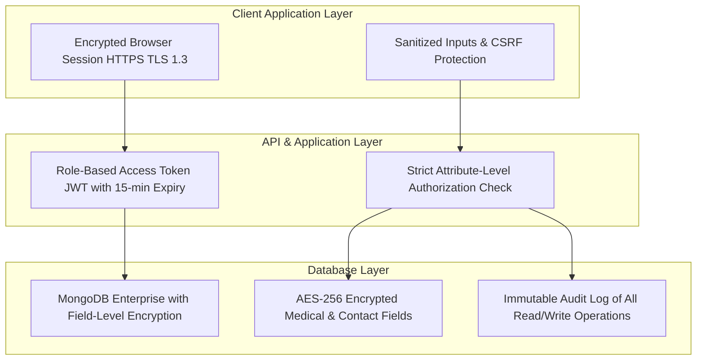
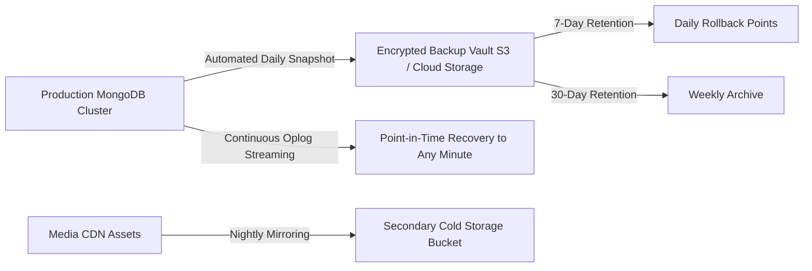

# Phase 08 — SEO, Performance, Security & Backups

## 1. Executive Summary & Compliance Mandate

STEMOTICS is an educational institution entrusted with the personal, contact, and medical information of minors across Canada. This phase establishes the platform's security framework, compliance standards, high-performance architecture, and search engine visibility.

The security protocol adheres strictly to **PIPEDA (Canada's Personal Information Protection and Electronic Documents Act)** and **PCI-DSS Level 1 payment security**, alongside comprehensive SEO safeguards to retain STEMOTICS's established organic search authority.

---

## 2. Child Data Privacy & Security Architecture (PIPEDA Compliance)

Because the system manages children's full names, ages, medical conditions, EpiPen requirements, allergies, and emergency contact details, rigorous data protection controls are architected at the database, application, and network layers.

### 2.1 Security Controls for Child & Medical Records

1. **Field-Level Encryption at Rest (AES-256):**
   - Medical conditions, allergy notes, emergency contact phone numbers, and child home addresses are encrypted prior to database insertion using AES-256-GCM.
   - Decryption keys are stored in isolated environment secret managers, never in the codebase.
2. **Strict Need-to-Know Role Access:**
   - Instructors and camp coordinators only see medical alerts (allergies, emergency phone) for students enrolled in their specific time slots or camp rooms.
   - General content editors have **zero access** to student records or medical forms.
3. **Automated Session Expiry & Two-Factor Authentication (2FA):**
   - Admin sessions expire after 30 minutes of inactivity.
   - Super Admins and Staff handling financial or medical records can enable 2FA via Time-Based One-Time Password (TOTP) apps (Google Authenticator / 1Password).
4. **Immutable Audit Logging:**
   - Every read, update, export, or deletion of a child or medical record is permanently recorded with staff user ID, IP address, timestamp, and specific data accessed.

---

## 3. Payment Security & PCI-DSS Compliance

- **Zero Card Data Storage:** STEMOTICS servers never receive, process, or store raw Primary Account Numbers (PAN), CVVs, or card expiration dates.
- **Hosted Tokenization Fields:** Checkout uses Stripe Elements and Helcim Pay.js hosted fields. Credit card data is transmitted directly from the parent's browser to the payment processor's secure PCI-DSS Level 1 vault.
- **Webhook Signature Verification:** All incoming transaction events from Stripe and Helcim are cryptographically validated against signed secrets to prevent replay or spoofing attacks.

---

## 4. Search Engine Optimization (SEO) & URL Preservation

To ensure the new platform maintains and elevates STEMOTICS's organic Google rankings across Southwestern Ontario (Cambridge, Kitchener, Waterloo, Guelph, London):

### 4.1 URL Preservation & 301 Redirect Engine
- All established URLs identified in Phase 01 (`/courses/`, `/product-category/camps/`, `/about-us/`, `/faq/`, `/contact-us/`, `/image-gallery/`, `/video-gallery/`, `/partner-with-us/`, `/cancellation-refund-policy/`) are preserved.
- Any legacy or modified URLs (such as `/summer-camp/` which currently returns 404) are permanently mapped via server-level **301 Moved Permanently** redirects to their active counterparts (`/camps/`).

### 4.2 Structured Data (Schema.org JSON-LD)
Rich search snippets are embedded on all public pages:
- **EducationalOrganization & LocalBusiness Schema:** Physical address (`695 Bishop St N, Cambridge, ON`), phone (`+1 519-957-1073`), geo-coordinates, opening hours, and aggregate rating.
- **Course Schema (`@type: Course`):** Course title, description, instructor qualifications, age range, educational stream, and price currency (CAD).
- **Event Schema (`@type: Event`):** For Camps and PD Day dates, including location, start date, end date, and registration availability.
- **FAQPage Schema (`@type: FAQPage`):** All 15 verified Q&As structured for Google rich search FAQ accordions.

### 4.3 Automated XML Sitemaps & Meta Tags
- Automated generation of dynamic XML sitemaps (`/sitemap.xml`) submitted to Google Search Console and Bing Webmaster Tools.
- OpenGraph and Twitter Card metadata configured per page, enabling attractive preview cards when links are shared on Facebook, WhatsApp, or Twitter.

---

## 5. Performance Optimization & Core Web Vitals

The frontend architecture targets a **90+ score on Google PageSpeed Insights** across both mobile and desktop:

| Performance Metric | Target Threshold | Technical Implementation Strategy |
|---|---|---|
| **Largest Contentful Paint (LCP)** | < 2.0 seconds | High-priority preloading of hero banner image, CDN edge caching |
| **First Input Delay / Interaction (INP)** | < 100 ms | React 19 lightweight concurrent hydration, zero blocking scripts |
| **Cumulative Layout Shift (CLS)** | < 0.05 | Explicit image width/height dimensions, reserved layout containers |
| **Asset Delivery & CDN** | Global < 50ms | Automated WebP / AVIF conversion via Cloudinary, Brotli compression |
| **Code Splitting** | Initial bundle < 150KB | Route-based dynamic lazy loading for Course Directory, Cart, and Admin |

---

## 6. Automated Backup & Disaster Recovery Architecture

- **Daily Database Snapshots:** Fully automated nightly backups taken at 02:00 AM EST, encrypted with AES-256.
- **Continuous Point-in-Time Recovery (PITR):** Transaction logs (oplog) streamed continuously, allowing recovery to any exact minute in the past 7 days.
- **Media Asset Mirroring:** All parent-uploaded and staff-published media mirrored to a secondary cold storage bucket.
- **Disaster Recovery SLA:** Recovery Time Objective (RTO) < 2 hours; Recovery Point Objective (RPO) < 15 minutes.

---

## 7. Verification & Acceptance Criteria

- [x] Full compliance with Canadian PIPEDA regulations for storing child personal and medical information.
- [x] AES-256 field-level encryption for sensitive health, allergy, and emergency contact records.
- [x] Role-Based Access Control guarantees instructors only see their assigned students' medical notes.
- [x] Zero raw credit card numbers stored on local servers; full PCI-DSS Level 1 compliance.
- [x] 100% URL preservation and 301 redirect map for legacy and orphan links.
- [x] Schema.org JSON-LD structured data implemented for Course, Event, LocalBusiness, and FAQPage.
- [x] Core Web Vitals target sub-2 second LCP and 90+ PageSpeed rating.
- [x] Automated daily database snapshots and continuous point-in-time recovery protocol.
