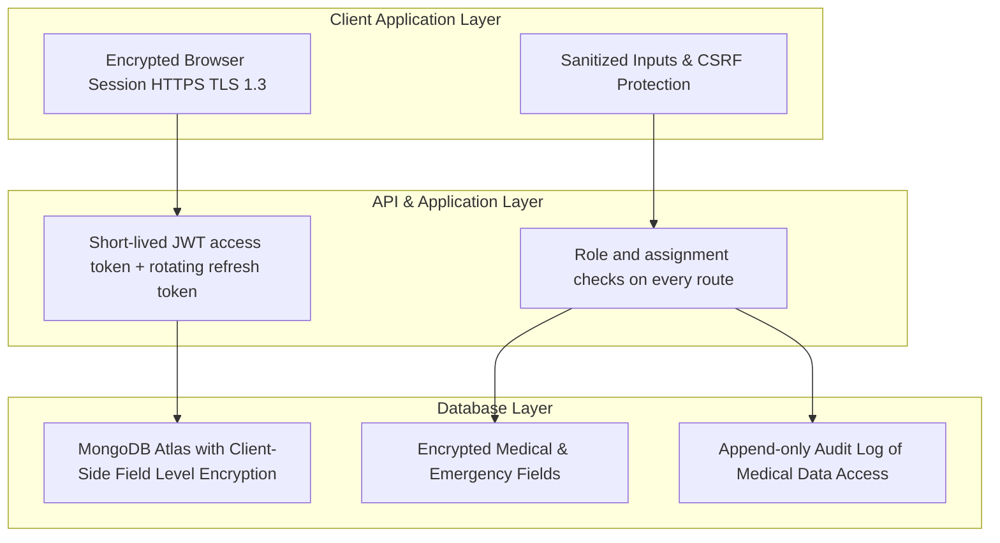
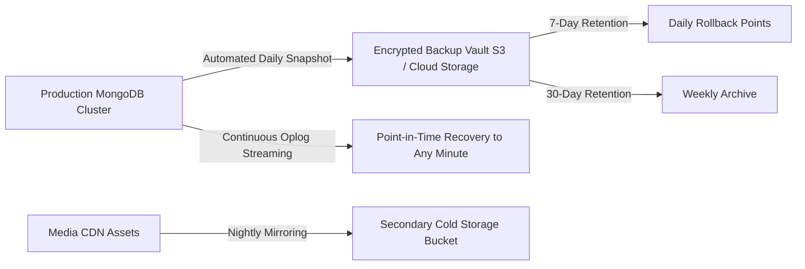

# Phase 08 — SEO, Performance, Security & Backups

## 1. Executive Summary & Compliance Mandate

STEMOTICS is an educational institution entrusted with the personal, contact, and medical information of minors across Canada. This phase establishes the platform's security framework, compliance standards, high-performance architecture, and search engine visibility.

The security design follows **PIPEDA** (Canada's federal private-sector privacy law) and keeps card data entirely with the payment processors to minimise **PCI DSS** scope, alongside SEO safeguards to keep STEMOTICS's existing search rankings.

> These are design goals, not certifications. Legal compliance (PIPEDA, CASL) should be reviewed by STEMOTICS's own advisor; this document describes the technical controls.

---

## 2. Child Data Privacy & Security Architecture (PIPEDA Compliance)

Because the system manages children's full names, ages, medical conditions, EpiPen requirements, allergies, and emergency contact details, rigorous data protection controls are architected at the database, application, and network layers.

### 2.1 Security Controls for Child & Medical Records

1. **Field-Level Encryption (one mechanism):**
   - Use **MongoDB Client-Side Field Level Encryption (CSFLE)** on Atlas: the application encrypts medical conditions, allergies, special-needs notes, emergency contacts and child addresses before they reach the database; data keys are protected by a cloud KMS key (AWS KMS / Azure Key Vault / GCP KMS), never stored in code or `.env` files.
   - Encrypted fields cannot be searched or sorted. Design rosters to filter on non-sensitive fields (child, slot, status) and decrypt only for display.
   - Atlas also encrypts all data at rest and in transit by default.
2. **Need-to-Know Access:**
   - Content editors and marketing roles have **no access** to children's records or medical data.
   - [Proposed] Instructors see medical/emergency data only for children in their assigned slots or camps (see [Phase 03 §6](Phase-03-CMS-Architecture.md)).
3. **Sessions & Authentication:**
   - Access token (JWT, ~15 minutes) plus a rotating refresh token, both in `HttpOnly`, `Secure`, `SameSite=Lax` cookies. Admin sessions end after 30 minutes of inactivity (refresh token not renewed).
   - CSRF protection on state-changing requests (SameSite cookies plus a CSRF token or `Origin` check).
   - Login rate limiting and lockout; bcrypt password hashing.
   - [Proposed] TOTP two-factor authentication, recommended as **mandatory** for roles that can see medical or payment data.
4. **Audit Logging:**
   - Every view, export, update or deletion of medical data is recorded (staff user, time, IP, child, action) in an append-only collection that application roles cannot edit or delete.
5. **Data Retention [Decision needed]:** how long medical forms and children's data are kept after a child stops attending, and how a parent can request deletion (PIPEDA access/correction requests).

---

## 3. Payment Security & PCI-DSS Compliance

- **Zero Card Data Storage:** STEMOTICS servers never receive, process, or store card numbers, CVVs, or expiry dates — only processor tokens.
- **Hosted Payment Fields:** Checkout uses HelcimPay.js and/or Stripe Elements (per Decision D-1). Card data goes from the browser directly to the processor. Stripe and Helcim are the PCI DSS Level 1 service providers; STEMOTICS is a small merchant and should qualify for the shortest self-assessment questionnaire (**SAQ A**) — confirm with the processors.
- **Payment page scripts:** keep third-party scripts off checkout pages and use a strict Content-Security-Policy there (PCI DSS v4 expects merchants to control scripts on payment pages).
- **Webhook Signature Verification:** Every Stripe and Helcim webhook is verified against its signing secret using the **raw request body**, checked for timestamp freshness, and processed idempotently (the same event ID is never applied twice).

---

## 4. Search Engine Optimization (SEO) & URL Preservation

To ensure the new platform maintains and elevates STEMOTICS's organic Google rankings across Southwestern Ontario (Cambridge, Kitchener, Waterloo, Guelph, London):

### 4.0 Rendering Requirement ([Decision D-8](README.md#5-pending-decisions))
Public pages (home, courses, product pages, camps, static pages, gallery) must be delivered as **server-rendered or prerendered HTML**, so search engines and link previews see full content and titles without running JavaScript. A purely client-rendered Vite SPA is not acceptable for the public site. Recommended: React Router v7 framework mode (Vite-based) with SSR; the admin CMS can remain client-rendered.

### 4.1 URL Strategy & 301 Redirect Map ([Decision D-10](README.md#5-pending-decisions))
Earlier drafts both "preserved all URLs" and "moved pages to new URLs" — pick one:
- **Option A (lowest SEO risk):** keep the existing WordPress paths (`/courses/`, `/product-category/camps/`, `/product/<slug>/`, `/about-us/`, `/faq/`, `/contact-us/`, `/image-gallery/`, `/video-gallery/`, `/partner-with-us/`, `/cancellation-refund-policy/`, `/school-library-community-center/`, `/my-account/`).
- **Option B:** cleaner new paths (`/camps`, `/account`, …) with a **301 redirect for every old URL**.

Either way:
- Export every URL from the live sitemaps (pages, all 29 `/product/` pages, product categories, tags) **before** launch and build a single redirect map; test every entry.
- WooCommerce-specific URLs (`/cart/`, `/checkout/`, `/my-account/` sub-pages) redirect to their new equivalents.
- `/summer-camp/` (reported as a 404) redirects to the camps page.
- Keep trailing-slash behaviour consistent to avoid duplicate URLs.

### 4.2 Structured Data (Schema.org JSON-LD)
Rich search snippets are embedded on all public pages:
- **EducationalOrganization & LocalBusiness Schema:** Physical address (`695 Bishop St N, Cambridge, ON`), phone (`+1 519-957-1073`), geo-coordinates, opening hours. (Do not add self-served review/aggregate rating markup — Google ignores it for a business's own site.)
- **Course Schema (`@type: Course`):** Course title, description, instructor qualifications, age range, educational stream, and price currency (CAD).
- **Event Schema (`@type: Event`):** For Camps and PD Day dates, including location, start date, end date, and registration availability.
- **FAQPage Schema (`@type: FAQPage`):** All 15 Q&As. (Google now shows FAQ rich results only for a few authoritative sites, so treat this as low priority.)

### 4.3 Automated XML Sitemaps & Meta Tags
- Automated generation of dynamic XML sitemaps (`/sitemap.xml`) submitted to Google Search Console and Bing Webmaster Tools.
- OpenGraph and Twitter Card metadata configured per page, enabling attractive preview cards when links are shared on Facebook, WhatsApp, or Twitter.

---

## 5. Performance Optimization & Core Web Vitals

The frontend architecture targets a **90+ score on Google PageSpeed Insights** across both mobile and desktop:

| Performance Metric | Target Threshold | Technical Implementation Strategy |
|---|---|---|
| **Largest Contentful Paint (LCP)** | < 2.0 seconds | Server-rendered HTML, preloaded hero image, CDN caching |
| **Interaction to Next Paint (INP)** | < 200 ms (Google "good") | Small JS bundles, defer third-party widgets (reviews, video) |
| **Cumulative Layout Shift (CLS)** | < 0.05 | Explicit image width/height dimensions, reserved layout containers |
| **Asset Delivery & CDN** | Global < 50ms | Automated WebP / AVIF conversion via Cloudinary, Brotli compression |
| **Code Splitting** | Initial bundle < 150KB | Route-based dynamic lazy loading for Course Directory, Cart, and Admin |

---

## 6. Automated Backup & Disaster Recovery Architecture

- **Daily Database Snapshots:** Atlas cloud backups (M10+ cluster) taken nightly around 02:00 `America/Toronto`; encrypted at rest by Atlas.
- **Continuous Point-in-Time Recovery (PITR):** Atlas continuous backup, restore to any point in the retention window (e.g. 7 days).
- **Encryption keys:** the CSFLE key vault and KMS key are backed up/recoverable — **without them encrypted medical data in backups cannot be read**.
- **Media:** Cloudinary assets backed up (Cloudinary backup feature or periodic export to a separate bucket). Original media files are also kept by staff.
- **Recovery targets [Proposed]:** RTO < 4 hours; RPO < 15 minutes. A restore is tested before launch and then quarterly.

---

## 7. Verification & Acceptance Criteria

- [ ] Medical and emergency fields encrypted with CSFLE; keys in a KMS; restore from backup tested including decryption.
- [ ] Content/marketing roles cannot access children's or medical data (verified at the API).
- [ ] Medical data access logged in an append-only audit log.
- [ ] No card data reaches STEMOTICS servers; webhooks verified on raw body and idempotent.
- [ ] Public pages server-rendered/prerendered (D-8).
- [ ] Redirect map covers every URL from the live sitemaps; all entries tested (D-10).
- [ ] Structured data validates in Google's Rich Results Test.
- [ ] LCP < 2.0 s and INP < 200 ms on mobile for home, course and product pages.
- [ ] Backups and point-in-time restore tested on staging.
