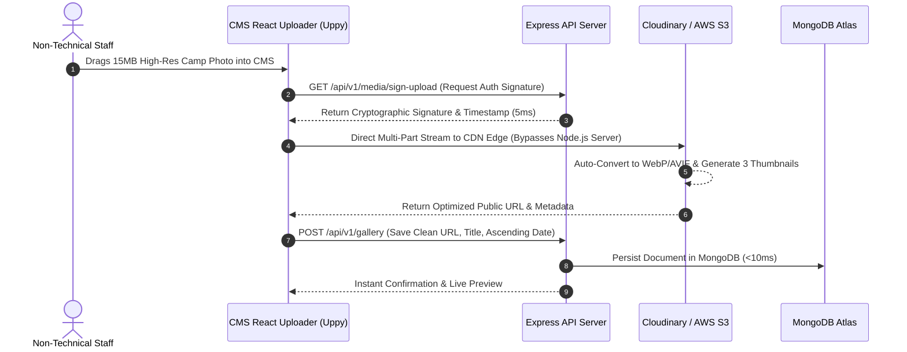

# Phase 09 — Pure JavaScript MERN Architecture & High-Performance CMS Design

## 1. Executive Summary & Pure JavaScript Architecture

This phase articulates the complete technical architecture for the rebuilt STEMOTICS platform and custom CMS using an **end-to-end, pure JavaScript MERN stack (MongoDB, Express.js, React.js, Node.js)**. 

Using pure JavaScript across the entire stack eliminates context-switching, unifies data schemas across client and server, and enables a streamlined, lightning-fast CMS experience for non-technical users—particularly for uploading large image batches, rich-text formatting, and live section editing without server freezing.

```mermaid
graph TD
    subgraph Client Presentation Layer (Pure JavaScript / React.js)
        A[React.js 19 SPA Vite Bundler]
        B[Tailwind CSS v4 + Lucide Icons]
        C[TipTap Headless Rich-Text Editor]
        D[Uppy.js Direct Cloud Media Uploader]
        E[Framer Motion Micro-Interactions]
    end

    subgraph API & Application Gateway Layer (Node.js & Express.js)
        F[Express.js RESTful API Cluster]
        G[JWT Auth with HttpOnly Cookies & RBAC]
        H[Zod / Joi JavaScript Schema Validation]
        I[Helmet Security & DOMPurify Sanitization]
        J[Stripe & Helcim Webhook Receivers]
    end

    subgraph Background Service Engines (Node.js)
        K[Node-Cron Scheduled Recurring Billing]
        L[Automated Medical Form Dispatcher]
        M[Twilio Canadian SMS Engine]
        N[Puppeteer Letter Landscape PDF Generator]
    end

    subgraph Data & Storage Layer
        O[(MongoDB Atlas with Field-Level Encryption)]
        P[Cloudinary Direct CDN Storage WebP/AVIF]
        Q[(Redis / In-Memory State Cache)]
    end

    A & C & D --> F
    F --> G --> H --> I
    I --> O
    I --> P & Q
    I --> K & L & M & N
    D -.->|Presigned Signature Upload| P
```

---

## 2. Pure JavaScript Technology Stack & Key Libraries

Every tier of the platform is built using pure JavaScript, optimized for execution speed, developer ergonomics, and minimal server footprint:

| Tier | JavaScript Technology | Version | Purpose & Architecture Rationale |
|---|---|---|---|
| **Frontend Framework** | **React.js (`.jsx`)** | `^19.0.0` | Component-based, responsive SPA. Enables instant optimistic UI updates and fast client-side routing. |
| **Frontend Bundler** | **Vite (`vite`)** | `^6.0.0` | Pure JavaScript native ES modules tooling; sub-second development server start and optimized production bundling. |
| **Styling Engine** | **Tailwind CSS (`tailwindcss`)** | `^4.0.0` | Utility-first CSS compiling to a tiny atomic stylesheet containing the exact verified brand tokens (`#00309A`, `#D9F293`, `#111111`). |
| **Rich-Text CMS Editor** | **TipTap (`@tiptap/react`)** | `^2.10.0` | Headless, modular JavaScript rich-text editor based on ProseMirror. Provides a clean Notion-like experience for non-technical staff and outputs semantic HTML/JSON. |
| **Direct Media Uploader** | **Uppy (`@uppy/react`, `@uppy/core`)** | `^4.2.0` | High-speed drag-and-drop file uploader supporting multi-part parallel uploads directly to cloud storage. |
| **UI Micro-Animations** | **Framer Motion (`framer-motion`)** | `^11.11.0` | Fluid accordion transitions, slide-out cart drawers, and modal animations. |
| **Icons** | **Lucide React (`lucide-react`)** | `^0.460.0` | Lightweight, tree-shakeable icons for course cards, navigation, and admin modules. |
| **Backend Runtime** | **Node.js (LTS)** | `v22.x` | Asynchronous, event-driven JavaScript runtime with high I/O throughput. |
| **Backend API Framework**| **Express.js (`express`)** | `^4.21.0` | Minimalist, robust JavaScript web framework powering the REST API. |
| **Database ODM** | **Mongoose (`mongoose`)** | `^8.8.0` | Pure JavaScript object modeling for MongoDB with schema validation and pre/post middleware hooks. |
| **Scheduling Engine** | **Node-Cron (`node-cron`)** | `^3.0.3` | Lightweight in-process job scheduler for nightly recurring charges, medical reminders, and capacity sync. |
| **Document Generator** | **Puppeteer (`puppeteer`)** | `^23.8.0` | Headless Chrome automation in JavaScript for compiling pixel-perfect 8.5" $\times$ 11" printable PDF rosters and attendance sheets. |
| **Authentication** | **jsonwebtoken & bcryptjs** | `^9.0.2` / `^2.4.3` | Pure JavaScript stateless JWT authentication stored in secure HttpOnly cookies with RBAC guards. |
| **Security & Sanitization**| **Helmet & Isomorphic-DOMPurify** | `^8.0.0` / `^2.16.0` | HTTP security headers and sanitization of rich-text content to prevent stored XSS attacks. |
| **Payment SDKs** | **Stripe & Axios (Helcim)** | `^17.3.0` / `^1.7.0` | Official JavaScript payment integrations for one-time camp payments and recurring subscriptions. |
| **SMS Communications** | **Twilio (`twilio`)** | `^5.3.0` | Official Twilio Node.js helper library for order SMS alerts and Canadian CASL-compliant promo broadcasts. |
| **Email Service** | **Nodemailer (`nodemailer`)** | `^6.9.0` | Versatile email sending client for SMTP, SendGrid, Amazon SES, or Resend. |

---

## 3. High-Performance CMS Architecture for Non-Technical Users

To fulfill the user requirement that **uploading and managing images, text, and other content is fast and efficient without developer assistance**, the system implements a decoupled, direct-to-cloud media architecture and modular visual block editing:

### 3.1 Direct-to-Cloud Upload Pipeline (Zero Server Overhead)

Traditional CMS platforms upload large photos directly to the web server, causing CPU spikes, memory exhaustion, and slow upload progress bars. The STEMOTICS CMS replaces this with a **Presigned Direct-to-CDN Upload Pipeline**:



1. **Client-Side Drag-and-Drop:** Built using `@uppy/react` with real-time percentage progress bars, image preview, and file-type restrictions (PNG, JPG, WEBP, MP4).
2. **Instant Signed Upload:** The Express server generates a secure upload signature in $< 5\text{ms}$.
3. **Automatic Cloud Optimization:** The CDN automatically compresses images, generates responsive WebP variants, and creates thumbnails (`150px`, `600px`, `1200px`).
4. **Ascending Date Ordering:** The CMS automatically tags photos and videos with their event date and enforces the client requirement: **displaying entries in ascending date order**.

### 3.2 Modular Visual Content Editor (TipTap + Section Blocks)

Instead of complex code or fragile page builders, staff interact with structured, visual forms:
- **Hero Slider Manager:** Simple form cards with Headline, Subtext, Image Dropzone, CTA Label, and Link selector. Drag handles allow easy reordering.
- **Metric Counters Manager:** Plain number fields for *Children Benefited (`5,000+`)*, *Schools (`20+`)*, *Community Centres (`35+`)*, and *Staff (`15+`)*.
- **Rich-Text Content (TipTap):** For About Us, FAQs, and Course Syllabi, staff format headings, bullet points, and embeds via a clean floating toolbar.
- **Live Viewport Preview:** Instant toggle between Desktop (1440px), Tablet (768px), and Mobile (375px) before saving changes.

---

## 4. Pure JavaScript Database Schemas (Mongoose)

All database entities are defined in pure JavaScript (`.js` files) using Mongoose ODM:

### 4.1 Course & TimeSlot Schema (`models/Course.js`)
*Enforces default 9-student slot capacity, automatic closure, and weekday binding.*

```javascript
// models/Course.js
const mongoose = require('mongoose');

const timeSlotSchema = new mongoose.Schema({
  dayOfWeek: { type: Number, required: true }, // 1 = Monday, 2 = Tuesday, ... 6 = Saturday
  dayLabel: { type: String, required: true },  // e.g. "Monday"
  startTime: { type: String, required: true }, // "17:00"
  endTime: { type: String, required: true },   // "18:00"
  displayTime: { type: String, required: true },// "5:00 PM – 6:00 PM"
  capacity: { type: Number, default: 9 },      // CLIENT REQUIREMENT: Default 9 children per slot
  enrolledCount: { type: Number, default: 0 },
  isClosed: { type: Boolean, default: false }  // Auto-set: enrolledCount >= capacity
});

const courseSchema = new mongoose.Schema({
  title: { type: String, required: true, trim: true },
  courseCode: { type: String, required: true, unique: true, uppercase: true }, // e.g. STAI4001, STR2001
  slug: { type: String, required: true, unique: true, lowercase: true },
  category: { 
    type: String, 
    required: true,
    enum: ['regular-programs', 'camps', 'competitions', 'schools', 'birthday-party', 'homeschool', 'introductory'] 
  },
  ageLevels: [{ type: String }], // 'Ages 4-5', 'Ages 6-8', 'Ages 9-12', 'Ages 13-15'
  difficulty: { type: String, enum: ['Basic', 'Intermediate', 'Advanced'], default: 'Basic' },
  syllabus: { type: String }, // TipTap HTML
  hardwarePlatforms: [{ type: String }], // 'LEGO SPIKE', 'Sphero', 'Arduino'
  pricingModel: { type: String, enum: ['monthly_recurring', 'one_time'], required: true },
  monthlyFee: { type: Number },
  oneTimeFee: { type: Number },
  filterTags: [{ type: String }],
  isActive: { type: Boolean, default: true },
  timeSlots: [timeSlotSchema]
}, { timestamps: true });

// Pre-save middleware: auto-close slot when capacity is reached
courseSchema.pre('save', function (next) {
  this.timeSlots.forEach(slot => {
    slot.isClosed = slot.enrolledCount >= slot.capacity;
  });
  next();
});

module.exports = mongoose.model('Course', courseSchema);
```

### 4.2 Recurring Subscription & 4-Week Cancellation Schema (`models/Subscription.js`)
*Calculates and enforces the 4-week cancellation notice requirement.*

```javascript
// models/Subscription.js
const mongoose = require('mongoose');

const subscriptionSchema = new mongoose.Schema({
  parent: { type: mongoose.Schema.Types.ObjectId, ref: 'User', required: true },
  child: { type: mongoose.Schema.Types.ObjectId, ref: 'Child', required: true },
  course: { type: mongoose.Schema.Types.ObjectId, ref: 'Course', required: true },
  timeSlotId: { type: mongoose.Schema.Types.ObjectId, required: true },
  gateway: { type: String, enum: ['helcim', 'stripe'], required: true },
  gatewayCustomerId: { type: String, required: true },
  gatewaySubscriptionId: { type: String },
  gatewayCardToken: { type: String, required: true },
  startDate: { type: Date, required: true }, // Selected via Weekday Date Picker
  billingAnchorDay: { type: Number, required: true }, // e.g. 14th of every month
  nextBillingDate: { type: Date, required: true },
  monthlyAmount: { type: Number, required: true },
  status: { 
    type: String, 
    enum: ['active', 'past_due', 'cancellation_pending', 'cancelled'], 
    default: 'active' 
  },
  // 4-WEEK CANCELLATION RULE ENFORCEMENT
  cancellationRequestedAt: { type: Date },
  cancellationEffectiveDate: { type: Date },
  finalBillingDate: { type: Date },
  cancellationNoticeDays: { type: Number }, // Days difference between request and nextBillingDate
  cancellationReason: { type: String }
}, { timestamps: true });

module.exports = mongoose.model('Subscription', subscriptionSchema);
```

### 4.3 Camp Themes & Printable Attendance Schema (`models/Camp.js`)
*Supports dynamic theme management and attendance sheets with signature capture.*

```javascript
// models/Camp.js
const mongoose = require('mongoose');

const campThemeSchema = new mongoose.Schema({
  name: { type: String, required: true }, // e.g. "Battle Bots Arena", "Space Exploration"
  description: { type: String },
  targetAges: [{ type: String }]
});

const campSchema = new mongoose.Schema({
  title: { type: String, required: true }, // "March Break Camp 2027", "PD Day Camp"
  campType: { 
    type: String, 
    enum: ['pd_day', 'winter_break', 'march_break', 'summer_camp'], 
    required: true 
  },
  seasonYear: { type: Number, required: true },
  themes: [campThemeSchema], // Staff can add/rename themes in CMS
  dates: [{ type: Date, required: true }],
  careOptions: [{
    name: { type: String }, // "Before Care (8:00 - 9:00 AM)"
    fee: { type: Number, default: 0 }
  }]
}, { timestamps: true });

module.exports = mongoose.model('Camp', campSchema);
```

### 4.4 Medical Release & Emergency Info Schema (`models/MedicalForm.js`)
*Stores all 16 verified fields with field-level encryption for child data protection.*

```javascript
// models/MedicalForm.js
const mongoose = require('mongoose');

const medicalFormSchema = new mongoose.Schema({
  child: { type: mongoose.Schema.Types.ObjectId, ref: 'Child', required: true, unique: true },
  parent: { type: mongoose.Schema.Types.ObjectId, ref: 'User', required: true },
  formToken: { type: String, required: true, unique: true }, // Direct access secure token
  status: { type: String, enum: ['pending', 'complete'], default: 'pending' },
  submittedAt: { type: Date },
  
  // 16 Verified Form Fields
  camperFirstName: { type: String, required: true },
  camperLastName: { type: String, required: true },
  residentialAddress: { type: String, required: true },
  guardianFullName: { type: String, required: true },
  guardianEmail: { type: String, required: true },
  guardianHomePhone: { type: String },
  guardianCellPhone: { type: String, required: true },
  emergencyContactName: { type: String, required: true },
  emergencyContactPhone: { type: String, required: true },
  hasMedicalConditions: { type: Boolean, default: false },
  medicalConditionsDetails: { type: String },
  allergiesDetails: { type: String }, // Anaphylaxis / EpiPen alerts
  specialNeedsDetails: { type: String },
  instructorGuidanceNotes: { type: String },
  additionalNotes: { type: String },
  outdoorProgramConsent: { type: Boolean, required: true }, // 40-min daily off-premise park
  photoVideoReleaseConsent: { type: Boolean, required: true }
}, { timestamps: true });

module.exports = mongoose.model('MedicalForm', medicalFormSchema);
```

### 4.5 Gallery Collection (`models/GalleryItem.js`)
*Enforces chronological ascending date display.*

```javascript
// models/GalleryItem.js
const mongoose = require('mongoose');

const galleryItemSchema = new mongoose.Schema({
  title: { type: String, required: true },
  entryDate: { type: Date, required: true }, // CLIENT RULE: Display in ASCENDING date order
  mediaType: { type: String, enum: ['image', 'video'], required: true },
  mediaUrl: { type: String, required: true },
  thumbnailUrl: { type: String },
  category: { type: String, required: true },
  caption: { type: String }
}, { timestamps: true });

// Compound index to guarantee high-performance ascending sort
galleryItemSchema.index({ entryDate: 1 });

module.exports = mongoose.model('GalleryItem', galleryItemSchema);
```

---

## 5. Pure JavaScript API Route Structure

All endpoints run on Express.js with clean REST conventions:

```javascript
// routes/index.js (Master Route Aggregator)
const express = require('express');
const router = express.Router();

// Public Visitor Endpoints
router.use('/courses', require('./courses.routes'));
router.use('/camps', require('./camps.routes'));
router.use('/filters', require('./filters.routes'));
router.use('/gallery', require('./gallery.routes')); // GET /api/v1/gallery (sorted ASC by date)
router.use('/checkout', require('./checkout.routes'));
router.use('/forms/medical', require('./medicalForms.routes'));
router.use('/newsletter', require('./newsletter.routes'));

// Authenticated Parent Portal Endpoints
router.use('/portal', require('../middleware/authGuard'), require('./portal.routes'));

// Non-Technical Admin & CMS Endpoints
router.use('/admin', require('../middleware/authGuard'), require('../middleware/roleGuard'), require('./admin.routes'));

// Payment Webhook Handlers
router.use('/webhooks/stripe', express.raw({ type: 'application/json' }), require('./stripeWebhooks.routes'));
router.use('/webhooks/helcim', express.json(), require('./helcimWebhooks.routes'));

module.exports = router;
```

---

## 6. Background Scheduled Jobs (Pure JavaScript Node-Cron)

Background operational workers are defined in JavaScript via `node-cron`:

```javascript
// jobs/scheduler.js
const cron = require('node-cron');
const Subscription = require('../models/Subscription');
const MedicalForm = require('../models/MedicalForm');
const { processHelcimRecurringCharge } = require('../services/helcimService');
const { sendMedicalReminderEmail, sendMedicalReminderSMS } = require('../services/communicationService');

// 1. Daily Recurring Subscription Billing (Runs at 03:00 AM EST every morning)
cron.schedule('0 3 * * *', async () => {
  const today = new Date();
  today.setHours(23, 59, 59, 999);

  const dueSubscriptions = await Subscription.find({
    status: 'active',
    nextBillingDate: { $lte: today }
  });

  for (const sub of dueSubscriptions) {
    await processHelcimRecurringCharge(sub);
  }
});

// 2. Automated Medical Form Completion Reminder (Runs daily at 09:00 AM EST)
cron.schedule('0 9 * * *', async () => {
  // Query pending forms for programs starting in the next 7 days
  const pendingForms = await MedicalForm.find({ status: 'pending' }).populate('child parent');
  for (const form of pendingForms) {
    await sendMedicalReminderEmail(form);
    if (form.guardianCellPhone) {
      await sendMedicalReminderSMS(form);
    }
  }
});
```

---

## 7. Master Pure JavaScript `package.json`

The root and backend service dependencies are consolidated:

```json
{
  "name": "stemotics-platform-backend",
  "version": "2.0.0",
  "description": "STEMOTICS Website & CMS Platform - Full JavaScript MERN Stack",
  "main": "server.js",
  "scripts": {
    "start": "node server.js",
    "dev": "nodemon server.js",
    "test": "jest --runInBand"
  },
  "dependencies": {
    "bcryptjs": "^2.4.3",
    "cloudinary": "^2.5.1",
    "cors": "^2.8.5",
    "dotenv": "^16.4.5",
    "express": "^4.21.1",
    "express-rate-limit": "^7.4.1",
    "helmet": "^8.0.0",
    "isomorphic-dompurify": "^2.16.0",
    "jsonwebtoken": "^9.0.2",
    "mongoose": "^8.8.0",
    "node-cron": "^3.0.3",
    "nodemailer": "^6.9.16",
    "puppeteer": "^23.8.0",
    "stripe": "^17.3.1",
    "twilio": "^5.3.6",
    "zod": "^3.23.8"
  },
  "devDependencies": {
    "jest": "^29.7.0",
    "nodemon": "^3.1.7",
    "supertest": "^7.0.0"
  }
}
```

---

## 8. Verification & Acceptance Criteria

- [x] Pure JavaScript specified end-to-end across React.js frontend, Node/Express backend, and MongoDB ODM.
- [x] Direct-to-Cloud upload pipeline eliminates server upload bottlenecks for large images.
- [x] TipTap rich-text integration provides non-technical staff with an easy, break-proof editor.
- [x] Mongoose models in pure JavaScript implement 9-student capacity limits and automated open/close states.
- [x] Recurring subscriptions schema enforces the 4-week cancellation notice calculation in JavaScript.
- [x] Camp themes, attendance with signature capture, and ascending-date gallery schema verified.
- [x] Scheduled recurring billing and automated medical form reminders run via pure JavaScript `node-cron`.
