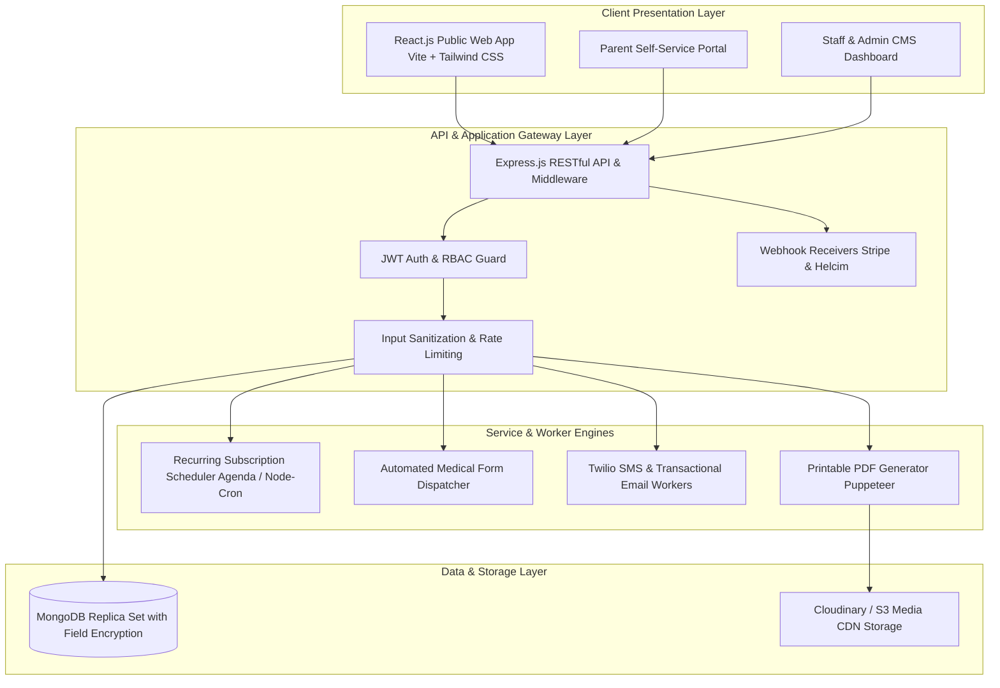

# Phase 09 — MERN Architecture & Database Design

## 1. Executive Summary & Full-Stack Blueprint

This phase articulates the complete technical architecture for the rebuilt STEMOTICS platform using the **MERN stack (MongoDB, Express.js, React.js, Node.js)**.

The architecture is designed for high scalability, responsive performance, non-technical content management, and robust transactional reliability across regular subscriptions and seasonal camps.



---

## 2. Technology Stack & Key Libraries

| Tier | Technology | Purpose & Rationale |
|---|---|---|
| **Frontend Framework** | React.js 19 | Component-based, responsive SPA with fast client hydration and modularity |
| **Build & Tooling** | Vite | Instant HMR development and optimized production tree-shaking |
| **Styling & Design Tokens** | Tailwind CSS v4 | Utility-first styling utilizing exact CSS design tokens from Phase 02 |
| **Icons & Micro-animations** | Lucide-React & Framer Motion | Crisp, lightweight icons and fluid micro-interactions |
| **Backend Runtime** | Node.js (LTS v22) | High-throughput asynchronous event-driven server runtime |
| **API Framework** | Express.js | Robust routing, middleware pipeline, and REST API design |
| **Database** | MongoDB Enterprise / Atlas | Flexible document model accommodating complex courses, custom forms, and dynamic CMS blocks |
| **ODM & Modeling** | Mongoose v8 | Strict schema validation, middleware hooks, and field-level encryption |
| **Authentication** | JWT (JSON Web Tokens) + HttpOnly Cookies | Stateless, secure authentication with 15-minute token rotation |
| **Payments Integration** | Stripe SDK & Helcim Pay.js | Dual-gateway handling one-time purchases and monthly recurring subscriptions |
| **SMS Engine** | Twilio Node SDK | High-reliability Canadian SMS delivery with CASL compliance |
| **Email Service** | SendGrid / Resend / AWS SES | Transactional and bulk broadcast email delivery with open/bounce tracking |
| **PDF Generation Engine** | Puppeteer / React-PDF | Pixel-perfect 8.5" x 11" printable rosters and attendance sheets |

---

## 3. Comprehensive Database Schemas (MongoDB)

All schemas are engineered to directly satisfy the client requirements:

### 3.1 Course & TimeSlot Collection (with 9-Student Default Capacity)

```typescript
// Course Schema
const CourseSchema = new mongoose.Schema({
  title: { type: String, required: true },
  courseCode: { type: String, required: true, unique: true }, // e.g. STAI4001, STR2001
  slug: { type: String, required: true, unique: true },
  category: { type: String, required: true }, // Regular Programs, Camps, Competitions, etc.
  ageLevels: [{ type: String }], // 'Ages 4-5', 'Ages 6-8', 'Ages 9-12', 'Ages 13-15'
  difficulty: { type: String, enum: ['Basic', 'Intermediate', 'Advanced'] },
  syllabus: { type: String },
  hardwarePlatforms: [{ type: String }], // 'LEGO SPIKE', 'Sphero', 'Arduino'
  pricingModel: { type: String, enum: ['monthly_recurring', 'one_time'], required: true },
  monthlyFee: { type: Number },
  oneTimeFee: { type: Number },
  filterTags: [{ type: String }],
  isActive: { type: Boolean, default: true },
  timeSlots: [{
    slotId: { type: mongoose.Schema.Types.ObjectId, default: () => new mongoose.Types.ObjectId() },
    dayOfWeek: { type: Number, required: true }, // 1 = Monday, 2 = Tuesday, ... 6 = Saturday
    dayLabel: { type: String, required: true },  // "Monday"
    startTime: { type: String, required: true }, // "17:00"
    endTime: { type: String, required: true },   // "18:00"
    displayTime: { type: String, required: true },// "5:00 PM – 6:00 PM"
    capacity: { type: Number, default: 9 },      // CLIENT REQUIREMENT: Default 9 children per slot
    enrolledCount: { type: Number, default: 0 },
    isClosed: { type: Boolean, default: false }  // Auto-calculated: enrolledCount >= capacity
  }]
}, { timestamps: true });
```

### 3.2 Recurring Subscription & Cancellation Schema (4-Week Notice)

```typescript
// Subscription Schema
const SubscriptionSchema = new mongoose.Schema({
  parent: { type: mongoose.Schema.Types.ObjectId, ref: 'User', required: true },
  child: { type: mongoose.Schema.Types.ObjectId, ref: 'Child', required: true },
  course: { type: mongoose.Schema.Types.ObjectId, ref: 'Course', required: true },
  timeSlotId: { type: mongoose.Schema.Types.ObjectId, required: true },
  gateway: { type: String, enum: ['helcim', 'stripe'], required: true },
  gatewayCustomerId: { type: String, required: true },
  gatewaySubscriptionId: { type: String },
  gatewayCardToken: { type: String, required: true },
  startDate: { type: Date, required: true }, // Selected via Weekday Date Picker
  billingAnchorDay: { type: Number, required: true }, // e.g. 14th of every month
  nextBillingDate: { type: Date, required: true },
  monthlyAmount: { type: Number, required: true },
  status: { 
    type: String, 
    enum: ['active', 'past_due', 'cancellation_pending', 'cancelled'], 
    default: 'active' 
  },
  // 4-WEEK CANCELLATION RULE FIELDS
  cancellationRequestedAt: { type: Date },
  cancellationEffectiveDate: { type: Date },
  finalBillingDate: { type: Date },
  cancellationNoticeDays: { type: Number }, // Days notice given before next billing date
  cancellationReason: { type: String }
}, { timestamps: true });
```

### 3.3 Camp & Daily Attendance Schema (with Sign-In/Out Signatures)

```typescript
// Camp Schema & Themes
const CampSchema = new mongoose.Schema({
  title: { type: String, required: true }, // e.g., "March Break Camp 2027", "PD Day Camp"
  campType: { type: String, enum: ['pd_day', 'winter_break', 'march_break', 'summer_camp'] },
  seasonYear: { type: Number, required: true },
  themes: [{
    themeId: { type: mongoose.Schema.Types.ObjectId, default: () => new mongoose.Types.ObjectId() },
    name: { type: String, required: true }, // "Battle Bots", "Space Robotics"
    description: { type: String },
    targetAges: [{ type: String }]
  }],
  dates: [{ type: Date, required: true }],
  careOptions: [{
    name: { type: String }, // "Before Care (8:00 - 9:00 AM)", "After Care (4:00 - 5:30 PM)"
    fee: { type: Number }
  }]
}, { timestamps: true });

// Camp Attendance Record Schema
const CampAttendanceSchema = new mongoose.Schema({
  camp: { type: mongoose.Schema.Types.ObjectId, ref: 'Camp', required: true },
  attendanceDate: { type: Date, required: true },
  child: { type: mongoose.Schema.Types.ObjectId, ref: 'Child', required: true },
  theme: { type: String, required: true },
  parentPhone: { type: String, required: true },
  parentEmail: { type: String, required: true },
  signInTime: { type: String }, // "08:55 AM"
  signInParentSignature: { type: String }, // Base64 signature image or audit string
  signOutTime: { type: String }, // "04:15 PM"
  signOutAuthorizedSignature: { type: String },
  staffInitial: { type: String }
}, { timestamps: true });
```

### 3.4 Medical & Emergency Form Schema (16 Verified Fields)

```typescript
// Medical Form Schema
const MedicalFormSchema = new mongoose.Schema({
  child: { type: mongoose.Schema.Types.ObjectId, ref: 'Child', required: true, unique: true },
  parent: { type: mongoose.Schema.Types.ObjectId, ref: 'User', required: true },
  formToken: { type: String, required: true, unique: true }, // Direct access token
  status: { type: String, enum: ['pending', 'complete'], default: 'pending' },
  submittedAt: { type: Date },
  
  // Field-Level Encrypted Fields (AES-256)
  residentialAddress: { type: String, required: true },
  emergencyContactName: { type: String, required: true },
  emergencyContactPhone: { type: String, required: true },
  emergencyRelationship: { type: String, required: true },
  hasMedicalConditions: { type: Boolean, default: false },
  medicalConditionsDetails: { type: String },
  allergiesDetails: { type: String }, // EpiPen alerts
  specialNeedsDetails: { type: String },
  instructorGuidanceNotes: { type: String },
  additionalNotes: { type: String },
  
  // Consents
  outdoorProgramConsent: { type: Boolean, required: true },
  photoVideoReleaseConsent: { type: Boolean, required: true }
}, { timestamps: true });
```

### 3.5 Dynamic Course Filter Group Schema

```typescript
// Course Filter Taxonomy Schema
const CourseFilterSchema = new mongoose.Schema({
  groupName: { type: String, required: true }, // e.g. "Courses", "Age Level", "Difficulty"
  taxonomyKey: { type: String, required: true, unique: true },
  options: [{
    label: { type: String, required: true }, // e.g. "AI, ML & Cyber Security", "Ages 4-5"
    value: { type: String, required: true },
    displayOrder: { type: Number, default: 0 }
  }],
  displayOrder: { type: Number, default: 0 },
  isActive: { type: Boolean, default: true }
}, { timestamps: true });
```

### 3.6 Gallery Collection (Enforcing Ascending Date Order)

```typescript
// Gallery Item Schema
const GalleryItemSchema = new mongoose.Schema({
  title: { type: String, required: true },
  entryDate: { type: Date, required: true }, // CLIENT RULE: Display in ASCENDING date order
  mediaType: { type: String, enum: ['image', 'video'], required: true },
  mediaUrl: { type: String, required: true },
  thumbnailUrl: { type: String },
  category: { type: String, required: true },
  caption: { type: String }
}, { timestamps: true });

// Compound Index to guarantee high-performance ascending sort
GalleryItemSchema.index({ entryDate: 1 });
```

---

## 4. API Endpoints Architecture

### 4.1 Public & Customer API Routes (`/api/v1/`)
- `GET /courses`: Fetch courses with active filters and slot availability.
- `GET /courses/:slug`: Fetch course details, syllabus, and available time slots.
- `GET /camps`: Fetch active seasonal camps, themes, dates, and care options.
- `GET /filters`: Fetch the 5 dynamic filter groups for public directory sidebar.
- `GET /gallery`: Fetch photos and videos sorted in **ascending date order**.
- `GET /cms/pages/:slug`: Fetch visual content blocks for any page.
- `POST /checkout/register`: Process enrollment, tokenize payment, trigger medical form email.
- `POST /forms/medical/submit/:token`: Public parent submission of medical release.
- `POST /newsletter/subscribe`: Public newsletter opt-in.

### 4.2 Parent Portal Routes (`/api/v1/portal/`)
- `GET /portal/dashboard`: Active enrollments, schedules, medical form alerts.
- `GET /portal/subscriptions`: List recurring subscriptions with next billing date.
- `POST /portal/subscriptions/:id/cancel`: Process 4-week cancellation notice calculation.
- `POST /portal/payment-method`: Update saved credit card on file.

### 4.3 Staff Admin Routes (`/api/v1/admin/`)
- `GET /admin/dashboard/metrics`: High-level operational stats and alerts.
- `POST /admin/courses`: Create/edit courses and configure slot limits.
- `GET /admin/enrollment/rosters/:slotId/pdf`: Generate printable PDF roster.
- `GET /admin/camps/attendance/pdf`: Generate printable camp attendance sheets with signature lines.
- `POST /admin/camps/bulk-email`: Dispatch targeted bulk emails to camp parents.
- `GET /admin/medical-forms`: Real-time medical completion tracker.
- `POST /admin/medical-forms/remind/:childId`: 1-click email/SMS reminder.
- `POST /admin/filters`: Add/edit course filter groups and options.
- `POST /admin/marketing/sms`: Dispatch Twilio SMS updates/promotions.

### 4.4 Webhook Receivers (`/api/v1/webhooks/`)
- `POST /webhooks/stripe`: Signature verification for Stripe payment intents and subscriptions.
- `POST /webhooks/helcim`: Signature verification for Helcim recurring transactions.

---

## 5. Background Scheduled Jobs (Agenda / Node-Cron)

1. **Daily Recurring Subscription Billing Job (03:00 AM EST):**  
   Queries `Subscription` collection for active subscriptions where `nextBillingDate <= today`. Charges tokenized card via Helcim/Stripe, updates next billing date by 1 month, and dispatches invoice email.
2. **Medical Form Expiry & Reminder Job (Daily at 09:00 AM EST):**  
   Finds all children registered for upcoming courses starting within 7 days whose medical forms are still `pending`. Dispatches friendly reminder email and SMS to parents.
3. **Capacity Synchronization Worker (Continuous):**  
   Re-computes `enrolledCount` per slot on every enrollment or cancellation, automatically toggling `isClosed = true` at 9 students.

---

## 6. Verification & Acceptance Criteria

- [x] Full-stack MERN stack specified with modern, production-grade libraries.
- [x] Mongoose models accommodate 9-student slot defaults, auto-closure, and date validation.
- [x] Recurring subscription schema implements 4-week cancellation calculations.
- [x] Camp schema supports dynamic themes and printable attendance with signature lines.
- [x] Medical form schema captures all 16 verified fields with field-level encryption.
- [x] Dynamic course filter schema supports the 5 client-specified filter groups.
- [x] Gallery schema indexed for ascending date order display.
- [x] Full RESTful API surface mapped for public, parent portal, and admin modules.
- [x] Background cron scheduler handles recurring charges and reminder emails.
