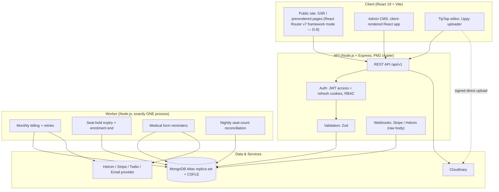
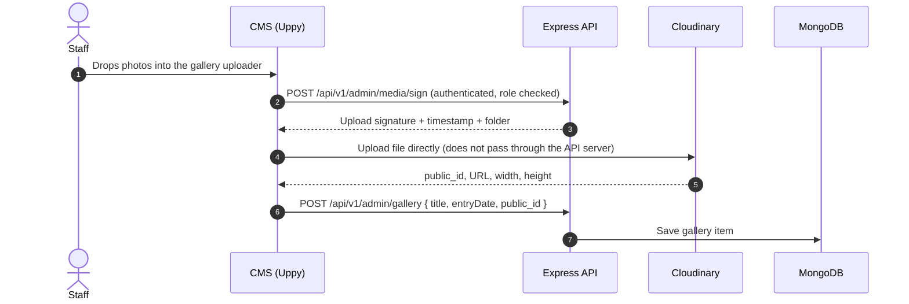
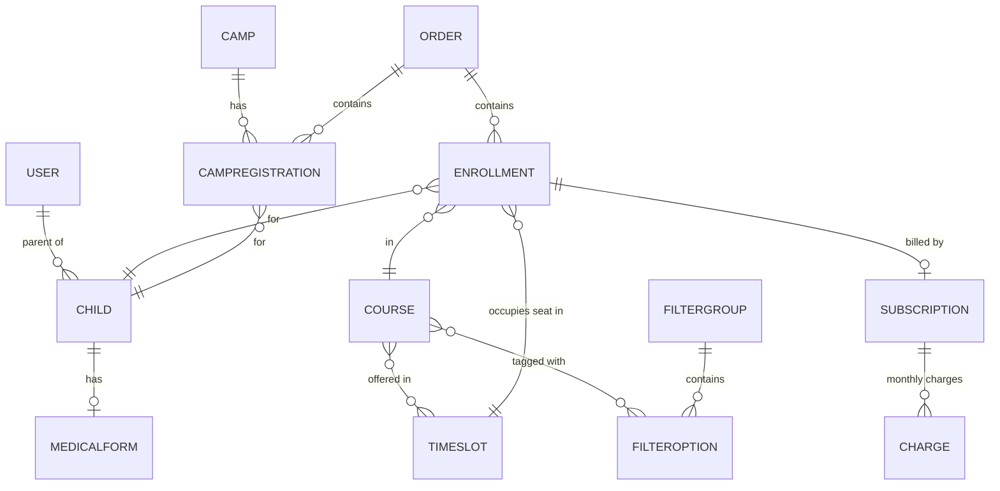

# Phase 09 — MERN Architecture & Data Model

## 1. Executive Summary & Architecture

This phase defines the technical architecture of the STEMOTICS platform on a JavaScript-only MERN stack (MongoDB, Express, React, Node.js). It specifies the data model behind the brief's core rules — **shared time-slot capacity (§1)**, **monthly billing with the 4-week cancellation rule (§5)**, **staff-managed filters (§6)**, **camps and themes (§3)** and the **medical form (§4)** — and how background jobs run safely.



**Key rules:**
- Scheduled jobs run **only in the worker**, never inside the clustered API. With PM2 cluster mode, every API instance would otherwise run the billing job and charge parents several times.
- All business dates (start dates, billing dates, camp dates) are **calendar dates in `America/Toronto`**, stored as `YYYY-MM-DD` strings. Timestamps (createdAt, payment times) are stored as UTC `Date`s.
- Seat reservation, billing and webhooks are **idempotent**: running them twice never double-books or double-charges.

---

## 2. Technology Stack

Versions are pinned to the current stable release at project kickoff (earlier drafts listed late-2024 versions).

| Tier | Technology | Purpose |
|---|---|---|
| Frontend framework | React 19 (`.jsx`) | UI for public site and admin |
| Rendering / routing | React Router v7 framework mode on Vite (D-8) | SSR/prerender for public pages; SPA for admin |
| Styling | Tailwind CSS v4 | Design tokens from [Phase 02](Phase-02-Brand-Design-System.md) |
| Rich text | TipTap (`@tiptap/react`) | Page, FAQ and course description editing |
| Uploads | Uppy (`@uppy/react`) | Signed direct uploads to Cloudinary |
| Animation / icons | Framer Motion (`motion`), Lucide React | UI polish |
| Runtime | Node.js Active LTS (Node 24 at time of writing; Node 22 is end-of-life April 2027) | API and worker |
| API framework | Express 5 | REST API |
| ODM | Mongoose (current major) | Schemas, validation |
| Field encryption | MongoDB CSFLE (`mongodb-client-encryption`) + cloud KMS | Medical/emergency fields ([Phase 08](Phase-08-SEO-Security-Backups.md)) |
| Dates | Luxon | Time-zone-safe calendar maths (`America/Toronto`) |
| Scheduling | node-cron (in the worker only) | Billing, holds, reminders |
| Auth | jsonwebtoken, bcrypt, cookie-parser | Sessions and passwords |
| Security | Helmet, express-rate-limit (shared store if >1 API instance), Zod, DOMPurify (server-side sanitising) | Headers, rate limits, validation, XSS protection |
| Payments | Helcim API (HelcimPay.js), Stripe Node SDK | Per [Decision D-1](README.md#5-pending-decisions) |
| SMS / Email | Twilio Node SDK; Nodemailer with SendGrid / SES / Resend | Notifications |
| Testing | Vitest or Jest, Supertest, `mongodb-memory-server` (replica-set mode), Playwright | Unit, API and end-to-end tests |

---

## 3. Content Editing & Media Uploads

### 3.1 Direct-to-Cloudinary Upload



- Allowed types: JPG, PNG, WebP, HEIC (images); videos default to YouTube links.
- Size limit per file (e.g. 20 MB) enforced both in Uppy and in the Cloudinary upload preset.
- Cloudinary serves resized WebP/AVIF variants on demand (`f_auto,q_auto,w_…`).

### 3.2 Structured Content Editing
Homepage slides, impact figures, staff profiles, testimonials and static pages are edited through structured forms (see [Phase 03](Phase-03-CMS-Architecture.md)). TipTap output is sanitised on the server before saving.

---

## 4. Data Model (Mongoose)

### 4.1 Overview



`User`, `Child` and `Order` are standard and not shown in full. `Child` stores first name, last name, date of birth and parent reference. To keep the snippets short, later snippets omit the `require('mongoose')` / `const { ObjectId } = mongoose.Schema.Types` lines shown in §4.3, and the `module.exports = mongoose.model(...)` line.

### 4.2 Time Slots & Seat Reservation (Brief §1)

Capacity belongs to the **time slot**, shared by every regular program offered in it.

```javascript
// models/TimeSlot.js
const mongoose = require('mongoose');

const timeSlotSchema = new mongoose.Schema({
  dayOfWeek: { type: Number, required: true, min: 1, max: 7 }, // ISO weekday: 1 = Monday ... 7 = Sunday (matches Luxon)
  startTime: { type: String, required: true },                 // "17:00" (America/Toronto)
  endTime: { type: String, required: true },                   // "18:00"
  label: { type: String, required: true },                     // "Monday 5:00 – 6:00 PM"
  capacity: { type: Number, required: true, default: 9, min: 0 }, // Brief §1: default 9, editable per slot
  occupiedCount: { type: Number, required: true, default: 0, min: 0 }, // held + active + cancellation_pending enrolments
  isActive: { type: Boolean, default: true }
}, { timestamps: true });

timeSlotSchema.index({ dayOfWeek: 1, startTime: 1 }, { unique: true });

// "Full" is derived, never stored, so it can't go stale when capacity changes.
timeSlotSchema.virtual('isFull').get(function () {
  return this.occupiedCount >= this.capacity;
});

module.exports = mongoose.model('TimeSlot', timeSlotSchema);
```

```javascript
// services/seatService.js
const TimeSlot = require('../models/TimeSlot');
const { ConflictError } = require('../utils/errors');

// Atomically take a seat only if one is free. Two parents racing for the last
// seat cannot both succeed: MongoDB applies the filter and $inc as one operation.
async function reserveSeat(timeSlotId, session) {
  const slot = await TimeSlot.findOneAndUpdate(
    { _id: timeSlotId, isActive: true, $expr: { $lt: ['$occupiedCount', '$capacity'] } },
    { $inc: { occupiedCount: 1 } },
    { new: true, session }
  );
  if (!slot) throw new ConflictError('TIME_SLOT_FULL'); // API responds 409
  return slot;
}

async function releaseSeat(timeSlotId, session) {
  await TimeSlot.updateOne(
    { _id: timeSlotId, occupiedCount: { $gt: 0 } },
    { $inc: { occupiedCount: -1 } },
    { session }
  );
}

module.exports = { reserveSeat, releaseSeat };
```

**Lifecycle:**
1. **Checkout:** in one transaction, `reserveSeat()` and create the `Enrollment` with `status: 'held'`, `holdExpiresAt = now + 15 min`.
2. **Payment approved** (webhook or synchronous response): enrolment → `active`.
3. **Payment failed / hold expired:** the worker changes `held` → `expired` **with the filter `status: 'held'`** and calls `releaseSeat()` only if that update modified a document, so a seat is never released twice.
4. **Enrolment ends** (service end date passed after cancellation): `cancellation_pending` → `ended`, release seat. The slot reopens automatically.
5. **Staff change capacity:** a plain update of `capacity`; `isFull` is derived, so the slot opens/closes immediately.
6. **Nightly reconciliation:** the worker recounts enrolments per slot and alerts staff if `occupiedCount` ever differs.

Seat-counting start (from booking vs. from start date) is pending [Decision D-7](README.md#5-pending-decisions); this design counts from booking.

### 4.3 Course

```javascript
// models/Course.js
const mongoose = require('mongoose');
const { ObjectId } = mongoose.Schema.Types;

const levelSchema = new mongoose.Schema({
  name: { type: String, required: true },   // "Level 1 – Express Coding Course"
  code: { type: String, required: true }    // "STC2001"
});

const courseSchema = new mongoose.Schema({
  title: { type: String, required: true, trim: true },          // "Coding Junior"
  code: { type: String, required: true, unique: true, uppercase: true }, // "STC2001"
  slug: { type: String, required: true, unique: true, lowercase: true }, // "coding-junior"
  // Business behaviour (fixed list, developer-owned) — separate from display filters.
  productType: { type: String, required: true, enum: ['regular_program', 'camp', 'one_time'] },
  levels: [levelSchema],
  timeSlots: [{ type: ObjectId, ref: 'TimeSlot' }],   // which shared slots this course is offered in
  filterOptions: [{ type: ObjectId, ref: 'FilterOption', index: true }], // Brief §6 tagging
  description: { type: String },                      // sanitised TipTap HTML
  monthlyFee: { type: Number },                       // cents, for regular programs
  oneTimeFee: { type: Number },                       // cents, for one-time products
  ageMin: { type: Number }, ageMax: { type: Number },
  isActive: { type: Boolean, default: true }
}, { timestamps: true });

module.exports = mongoose.model('Course', courseSchema);
```

Money is stored in **cents** (integers) to avoid floating-point rounding.

### 4.4 Filter Groups & Options (Brief §6)

```javascript
// models/FilterGroup.js
const filterGroupSchema = new mongoose.Schema({
  name: { type: String, required: true },          // "Age Level"
  slug: { type: String, required: true, unique: true },
  sortOrder: { type: Number, default: 0 },
  isActive: { type: Boolean, default: true }
}, { timestamps: true });

// models/FilterOption.js
const filterOptionSchema = new mongoose.Schema({
  group: { type: mongoose.Schema.Types.ObjectId, ref: 'FilterGroup', required: true, index: true },
  label: { type: String, required: true },         // "Ages 6-8"
  slug: { type: String, required: true },
  sortOrder: { type: Number, default: 0 }
}, { timestamps: true });
filterOptionSchema.index({ group: 1, slug: 1 }, { unique: true });
```

**Listing query** (OR within a group, AND across groups):

```javascript
// selected = { 'age-level': [optId1, optId2], 'course-categories': [optId3] }
const groupClauses = Object.values(selected)
  .filter(ids => ids.length > 0)                      // no selection in a group = no restriction
  .map(ids => ({ filterOptions: { $in: ids } }));
const filter = { isActive: true, ...(groupClauses.length && { $and: groupClauses }) };
const courses = await Course.find(filter).sort({ title: 1 });
```

Deleting a group/option runs `Course.updateMany({}, { $pull: { filterOptions: { $in: removedIds } } })` in the same transaction.

### 4.5 Enrollment, Subscription & Charge (Brief §5)

```javascript
// models/Enrollment.js
const enrollmentSchema = new mongoose.Schema({
  order: { type: ObjectId, ref: 'Order', required: true },
  child: { type: ObjectId, ref: 'Child', required: true, index: true },
  course: { type: ObjectId, ref: 'Course', required: true },
  levelCode: { type: String },                                  // "STC2002"
  timeSlot: { type: ObjectId, ref: 'TimeSlot', required: true, index: true },
  startDate: { type: String, required: true },                  // "2027-04-12", must fall on the slot's weekday
  status: { type: String, enum: ['held', 'active', 'cancellation_pending', 'ended', 'expired'], default: 'held', index: true },
  holdExpiresAt: { type: Date },
  serviceEndDate: { type: String }                              // set on cancellation
}, { timestamps: true });
```

```javascript
// models/Subscription.js
const subscriptionSchema = new mongoose.Schema({
  enrollment: { type: ObjectId, ref: 'Enrollment', required: true, unique: true },
  parent: { type: ObjectId, ref: 'User', required: true },
  gateway: { type: String, enum: ['helcim', 'stripe'], required: true }, // per Decision D-1
  gatewayCustomerId: { type: String, required: true },
  gatewayCardToken: { type: String, required: true },          // processor token, never card data
  monthlyAmount: { type: Number, required: true },             // cents
  billingAnchorDay: { type: Number, required: true, min: 1, max: 31 }, // day of month from startDate
  nextBillingDate: { type: String, default: null, index: true },       // "YYYY-MM-DD"; null = no more charges
  status: { type: String, enum: ['active', 'cancellation_pending', 'ended'], default: 'active' },
  pastDue: { type: Boolean, default: false },                  // separate from status so a failed charge
                                                               // never loses the cancellation state
  // 4-week rule
  cancellationRequestedAt: { type: Date },
  cancellationCase: { type: String, enum: ['A', 'B'] },
  cancellationNoticeDays: { type: Number },
  finalBillingDate: { type: String, default: null },           // Case B: the one remaining charge date
  serviceEndDate: { type: String }
}, { timestamps: true });
```

```javascript
// models/Charge.js — one document per subscription per billing date
const chargeSchema = new mongoose.Schema({
  subscription: { type: ObjectId, ref: 'Subscription', required: true },
  cycleDate: { type: String, required: true },                 // the billing date being charged
  amount: { type: Number, required: true },
  status: { type: String, enum: ['processing', 'paid', 'failed', 'abandoned'], required: true },
  attempts: { type: Number, default: 0 },
  nextRetryAt: { type: String },
  gatewayTransactionId: { type: String }
}, { timestamps: true });

// The guarantee against double charging: a cycle can only be claimed once.
chargeSchema.index({ subscription: 1, cycleDate: 1 }, { unique: true });
```

**Date helpers and the 4-week rule:**

```javascript
// services/billingDates.js
const { DateTime } = require('luxon');
const TZ = 'America/Toronto';

function todayInToronto() {
  return DateTime.now().setZone(TZ).toISODate();
}

function addDays(isoDate, days) {
  return DateTime.fromISO(isoDate, { zone: TZ }).plus({ days }).toISODate();
}

// Next monthly billing date, clamped for short months: anchor 31 → Feb 28 → Mar 31.
function nextAnchorDate(isoDate, anchorDay) {
  const nextMonth = DateTime.fromISO(isoDate, { zone: TZ }).startOf('month').plus({ months: 1 });
  return nextMonth.set({ day: Math.min(anchorDay, nextMonth.daysInMonth) }).toISODate();
}

// Brief §5: cancel ≥ 4 weeks before the next billing date, otherwise the upcoming month is still charged.
function calculateCancellation(sub, requestDate) {
  const R = DateTime.fromISO(requestDate, { zone: TZ });
  const N = DateTime.fromISO(sub.nextBillingDate, { zone: TZ });
  const noticeDays = Math.round(N.diff(R, 'days').days); // round: DST days are 23/25 hours

  if (noticeDays >= 28) {
    return {
      cancellationCase: 'A',
      noticeDays,
      nextBillingDate: null,          // no further charges
      finalBillingDate: null,
      serviceEndDate: N.minus({ days: 1 }).toISODate()
    };
  }
  const following = nextAnchorDate(sub.nextBillingDate, sub.billingAnchorDay);
  return {
    cancellationCase: 'B',
    noticeDays,
    nextBillingDate: sub.nextBillingDate, // one more charge on N
    finalBillingDate: sub.nextBillingDate,
    serviceEndDate: DateTime.fromISO(following, { zone: TZ }).minus({ days: 1 }).toISODate()
  };
}

module.exports = { TZ, todayInToronto, addDays, nextAnchorDate, calculateCancellation };
```

The parent portal shows the result of `calculateCancellation()` **before** the parent confirms; on confirmation the same values are saved and the status becomes `cancellation_pending`.

### 4.6 Camps & Camp Registrations (Brief §3)

```javascript
// models/Camp.js
const campThemeSchema = new mongoose.Schema({
  name: { type: String, required: true },          // staff-editable (Brief §3)
  description: { type: String },
  ageGroups: [{ type: String }],                   // e.g. "Ages 6-8"
  sortOrder: { type: Number, default: 0 },
  isActive: { type: Boolean, default: true }       // retire instead of delete, keeps history intact
});

const campSchema = new mongoose.Schema({
  name: { type: String, required: true },          // "March Break Camp 2027" — camps are records, not hard-coded types
  campKind: { type: String, required: true },      // "PD Day" | "Winter" | "March Break" (staff-managed list)
  course: { type: ObjectId, ref: 'Course' },       // the product parents buy
  dates: [{ type: String, required: true }],       // "2027-03-15", ...
  themes: [campThemeSchema],
  careOptions: [{ name: String, fee: Number }],    // before/after care, cents
  isActive: { type: Boolean, default: true }
}, { timestamps: true });

// models/CampRegistration.js
const campRegistrationSchema = new mongoose.Schema({
  order: { type: ObjectId, ref: 'Order', required: true },
  camp: { type: ObjectId, ref: 'Camp', required: true, index: true },
  child: { type: ObjectId, ref: 'Child', required: true },
  parent: { type: ObjectId, ref: 'User', required: true },
  themeId: { type: ObjectId, required: true },     // _id of the theme subdocument
  dates: [{ type: String, required: true }],       // days attended (one PD day, or a full week)
  ageAtCamp: { type: Number, required: true },
  careOptions: [{ type: String }],
  status: { type: String, enum: ['active', 'cancelled'], default: 'active' }
}, { timestamps: true });
campRegistrationSchema.index({ camp: 1, dates: 1, themeId: 1 }); // attendance sheet queries
```

Attendance sheets (Brief §3) query `CampRegistration` by camp + date (or week's dates) + theme + age group and join the parent's phone and email.

### 4.7 Medical Form (Brief §4)

```javascript
// models/MedicalForm.js
const requiredWhenComplete = function () { return this.status === 'complete'; };

const medicalFormSchema = new mongoose.Schema({
  child: { type: ObjectId, ref: 'Child', required: true, unique: true }, // one form per child (sent once)
  parent: { type: ObjectId, ref: 'User', required: true },
  status: { type: String, enum: ['pending', 'complete'], default: 'pending', index: true },
  tokenHash: { type: String, required: true, unique: true },   // SHA-256 of the emailed token
  tokenExpiresAt: { type: Date, required: true },
  sentAt: { type: Date }, submittedAt: { type: Date },

  // The 16 live-form fields (Phase 01 §6.7). Required only once the parent submits,
  // so the pending record can be created at enrolment time.
  camperFirstName: { type: String, required: requiredWhenComplete },
  camperLastName: { type: String, required: requiredWhenComplete },
  address: { type: String, required: requiredWhenComplete },             // encrypted (CSFLE)
  guardianFullName: { type: String, required: requiredWhenComplete },
  guardianEmail: { type: String, required: requiredWhenComplete },
  guardianHomePhone: { type: String },
  guardianCellPhone: { type: String, required: requiredWhenComplete },
  emergencyContactName: { type: String, required: requiredWhenComplete }, // encrypted
  emergencyContactPhone: { type: String, required: requiredWhenComplete }, // encrypted
  hasMedicalConditions: { type: Boolean, required: requiredWhenComplete },
  medicalConditionsDetails: { type: String },                            // encrypted [Proposed field]
  allergies: { type: String },                                           // encrypted
  specialNeeds: { type: String },                                        // encrypted
  instructorAssistanceInfo: { type: String },                            // encrypted
  additionalDetails: { type: String },                                   // encrypted
  outdoorProgramConsent: { type: Boolean, required: requiredWhenComplete },
  imageVideoReleaseConsent: { type: Boolean, required: requiredWhenComplete }
}, { timestamps: true });
```

Fields marked "encrypted" are listed in the CSFLE schema map; Mongoose sees them as normal strings because the MongoDB driver encrypts and decrypts transparently. Completion status, child and parent stay unencrypted so rosters can filter on them.

### 4.8 Gallery (Brief §8)

```javascript
// models/GalleryItem.js
const galleryItemSchema = new mongoose.Schema({
  title: { type: String, required: true },
  entryDate: { type: String, required: true },     // "2026-07-22" — Brief §8: display ascending by date
  mediaType: { type: String, enum: ['image', 'video'], required: true },
  cloudinaryPublicId: { type: String },            // images
  videoUrl: { type: String },                      // YouTube link
  category: { type: String },                      // optional tag, e.g. "Camps", "Competitions"
  caption: { type: String },
  isPublished: { type: Boolean, default: true }
}, { timestamps: true });

galleryItemSchema.index({ mediaType: 1, entryDate: 1, createdAt: 1 });
// GET /api/v1/gallery?type=image → find({ mediaType, isPublished: true }).sort({ entryDate: 1, createdAt: 1 })
```

---

## 5. API Structure

```javascript
// app.js
const express = require('express');
const app = express();

// Webhooks are mounted BEFORE express.json(): signature checks need the exact raw body.
app.use('/api/v1/webhooks/stripe', express.raw({ type: 'application/json' }), require('./routes/stripeWebhooks.routes'));
app.use('/api/v1/webhooks/helcim', express.raw({ type: 'application/json' }), require('./routes/helcimWebhooks.routes'));

app.use(express.json({ limit: '1mb' }));
app.use(require('cookie-parser')());
app.use('/api/v1', require('./routes'));
```

```javascript
// routes/index.js
const router = require('express').Router();
const { requireAuth, requireRole } = require('../middleware/auth');

// Public
router.use('/courses', require('./courses.routes'));          // listing with filters, slot availability
router.use('/filters', require('./filters.routes'));
router.use('/camps', require('./camps.routes'));
router.use('/gallery', require('./gallery.routes'));          // sorted ascending by entryDate
router.use('/checkout', require('./checkout.routes'));        // reserves seats, creates orders
router.use('/forms', require('./forms.routes'));              // form builder public links + medical form by token
router.use('/newsletter', require('./newsletter.routes'));    // double opt-in, unsubscribe
router.use('/auth', require('./auth.routes'));                // login, refresh, password reset

// Parent portal
router.use('/portal', requireAuth, require('./portal.routes'));

// Admin — each sub-router also checks its own roles
router.use('/admin', requireAuth, requireRole('staff'), require('./admin.routes'));

module.exports = router;
```

Every request body is validated with Zod. Responses for a full slot use HTTP `409` with code `TIME_SLOT_FULL`.

---

## 6. Background Worker

```javascript
// worker.js — run as exactly ONE process (PM2 fork mode, instances: 1).
// Never start these schedules from the clustered API process.
const cron = require('node-cron');
const { TZ } = require('./services/billingDates');
const jobs = require('./jobs');

const run = (name, fn) => () => fn().catch(err => jobs.reportFailure(name, err));

cron.schedule('0 3 * * *',   run('billing', jobs.runDailyBilling),          { timezone: TZ });
cron.schedule('0 4 * * *',   run('billingRetries', jobs.retryFailedCharges), { timezone: TZ });
cron.schedule('30 3 * * *',  run('endEnrolments', jobs.endFinishedEnrolments), { timezone: TZ });
cron.schedule('*/5 * * * *', run('expireHolds', jobs.releaseExpiredHolds),  { timezone: TZ });
cron.schedule('0 9 * * *',   run('medicalReminders', jobs.sendMedicalFormReminders), { timezone: TZ });
cron.schedule('0 2 * * *',   run('seatReconcile', jobs.reconcileSeatCounts), { timezone: TZ });
```

```javascript
// jobs/billing.js
const Subscription = require('../models/Subscription');
const Charge = require('../models/Charge');
const gateway = require('../services/paymentGateway');      // Helcim/Stripe adapter per Decision D-1
const notify = require('../services/notificationService');
const { todayInToronto, addDays, nextAnchorDate } = require('../services/billingDates');

async function runDailyBilling() {
  const today = todayInToronto();

  // Includes cancellation_pending: Case B subscriptions still owe one final charge.
  const due = await Subscription.find({
    status: { $in: ['active', 'cancellation_pending'] },
    nextBillingDate: { $ne: null, $lte: today }               // "YYYY-MM-DD" strings compare correctly
  });

  for (const sub of due) {
    const cycleDate = sub.nextBillingDate;

    // 1. Claim the cycle. The unique index makes a second run (or a second worker) skip it.
    let charge;
    try {
      charge = await Charge.create({ subscription: sub._id, cycleDate, amount: sub.monthlyAmount, status: 'processing', attempts: 1 });
    } catch (err) {
      if (err.code === 11000) continue;                       // already claimed
      throw err;
    }

    // 2. Charge the saved card. The charge id is sent as the idempotency key where the gateway supports one.
    const result = await gateway.chargeSavedCard(sub, { amount: sub.monthlyAmount, idempotencyKey: String(charge._id) });

    if (result.approved) {
      await onChargeApproved(sub, charge, result);
    } else {
      charge.status = 'failed';
      charge.nextRetryAt = addDays(today, 3);                 // retry policy: +3 days, then +7 days, then abandon
      await charge.save();
      sub.pastDue = true;
      await sub.save();
      await notify.paymentFailed(sub, charge);                // parent email/SMS + staff dashboard alert
    }
  }
}

async function onChargeApproved(sub, charge, result) {
  charge.status = 'paid';
  charge.gatewayTransactionId = result.transactionId;
  await charge.save();

  const isFinalCharge = sub.finalBillingDate && charge.cycleDate === sub.finalBillingDate;
  sub.nextBillingDate = isFinalCharge ? null : nextAnchorDate(charge.cycleDate, sub.billingAnchorDay);
  sub.pastDue = false;
  await sub.save();
  await notify.paymentReceipt(sub, charge);
}

module.exports = { runDailyBilling, onChargeApproved };
```

`retryFailedCharges` picks `failed` charges whose `nextRetryAt` has arrived, claims each with `findOneAndUpdate({ _id, status: 'failed' }, { status: 'processing', $inc: { attempts: 1 } })`, and calls `onChargeApproved` on success. What happens to the enrolment and seat after the last failed retry is a client decision.

**Other jobs:**
- `releaseExpiredHolds`: `held` enrolments past `holdExpiresAt` → `expired`, release seat (see §4.2).
- `endFinishedEnrolments`: subscriptions/enrolments whose `serviceEndDate` < today → `ended`, release seat.
- `sendMedicalFormReminders`: **only** pending forms whose child's first class/camp day is in 3 days, and only once per form — not every pending form every day. Uses the parent's account email/phone (the form's own contact fields are empty until it is submitted).
- `reconcileSeatCounts`: recount `held` + `active` + `cancellation_pending` enrolments per slot and alert on mismatch.

---

## 7. Verification & Acceptance Criteria

- [ ] Capacity is enforced per shared time slot; concurrent checkout test cannot overbook (Phase 10 CAP tests).
- [ ] Seats are released exactly once on hold expiry, cancellation end or payment failure.
- [ ] Filter groups/options are data; listing uses OR within a group and AND across groups.
- [ ] Billing worker runs as a single process; running the billing job twice for the same day charges nobody twice.
- [ ] Case B subscriptions are charged exactly once more and then stop.
- [ ] Anchor days 29–31 bill correctly in short months.
- [ ] Medical form record can be created as `pending` with empty fields; submission enforces required fields.
- [ ] Sensitive medical fields are stored encrypted (verified by reading the raw collection without the key).
- [ ] Webhooks verified on the raw body and processed idempotently.
- [ ] All scheduled jobs use `America/Toronto`.
