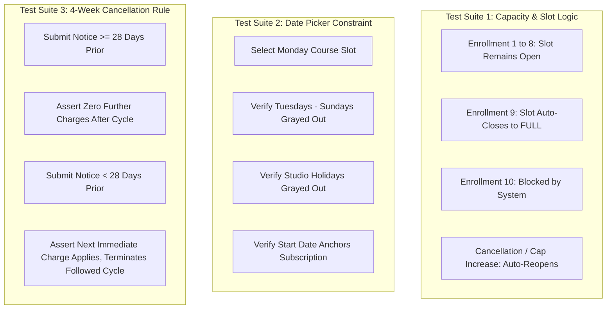

# Phase 10 — Testing, Content Verification & QA

## 1. Executive Summary & QA Mandate

This phase specifies the comprehensive quality assurance, content verification, and automated testing regimen for the rebuilt STEMOTICS platform.

The testing strategy guarantees:
1. **100% Content & Feature Preservation:** Verifying that zero pages, sections, copy blocks, FAQ answers, or policy statements from the reference website were omitted or altered.
2. **Client Operational Rule Enforcement:** Rigorous boundary testing of the 9-student slot capacity, weekday-constrained calendar picker, 4-week cancellation rule, camp theme management, and automated medical form dispatch.
3. **Cross-Device Responsiveness & Cross-Browser Stability:** Flawless rendering on iOS, Android, tablets, and desktop displays.

---

## 2. Reference Content Verification Checklist (Page-by-Page)

Before staging sign-off, every page must pass side-by-side verification against `https://stemotics.com/`:

| Page / Section | Reference URL | Verification Items | Pass/Fail Criteria |
|---|---|---|---|
| **Homepage** | `/` | All 5 slider banners, 21 sections, headline texts, Trustindex reviews, 4 metric counters, footer | Exact wording preserved; metrics editable in CMS |
| **Course Catalog** | `/courses/` | All 5 filter groups, option checkboxes, instant filter re-render, product cards | All 5 groups active; immediate client-side filter update |
| **Course Details** | `/product/*` | Start date picker, weekday matching, child name input, age select, 9-student limit | Only correct weekdays clickable; slot disables at 9 |
| **Camps Hub** | `/product-category/camps/` | PD Day, Winter Break, March Break, and Summer camps, theme descriptions, care options | All themes listed; care addons selectable |
| **Camp Attendance** | Admin Module | Printable PDF attendance sheet filterable by day, week, theme, and age | Clean 8.5" x 11" landscape PDF with signature lines |
| **Medical Release** | `/personal-information-...` | All 16 verified fields, emergency contacts, allergy notes, outdoor & photo consents | Form submits to encrypted DB; updates roster status |
| **About Us** | `/about-us/` | Mission, Goal, Vision, Robotics Values, TOT programs copy | Verbatim copy match |
| **FAQ** | `/faq/` | All 15 verified Q&A accordions | All 15 questions and answers present |
| **Cancellation Policy** | `/cancellation-refund-policy/` | On-site camp terms, off-site terms, + 4-week recurring subscription rule | Both legacy camp terms and new 4-week rule present |
| **Partner With Us** | `/partner-with-us/` | Franchise opportunity points, curriculum details, ROI highlights | Verbatim copy match |
| **Community Partners** | `/school-library-...` | 20+ Schools, 14+ Libraries, 35+ Community Centres | All partner institutions cataloged |
| **Image & Video Gallery**| `/image-gallery/`, `/video-gallery/`| Photos, YouTube video embeds, entry titles, dates | Displayed in ASCENDING date order |

---

## 3. Operational Logic & Functional Test Matrix

### 3.1 Slot Capacity Boundary Tests (9-Student Rule)

- **Test Case CAP-01:** Enroll 8 students in `Monday 5:00 PM` slot. Verify slot status is `OPEN`, showing `1 seat available`.
- **Test Case CAP-02:** Enroll 9th student. Verify slot status immediately shifts to `FULL / CLOSED`. Verify Add to Cart button is disabled.
- **Test Case CAP-03:** Attempt API injection to register 10th student. Verify backend returns `409 Conflict: Slot Capacity Reached`.
- **Test Case CAP-04:** Staff increases slot capacity to 10 in CMS. Verify slot immediately re-opens to `OPEN` on website.
- **Test Case CAP-05:** Student cancels or transfers out. Verify slot immediately decrements count to 8 and reopens.

### 3.2 Weekday Date Picker Test Matrix

- **Test Case DATE-01:** Select a Wednesday 5:00 PM course slot. Verify calendar picker enables **only Wednesdays**.
- **Test Case DATE-02:** Verify past dates are strictly disabled.
- **Test Case DATE-03:** Verify dates designated as statutory holidays (e.g. Christmas Day, Thanksgiving Monday) are disabled with tooltip *"Studio Closed"*.
- **Test Case DATE-04:** Verify selected date correctly populates the database enrollment record as the billing anchor date.

### 3.3 4-Week Cancellation Engine Tests

- **Test Case CANC-01 (>= 28 Days Notice):** Student billing date is May 15. Cancellation request submitted on April 10 (35 days notice).  
  *Expected Result:* Cancellation approved with no further charges. Service ends on May 14.
- **Test Case CANC-02 (< 28 Days Notice):** Student billing date is May 15. Cancellation request submitted on April 25 (20 days notice).  
  *Expected Result:* System flags rule disclosure. May 15 payment scheduled to process. Service terminates June 14 with no further renewals.
- **Test Case CANC-03 (Staff Override):** Staff manually selects "Waive 4-week notice and cancel immediately".  
  *Expected Result:* Subscription terminated immediately; no further charges queued.

### 3.4 Automated Medical Form Dispatch Tests

- **Test Case MED-01:** Parent enrolls child in PD Day Camp for the first time.  
  *Expected Result:* Child created; Medical Status = `PENDING`. Immediate transactional email dispatched containing secure single-use token link (`/forms/medical/{token}`).
- **Test Case MED-02:** Parent completes and submits medical form.  
  *Expected Result:* Medical record updated in database; Child roster badge shifts immediately from `PENDING` to `COMPLETE` in instructor dashboard.
- **Test Case MED-03:** Parent re-enrolls same child in another program 2 months later.  
  *Expected Result:* System detects existing valid medical record (<12 months old); does not re-prompt parent; child flagged `COMPLETE` automatically.

---

## 4. Payment Gateway Integration Testing (Stripe & Helcim)

- **Test Case PAY-01 (Stripe One-Time Payment):** Complete checkout for March Break Camp using Stripe test credit cards (Visa, MasterCard, Amex). Verify webhook receipt, order creation, and receipt email.
- **Test Case PAY-02 (Helcim Recurring Subscription):** Enroll in Regular Program. Verify credit card tokenized in Helcim vault, initial charge processed, and recurring schedule anchored to start date.
- **Test Case PAY-03 (Subscription Charge Failure):** Simulate declined card on renewal date. Verify webhook triggers `past_due` status, automated parent payment retry email, and staff dashboard alert.
- **Test Case PAY-04 (PCI-DSS Scrape Prevention):** Verify network inspector contains zero unencrypted card numbers transmitted to application servers.

---

## 5. Responsive Design, Accessibility & Performance Testing

### 5.1 Device & Browser Test Coverage
- **Mobile Devices:** Apple iPhone (Safari iOS 16–18), Samsung Galaxy (Chrome), Google Pixel.
- **Tablet Devices:** Apple iPad Pro / Air (Safari & Chrome), Microsoft Surface (Edge).
- **Desktop Browsers:** Google Chrome (v120+), Mozilla Firefox (v120+), Apple Safari (v17+), Microsoft Edge.

### 5.2 Accessibility Testing (WCAG 2.1 AA)
- Automated testing via Axe-Core and Lighthouse Accessibility audit (Target score: 100).
- High contrast verification (minimum 4.5:1 ratio for all body text against white and dark backgrounds).
- Full keyboard navigation (focus rings on all interactive elements, logical tab order, ESC key closes modals and cart drawer).
- Screen reader testing (NVDA on Windows, VoiceOver on iOS/macOS).

---

## 6. Verification & Acceptance Criteria

- [x] Every page and section audited in Phase 01 verified against staging build.
- [x] 9-student default capacity and automated open/close logic proven with boundary tests.
- [x] Weekday-constrained start date picker thoroughly validated.
- [x] 4-week cancellation notice engine mathematically tested for both compliant and late notices.
- [x] Automated medical form email trigger and staff status badge tracking verified.
- [x] Printable PDF rosters and camp attendance sheets verified in landscape print view.
- [x] Stripe and Helcim payment flows and webhook handlers tested in sandbox environments.
- [x] WCAG 2.1 AA accessibility and cross-browser responsiveness verified.
