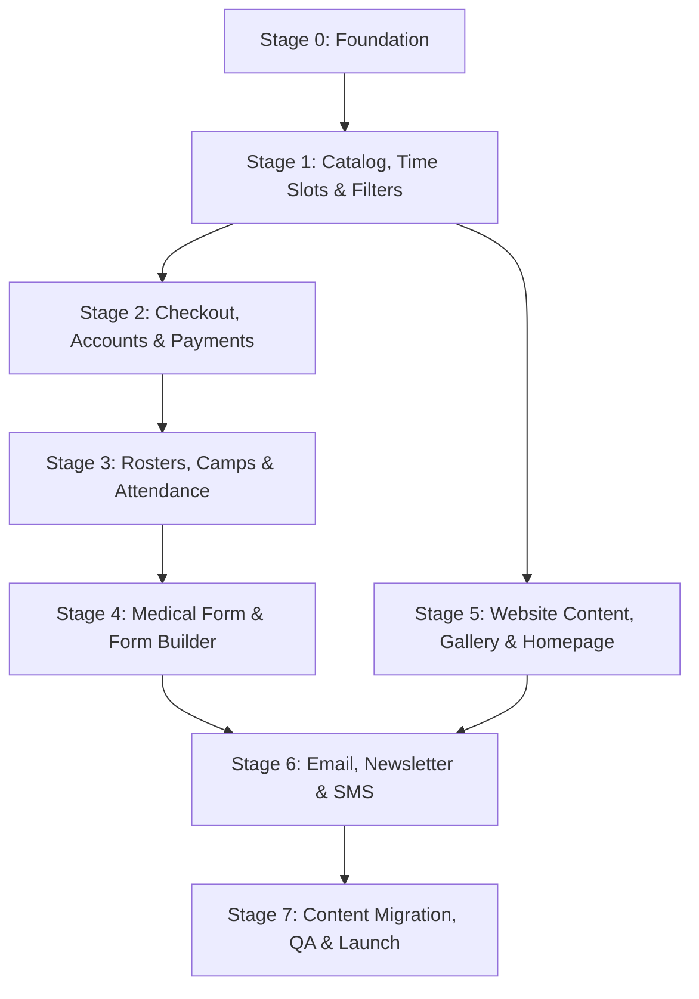
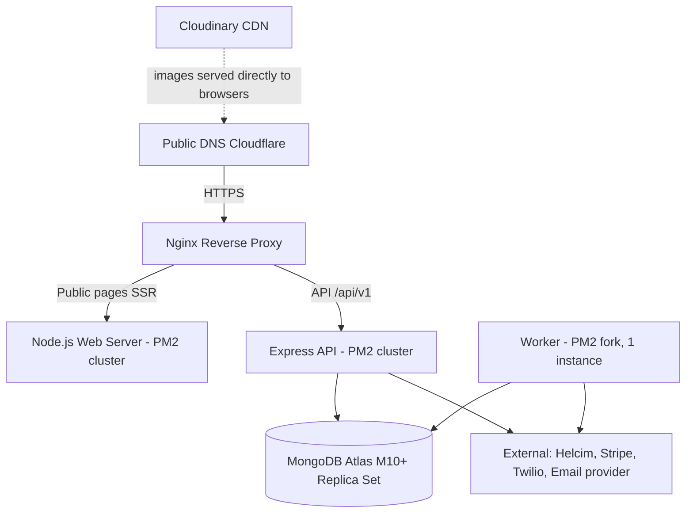
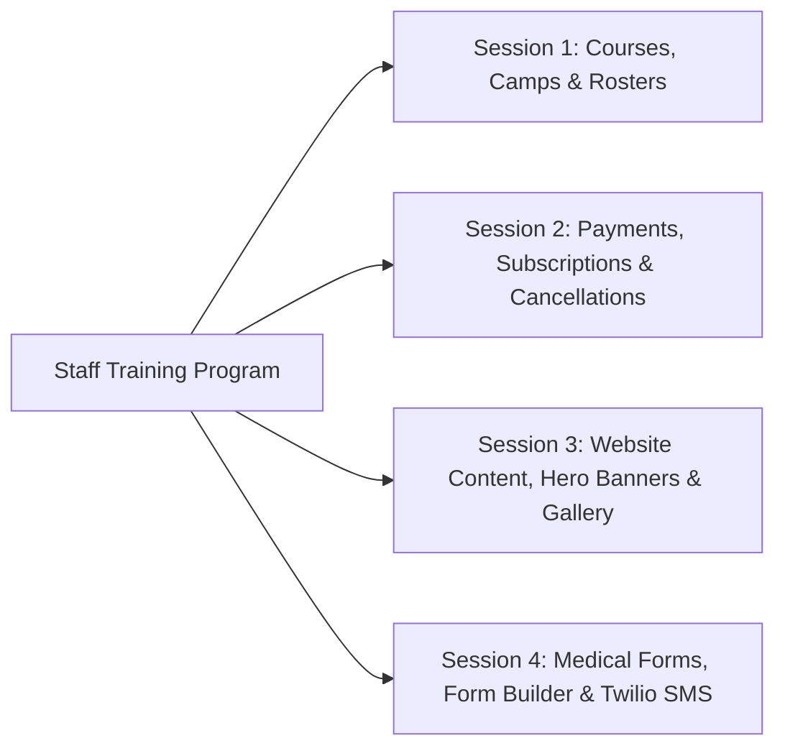

# Phase 11 — Deployment, Training & Handover

## 1. Executive Summary & Delivery Scope

This phase governs the transition of the STEMOTICS platform from staging into production, user acceptance testing (UAT), non-technical staff training, and operational handover.

The client brief (Oct 27, 2026) does **not** specify a development sequence. The sequence below is our **[Proposed]** order, based on technical dependencies. It puts security foundations first, because field encryption, roles and the rendering approach are hard to add later.

---

## 2. Proposed Implementation Sequence

| Stage | Deliverables | Brief | Blocked by |
|---|---|---|---|
| **0. Foundation** | Repo, CI, staging; SSR setup for public pages (D-8); auth (access/refresh cookies), RBAC, audit log; MongoDB Atlas with CSFLE + KMS; worker process skeleton; time zone utilities. | — | D-8 |
| **1. Catalog, Time Slots & Filters** | Course model with levels; shared TimeSlot model with capacity (default 9); FilterGroup/FilterOption admin; course listing with filters; product pages with slot selection and weekday date picker. | §1, §6, §12 | — |
| **2. Checkout, Accounts & Payments** | Cart, guest/account checkout, atomic seat reservation with holds, payment integration, monthly subscriptions, billing worker, 4-week cancellation, parent portal (orders, cancel, new orders, password reset). | §1, §5, §10 | **D-1, D-2, D-7** |
| **3. Rosters, Camps & Attendance** | Per-slot rosters; camps with themes (add/edit/rename); camp registration; attendance sheets with filters; camp bulk email. | §2, §3 | D-3, D-4 |
| **4. Medical Form & Form Builder** | Form builder with shareable links; system medical form (locked core fields); automatic first-enrolment email; per-child status; school registration form. | §4, §11 | D-6, D-11 |
| **5. Website Content** | Homepage (slider, featured programs, impact section, team, testimonials, newsletter sign-up); static pages; gallery (ascending date); LMS link; navigation/footer managers. Can run in parallel with Stages 2–4. | §7, §8, §9 | D-5 |
| **6. Email, Newsletter & SMS** | Newsletter composer with double opt-in/unsubscribe; order SMS; marketing SMS with consent; Twilio sender registration (start early — approval can take weeks). | §7, §10 | — |
| **7. Migration, QA & Launch** | Content migration from the live site; migration plan for existing Helcim customers; redirect map (D-10); full Phase 10 test run; UAT with staff; DNS cutover; training. | All | D-9, D-10 |

**Existing customers:** STEMOTICS currently collects card details manually and enters them into Helcim. Plan how current regular-program families move onto automatic billing (e.g. a "set up your card" email with a link to the parent portal) — this needs a client decision before launch.

---

## 3. Production Deployment Architecture

### 3.1 Infrastructure Specifications
- **Hosting:** A Linux VPS (Ubuntu 24.04 LTS) in Canada is sufficient for this traffic. Kubernetes is not needed.
- **Process Management:** PM2. Web/API in cluster mode for zero-downtime reloads; **worker in fork mode with exactly one instance** (scheduled billing must never run twice).
- **Rate limiting:** if the API runs more than one instance, use a shared rate-limit store (MongoDB or Redis); otherwise limits are per instance.
- **Reverse Proxy:** Nginx with HTTP/2, compression, security headers (HSTS, CSP, X-Frame-Options).
- **TLS:** Let's Encrypt with automatic renewal, or Cloudflare origin certificates.
- **Database:** MongoDB Atlas M10+ in a Canadian region (keeps children's data in Canada), continuous backups with point-in-time restore.
- **Domains:** Staging on `staging.stemotics.com` (password-protected, `noindex`); production cutover to `stemotics.com` with a lowered DNS TTL beforehand.
- **Monitoring:** uptime checks, error tracking, and alerts if the billing job fails or does not run.

---

## 4. Pre-Deployment Verification Checklist

Before pointing production DNS to the rebuilt platform:

- [ ] **Content:** Phase 10 §2 content checklist signed off by STEMOTICS.
- [ ] **Redirects:** every URL from the live sitemaps tested (D-10).
- [ ] **Payments:** sandbox tests pass; production keys installed; a small real transaction made and refunded on each processor.
- [ ] **Shared slot capacity:** CAP tests pass on staging, including the concurrency test.
- [ ] **Date picker:** only the slot's weekday selectable.
- [ ] **4-week rule:** CANC tests pass; cancellation wording approved (D-9).
- [ ] **Medical form:** first-enrolment email sent; status visible on rosters.
- [ ] **Printing:** time-slot rosters and camp attendance sheets printed on paper and checked by staff.
- [ ] **SMS:** Twilio sender registration approved; delivery to Canadian numbers and `STOP` tested.
- [ ] **Email:** SPF, DKIM, DMARC set up for `stemotics.com`.
- [ ] **Worker:** exactly one worker instance running; billing job alert tested.
- [ ] **Security:** OWASP ZAP scan with no high findings; SSL Labs A or better.
- [ ] **Backups:** restore tested on staging, including decrypting medical fields.
- [ ] **Existing customers:** migration plan for current regular-program families agreed and executed.

---

## 5. Non-Technical Staff Training Program [Proposed]

The brief's recurring goal is that staff can manage everything "without needing a developer". Training sessions are recommended to make that real:

### 5.1 Training Modules & Agendas

1. **Session 1 — Courses, Camps & Daily Operations:**
   - Creating a Regular Program or Camp; managing time slots.
   - Setting time-slot capacity (default 9, shared by all programs in the slot).
   - Managing camp themes.
   - Printing time-slot rosters and camp sign-in/out attendance sheets.
2. **Session 2 — Billing, Subscriptions & Cancellations:**
   - Customer accounts and transaction logs.
   - How monthly billing works and what to do with failed payments.
   - The 4-week cancellation rule (Case A / Case B) and any staff overrides.
3. **Session 3 — Website Content & Gallery Management:**
   - Editing page text, images and buttons; editing static pages.
   - Managing homepage slides.
   - Adding photos and videos to the gallery.
   - Updating homepage impact figures, team profiles and testimonials.
4. **Session 4 — Forms, Communications & Marketing:**
   - Tracking medical form completion and sending 1-click reminders.
   - Creating custom forms (e.g. school workshop registration) and generating shareable links.
   - Composing broadcast camp emails with targeted filters.
   - Sending order SMS and promotional SMS blasts via Twilio.

---

## 6. Handover Documentation Package

The client will receive a comprehensive, human-readable **Operations & Administrator Manual**:

1. **Admin User Guide (PDF & Video Tutorials):** Step-by-step walkthroughs with screenshots for every admin action.
2. **Credentials & Vault Handoff:** Secure transfer of all API credentials (Stripe, Helcim, Twilio, SendGrid, MongoDB Atlas, Cloudinary, Domain Registrar).
3. **Disaster Recovery & Support Protocol:** Emergency contacts, daily backup restoration instructions, and hosting support channels.
4. **Client Acceptance & Formal Sign-Off:** Written sign-off verifying that all requirements from the October 27, 2026 specifications have been delivered and verified.

---

## 7. Verification & Acceptance Criteria

- [ ] Implementation sequence agreed with STEMOTICS.
- [ ] Production infrastructure deployed with a single worker instance and automated TLS.
- [ ] Pre-deployment checklist (§4) completed.
- [ ] Staff training delivered (if approved).
- [ ] Documentation package and credentials handed over through a password manager, not email.
- [ ] Written client sign-off against brief §1–§12.
