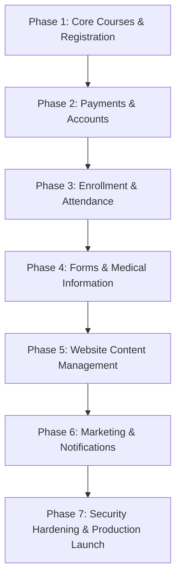
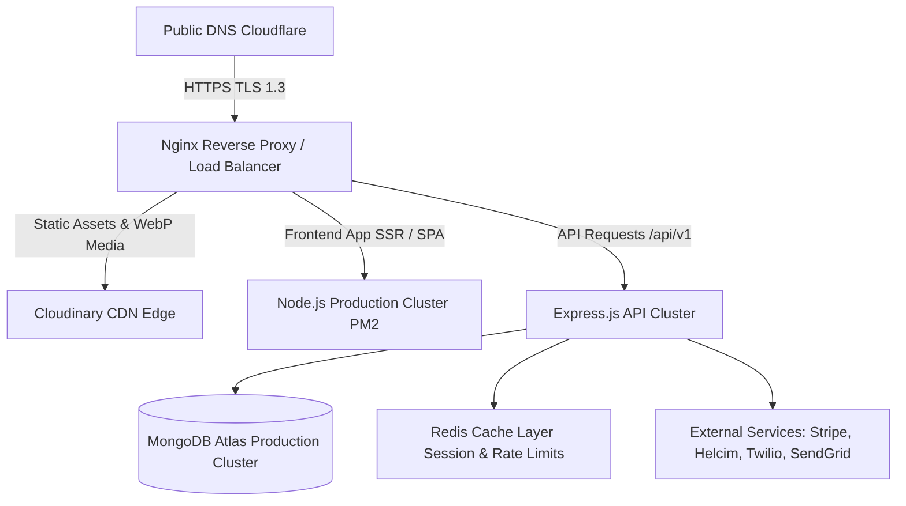
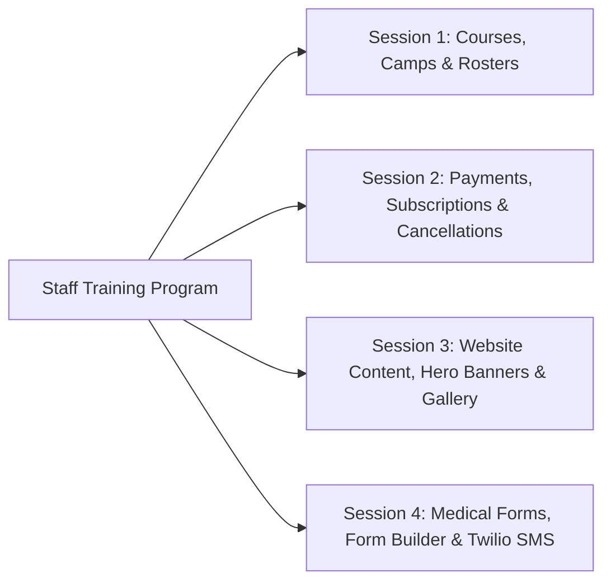

# Phase 11 — Deployment, Training & Handover

## 1. Executive Summary & Delivery Scope

This phase governs the transition of the STEMOTICS platform from staging into production, user acceptance testing (UAT), non-technical staff training, and operational handover.

The implementation order adheres to the **Suggested Development Sequence** outlined in the client requirements brief dated October 27, 2026, ensuring that core dependencies (courses, registration, payments, rosters) are delivered and tested prior to secondary modules.

---

## 2. Implementation Phases & Development Sequence

### Detailed Sequence Breakdown

| Sequence Phase | Focus Areas & Deliverables | Primary User Value |
|---|---|---|
| **1. Core Courses & Registration** | Course schema, categories, 5 dynamic filter groups, weekday date picker, slot capacity engine (default 9). | Visitors can browse and select valid course start dates; capacity is enforced. |
| **2. Payments & Accounts** | Stripe (one-time/camps) & Helcim (recurring subscriptions), guest checkout, Parent Portal, 4-week cancellation engine. | Secure payment processing, subscription management, parent order history. |
| **3. Enrollment & Attendance** | Slot capacity auto-close/reopen, 1-click printable PDF rosters, camp theme management, printable attendance sheets with signature lines. | Staff can run daily operations, manage room limits, and print sign-in sheets. |
| **4. Forms & Medical Information** | Automated medical form trigger upon enrollment, 16 verified fields collection, staff tracking dashboard, drag-and-drop form builder. | 100% compliance with child safety policies and custom school registration forms. |
| **5. Website Content Management** | Visual block editor, homepage hero slider, metric counters, photo/video gallery in ascending date order, static pages, LMS link. | Staff can edit any webpage text, images, buttons, and gallery items independently. |
| **6. Marketing & Notifications** | Bulk email with camp filters, Twilio SMS order alerts and opt-in marketing, newsletter broadcasts, CASL compliance. | Multi-channel communication and seasonal camp re-enrollment campaigns. |
| **7. Production Launch & Handover** | DNS cutover, SSL provisioning, automated backups, staff training workshops, admin documentation. | Live production operation and independent staff self-sufficiency. |

---

## 3. Production Deployment Architecture

### 3.1 Infrastructure Specifications
- **Hosting Environment:** Production Linux VPS (Ubuntu 24.04 LTS) or containerized Kubernetes/Docker cluster.
- **Process Management:** PM2 with cluster mode for zero-downtime reloads.
- **Reverse Proxy:** Nginx configured with HTTP/2, Brotli compression, strict security headers (HSTS, CSP, X-Frame-Options).
- **SSL / TLS:** Let's Encrypt automated SSL certificate renewal (TLS 1.3).
- **Database:** MongoDB Atlas M10+ replica set with automated daily snapshots and continuous point-in-time recovery.
- **Domain & DNS:** Staging on `staging.stemotics.com`, production cutover to `stemotics.com` via Cloudflare with zero downtime.

---

## 4. Pre-Deployment Verification Checklist

Before pointing production DNS to the rebuilt platform:

- [ ] **Content Equivalence Audit:** Every page and section from Phase 01 verified against staging.
- [ ] **SEO Safeguards:** 301 redirects tested for legacy URLs (e.g. `/summer-camp/` -> `/camps/`).
- [ ] **Payment Sandbox Verification:** Successful test transactions for both Stripe (one-time) and Helcim (recurring subscriptions).
- [ ] **Capacity Limits Check:** Verify 9-student limit auto-closes slots and blocks overflow enrollments.
- [ ] **Weekday Date Picker:** Verify that only matching weekdays are selectable for each course slot.
- [ ] **4-Week Cancellation Notice:** Verify calculation logic in parent portal and checkout disclosure.
- [ ] **Medical Form Dispatch:** Verify automated email link sends immediately upon test enrollment.
- [ ] **Printable Sheets:** Generate and print physical test copies of Regular Program rosters and Camp attendance sheets.
- [ ] **Twilio SMS Webhooks:** Verify SMS delivery to Canadian numbers and `STOP` opt-out compliance.
- [ ] **Security Scans:** Pass automated OWASP ZAP vulnerability scan and SSL Labs A+ rating.
- [ ] **Backup Verification:** Perform test database backup and restore on staging cluster.

---

## 5. Non-Technical Staff Training Program

To achieve the client's goal of **complete operational independence without developer intervention**, the handover includes structured training sessions:

### 5.1 Training Modules & Agendas

1. **Session 1 — Courses, Camps & Daily Operations:**
   - How to create a new Regular Program or seasonal Camp.
   - Setting slot capacity (adjusting the default 9-student limit).
   - Managing camp themes.
   - 1-click printing of class rosters and daily sign-in/out attendance sheets.
2. **Session 2 — Billing, Subscriptions & Cancellations:**
   - Navigating customer accounts and transaction logs.
   - How recurring monthly subscriptions process via Helcim and Stripe.
   - Handling the 4-week cancellation rule, understanding automated calculations, and applying staff overrides.
3. **Session 3 — Website Content & Gallery Management:**
   - Using the visual page editor to update text, replace images, and edit buttons.
   - Reordering and updating the 5 hero slider banners.
   - Adding photos and videos to the gallery (ensuring ascending date display).
   - Updating homepage metric counters (children benefited, schools, community centres).
4. **Session 4 — Forms, Communications & Marketing:**
   - Tracking medical form completion and sending 1-click reminders.
   - Creating custom forms (e.g. school workshop registration) and generating shareable links.
   - Composing broadcast camp emails with targeted filters.
   - Sending order SMS and promotional SMS blasts via Twilio.

---

## 6. Handover Documentation Package

The client will receive a comprehensive, human-readable **Operations & Administrator Manual**:

1. **Admin User Guide (PDF & Video Tutorials):** Step-by-step walkthroughs with screenshots for every admin action.
2. **Credentials & Vault Handoff:** Secure transfer of all API credentials (Stripe, Helcim, Twilio, SendGrid, MongoDB Atlas, Cloudinary, Domain Registrar).
3. **Disaster Recovery & Support Protocol:** Emergency contacts, daily backup restoration instructions, and hosting support channels.
4. **Client Acceptance & Formal Sign-Off:** Written sign-off verifying that all requirements from the October 27, 2026 specifications have been delivered and verified.

---

## 7. Verification & Acceptance Criteria

- [x] Implementation sequence follows the client's recommended 6-part dependency order.
- [x] Production infrastructure architecture specified with high availability and automated SSL.
- [x] Pre-deployment checklist covers 100% of functional, legal, and operational requirements.
- [x] Structured 4-session training program designed specifically for non-technical staff.
- [x] Comprehensive documentation package and credentials transfer protocol defined.
- [x] Formal client handover protocol established for final sign-off.
