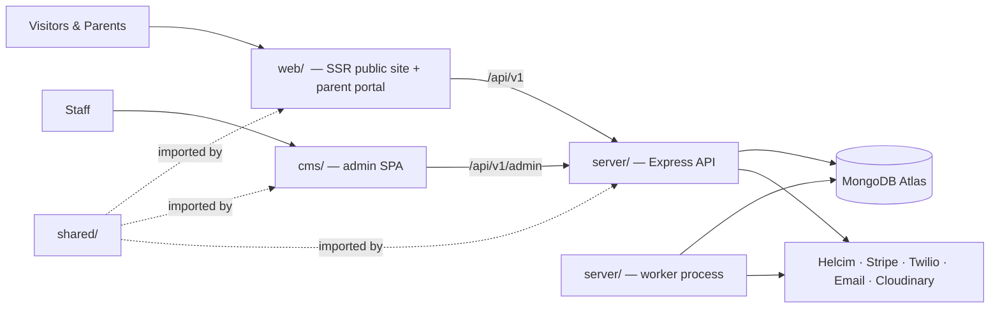

# Project Folder & File Structure

## 1. Overview

The codebase is one Git repository (a **monorepo**) with four top-level folders managed by **npm workspaces**:

| Folder | What it is | Who uses it | Tech |
|---|---|---|---|
| **`web/`** | Public website + Parent Portal (`/account`) | Visitors and parents | React 19, React Router v7 framework mode (SSR), Vite, Tailwind v4 |
| **`cms/`** | Staff admin / CMS | STEMOTICS staff only | React 19 SPA, Vite, React Router, Tailwind v4, TipTap, Uppy |
| **`server/`** | REST API **and** background worker | Called by `web/` and `cms/` | Node.js, Express 5, Mongoose, node-cron |
| **`shared/`** | Code used by more than one app | Imported by `web/`, `cms/`, `server/` | Plain JavaScript |

`web/` and `cms/` are both frontends; neither talks to MongoDB, Helcim, Stripe or Twilio directly. All data and business rules (seat capacity, billing, the 4-week rule, medical form access) live in **`server/`**, so they are enforced the same way no matter which app makes the request.

The Parent Portal (view orders, cancel subscriptions, place orders, reset password — Brief §10) is part of **`web/`**, not `cms/`. The CMS is for staff only.



This structure assumes React Router v7 framework mode for `web/` ([Decision D-8](README.md#5-pending-decisions)). If Next.js is chosen instead, only the inside of `web/` changes.

---

## 2. Root Structure

```text
stemotics/
├── web/                         # Public website + parent portal (SSR)
├── cms/                         # Staff admin / CMS (SPA)
├── server/                      # Express API + background worker
├── shared/                      # Constants, validation schemas, date rules, design tokens
├── e2e/                         # Playwright end-to-end tests across web + cms
├── STEMOTICS_R&D_Documentation/ # These R&D documents (existing folder, unchanged)
├── .github/workflows/           # CI: lint, test, build on every push
├── ecosystem.config.cjs         # PM2: web (cluster), api (cluster), worker (fork × 1)
├── package.json                 # npm workspaces + root scripts
├── package-lock.json
├── .nvmrc                       # Node version (current Active LTS)
├── .editorconfig
├── .gitignore                   # node_modules, dist, build, .env*
├── eslint.config.js             # One lint config for all workspaces
├── .prettierrc
└── README.md                    # How to install, run and deploy
```

**Root `package.json`:**

```json
{
  "name": "stemotics",
  "private": true,
  "workspaces": ["web", "cms", "server", "shared"],
  "scripts": {
    "dev": "concurrently -n server,web,cms \"npm run dev -w server\" \"npm run dev -w web\" \"npm run dev -w cms\"",
    "dev:worker": "npm run worker -w server",
    "build": "npm run build -w web && npm run build -w cms",
    "test": "npm test --workspaces --if-present",
    "test:e2e": "playwright test --config e2e/playwright.config.js",
    "lint": "eslint ."
  },
  "devDependencies": {
    "concurrently": "*",
    "eslint": "*",
    "prettier": "*",
    "@playwright/test": "*"
  }
}
```

(`"*"` is a placeholder — pin current versions at kickoff.)

---

## 3. `web/` — Public Website & Parent Portal

```text
web/
├── app/
│   ├── root.jsx                      # HTML shell, <head>, header, footer, error boundary
│   ├── routes.js                     # Route table (URL → route file)
│   ├── routes/
│   │   ├── home.jsx                  # /                       Brief §7
│   │   ├── courses.jsx               # /courses/               Brief §6 filters
│   │   ├── product.jsx               # /product/:slug/         slot picker + weekday date picker (§1, §12)
│   │   ├── product-category.jsx      # /product-category/:slug/
│   │   ├── image-gallery.jsx         # /image-gallery/         Brief §8 (ascending date)
│   │   ├── video-gallery.jsx         # /video-gallery/
│   │   ├── cms-page.jsx              # /:slug/  About Us, Contact Us, FAQ, Policy, Partner With Us (§9)
│   │   ├── cart.jsx                  # /cart/
│   │   ├── checkout.jsx              # /checkout/              guest or account (§10)
│   │   ├── order-success.jsx         # /order-success/
│   │   ├── form.jsx                  # /forms/:slug            form-builder public link (§11)
│   │   ├── medical-form.jsx          # /forms/medical/:token   medical form link (§4)
│   │   ├── newsletter-confirm.jsx    # /newsletter/confirm/:token
│   │   ├── newsletter-unsubscribe.jsx
│   │   ├── account/                  # Parent portal (login required)
│   │   │   ├── layout.jsx            # Auth guard + portal navigation
│   │   │   ├── index.jsx             # /account/               overview
│   │   │   ├── orders.jsx            # /account/orders/        view orders (§10)
│   │   │   ├── subscriptions.jsx     # /account/subscriptions/ cancel with 4-week rule (§5, §10)
│   │   │   ├── children.jsx          # /account/children/      medical form status
│   │   │   └── settings.jsx          # /account/settings/      password, contact details
│   │   ├── login.jsx                 # /login/
│   │   ├── register.jsx              # /register/
│   │   ├── forgot-password.jsx       # /forgot-password/       (§10)
│   │   ├── reset-password.jsx        # /reset-password/:token
│   │   ├── sitemap[.]xml.js          # /sitemap.xml            generated from courses + pages
│   │   └── robots[.]txt.js           # /robots.txt
│   ├── components/
│   │   ├── layout/                   # Header.jsx, UtilityBar.jsx, Footer.jsx, MobileMenu.jsx, CartDrawer.jsx
│   │   ├── home/                     # HeroSlider.jsx, FeaturedPrograms.jsx, ImpactCounters.jsx,
│   │   │                             # TeamSection.jsx, Testimonials.jsx, NewsletterSignup.jsx
│   │   ├── courses/                  # FilterSidebar.jsx, FilterChips.jsx, CourseCard.jsx, CourseGrid.jsx
│   │   ├── booking/                  # TimeSlotPicker.jsx, WeekdayDatePicker.jsx, LevelSelect.jsx
│   │   ├── checkout/                 # CheckoutSteps.jsx, ChildDetails.jsx, PaymentFields.jsx,
│   │   │                             # CancellationRuleNotice.jsx
│   │   ├── portal/                   # SubscriptionCard.jsx, CancelSubscriptionDialog.jsx
│   │   ├── gallery/                  # GalleryGrid.jsx, Lightbox.jsx, VideoModal.jsx
│   │   ├── forms/                    # FormRenderer.jsx (renders form-builder JSON), field components
│   │   └── ui/                       # Button.jsx, Badge.jsx, Dialog.jsx, Input.jsx, Select.jsx, Spinner.jsx
│   ├── lib/
│   │   ├── api.server.js             # API calls made during SSR (loaders/actions)
│   │   ├── api.client.js             # API calls made in the browser
│   │   ├── seo.js                    # <title>/meta/OpenGraph + JSON-LD helpers (Phase 08)
│   │   └── format.js                 # Price (cents → $), date display
│   ├── hooks/                        # useCart.js, useAuth.js
│   └── styles/
│       └── app.css                   # @import "tailwindcss"; @import shared tokens
├── public/                           # favicon, logo, static images
├── react-router.config.js            # ssr: true (or prerender list)
├── vite.config.js                    # dev proxy /api → server
├── .env.example                      # VITE_PUBLIC_*, API_URL (no secrets)
└── package.json
```

**Notes:**
- Route paths follow the URL strategy chosen in [Decision D-10](README.md#5-pending-decisions). The table above uses the existing WordPress paths (Option A); with Option B only `routes.js` and the redirect map change.
- Static pages (§9) are **one route** (`cms-page.jsx`) that loads the page content by slug from the API — staff can edit them in the CMS without a deploy.
- Payment card fields (`PaymentFields.jsx`) only embed HelcimPay.js / Stripe Elements; card data never passes through our code ([Phase 08 §3](Phase-08-SEO-Security-Backups.md)).

---

## 4. `cms/` — Staff Admin

One folder per admin module from [Phase 03 §2](Phase-03-CMS-Architecture.md).

```text
cms/
├── src/
│   ├── main.jsx                      # Entry: router, auth provider, query client
│   ├── App.jsx                       # Layout: sidebar, top bar, LMS link
│   ├── router.jsx                    # Route table + role guards
│   ├── pages/
│   │   ├── LoginPage.jsx
│   │   ├── dashboard/                # 1. Dashboard [Proposed]
│   │   │   └── DashboardPage.jsx
│   │   ├── programs/                 # 2. Programs & Camps (§3, §6)
│   │   │   ├── CoursesListPage.jsx
│   │   │   ├── CourseEditPage.jsx    # levels, slots offered, filter tags, prices
│   │   │   ├── TimeSlotsPage.jsx     # shared slots + capacity (default 9) (§1)
│   │   │   ├── CampsListPage.jsx
│   │   │   └── CampEditPage.jsx      # dates, themes add/edit/rename/retire, care options
│   │   ├── enrollment/               # 3. Enrollment & Attendance (§1–§3)
│   │   │   ├── SlotRosterPage.jsx    # printable roster per time slot (§2)
│   │   │   ├── CampAttendancePage.jsx# printable sheet, filter day/week/theme/age (§3)
│   │   │   └── EnrollmentsPage.jsx
│   │   ├── payments/                 # 4. Payments & Customers (§5, §10)
│   │   │   ├── CustomersPage.jsx
│   │   │   ├── CustomerDetailPage.jsx
│   │   │   ├── SubscriptionsPage.jsx # past-due, cancellations, overrides
│   │   │   └── TransactionsPage.jsx
│   │   ├── medical/                  # 5. Medical Forms (§4)
│   │   │   ├── MedicalStatusPage.jsx # pending list, resend link
│   │   │   └── EmergencyCardPage.jsx
│   │   ├── filters/                  # 6. Course Filters (§6)
│   │   │   └── FilterGroupsPage.jsx  # add/remove groups and options
│   │   ├── content/                  # 7. Content Management (§7–§9)
│   │   │   ├── HomepagePage.jsx      # slider, featured programs, impact figures
│   │   │   ├── PagesListPage.jsx     # About, Contact, FAQ, Policy, Partner With Us
│   │   │   ├── PageEditPage.jsx
│   │   │   ├── GalleryPage.jsx       # title + date, ascending order (§8)
│   │   │   ├── TeamPage.jsx          # teachers & staff photos and details
│   │   │   ├── TestimonialsPage.jsx
│   │   │   ├── NavigationPage.jsx    # header menu, footer columns
│   │   │   └── MediaLibraryPage.jsx
│   │   ├── marketing/                # 8. Marketing & Notifications (§3, §7, §10)
│   │   │   ├── CampEmailPage.jsx     # bulk email to camp parents with filters
│   │   │   ├── NewslettersPage.jsx
│   │   │   ├── NewsletterEditPage.jsx
│   │   │   ├── SubscribersPage.jsx
│   │   │   └── SmsPage.jsx           # marketing SMS to opted-in customers
│   │   ├── forms/                    # 9. Form Builder (§11)
│   │   │   ├── FormsListPage.jsx
│   │   │   ├── FormBuilderPage.jsx   # drag-and-drop fields, publish, copy link
│   │   │   └── SubmissionsPage.jsx   # table + CSV export
│   │   └── settings/
│   │       ├── StaffUsersPage.jsx    # staff accounts and roles (RBAC)
│   │       └── AuditLogPage.jsx      # medical data access log
│   ├── components/
│   │   ├── layout/                   # Sidebar.jsx, TopBar.jsx, RoleGate.jsx
│   │   ├── editor/                   # RichTextEditor.jsx (TipTap), SectionForm.jsx
│   │   ├── media/                    # Uploader.jsx (Uppy → Cloudinary), MediaPicker.jsx
│   │   ├── form-builder/             # FieldPalette.jsx, Canvas.jsx, FieldSettings.jsx
│   │   ├── print/                    # PrintLayout.jsx + print.css (Letter landscape)
│   │   ├── tables/                   # DataTable.jsx, Filters.jsx, ExportCsvButton.jsx
│   │   └── ui/                       # Shared admin UI primitives
│   ├── lib/
│   │   ├── api.js                    # fetch wrapper (cookies, CSRF header, 401 → login)
│   │   └── permissions.js            # which role sees which menu item
│   ├── hooks/                        # useAuth.js, useDebounce.js
│   └── styles/
│       └── app.css
├── index.html                        # <meta name="robots" content="noindex">
├── vite.config.js                    # base: '/admin/', dev proxy /api → server
├── .env.example
└── package.json
```

**Notes:**
- The CMS is client-rendered; it doesn't need SEO and is marked `noindex`.
- Hiding menu items by role (`RoleGate.jsx`) is only for convenience. **The API enforces every permission** ([Phase 03 §6](Phase-03-CMS-Architecture.md)).
- Print pages (`SlotRosterPage`, `CampAttendancePage`) use `components/print/` and the browser's Print / Save as PDF.

---

## 5. `server/` — API & Worker

```text
server/
├── src/
│   ├── server.js                     # Starts the HTTP API (PM2 cluster)
│   ├── worker.js                     # Starts scheduled jobs (PM2 fork, exactly 1 instance)
│   ├── app.js                        # Express app: webhooks (raw body) → json → routes → errors
│   ├── config/
│   │   ├── env.js                    # Reads + validates env vars with Zod; fails fast if missing
│   │   ├── db.js                     # Mongoose connection with CSFLE auto-encryption options
│   │   └── encryptionSchema.js       # Which MedicalForm fields are encrypted
│   ├── models/                       # Mongoose models (Phase 09 §4)
│   │   ├── User.js  Child.js  Order.js
│   │   ├── Course.js  TimeSlot.js  FilterGroup.js  FilterOption.js
│   │   ├── Enrollment.js  Subscription.js  Charge.js
│   │   ├── Camp.js  CampRegistration.js
│   │   ├── MedicalForm.js  Form.js  FormSubmission.js
│   │   ├── Page.js  SiteSettings.js  Slide.js  TeamMember.js  Testimonial.js
│   │   ├── GalleryItem.js  Media.js
│   │   ├── NewsletterSubscriber.js  Newsletter.js  MessageLog.js
│   │   └── AuditLog.js  WebhookEvent.js
│   ├── routes/
│   │   ├── index.js                  # Mounts everything under /api/v1
│   │   ├── public/                   # courses, filters, camps, gallery, pages, forms, newsletter, checkout
│   │   ├── auth.routes.js            # login, refresh, logout, forgot/reset password
│   │   ├── portal/                   # orders, subscriptions (cancel), children, medical status
│   │   ├── admin/                    # one file per CMS module (programs, timeSlots, camps, rosters,
│   │   │                             # payments, medical, filters, content, gallery, marketing, forms, users)
│   │   └── webhooks/                 # stripe.routes.js, helcim.routes.js, twilio.routes.js
│   ├── controllers/                  # Thin: read request → call service → send response
│   ├── services/                     # All business rules live here
│   │   ├── seatService.js            # reserveSeat / releaseSeat (§1)
│   │   ├── billingDates.js           # Toronto dates, nextAnchorDate, calculateCancellation (§5)
│   │   ├── subscriptionService.js    # create, cancel (Case A/B), staff override
│   │   ├── checkoutService.js        # cart → order → seat hold → payment
│   │   ├── payments/
│   │   │   ├── index.js              # chooses processor per Decision D-1
│   │   │   ├── helcim.js
│   │   │   └── stripe.js
│   │   ├── medicalFormService.js     # create pending form, tokens, submit, status (§4)
│   │   ├── rosterService.js          # per-slot roster, camp attendance data (§2, §3)
│   │   ├── filterService.js          # listing query: OR within group, AND across groups (§6)
│   │   ├── emailService.js           # transactional + bulk email
│   │   ├── smsService.js             # Twilio, opt-in checks (§10)
│   │   ├── newsletterService.js      # double opt-in, send, unsubscribe (§7)
│   │   ├── mediaService.js           # Cloudinary upload signatures
│   │   ├── sanitizeService.js        # Clean TipTap HTML before saving
│   │   └── auditService.js
│   ├── jobs/                         # Run only by worker.js (Phase 09 §6)
│   │   ├── billing.js                # runDailyBilling, retryFailedCharges
│   │   ├── enrolments.js             # releaseExpiredHolds, endFinishedEnrolments
│   │   ├── medicalReminders.js
│   │   ├── reconcileSeats.js
│   │   └── index.js
│   ├── middleware/
│   │   ├── auth.js                   # requireAuth, requireRole
│   │   ├── csrf.js
│   │   ├── rateLimit.js
│   │   ├── validate.js               # Runs Zod schemas from shared/
│   │   └── errorHandler.js           # Maps errors (e.g. TIME_SLOT_FULL → 409)
│   ├── templates/
│   │   ├── email/                    # order-confirmation, medical-form-link, payment-failed,
│   │   │                             # cancellation-confirmation, password-reset, newsletter-confirm
│   │   └── sms/                      # order-confirmation.js
│   └── utils/                        # errors.js, logger.js, tokens.js (random + hash)
├── scripts/
│   ├── seed.js                       # Filter groups, time slots, 3 camps, pages (from Phase 01)
│   └── create-admin.js               # First Super Admin account
├── tests/
│   ├── unit/                         # billingDates, filterService, calculateCancellation
│   ├── api/                          # Supertest: CAP-*, CANC-*, MED-* from Phase 10
│   └── setup.js                      # mongodb-memory-server in replica-set mode
├── .env.example                      # MONGODB_URI, JWT secrets, HELCIM_*, STRIPE_*, TWILIO_*, ...
└── package.json                      # scripts: dev, start, worker, test, seed
```

**Layering rule:** `routes → controllers → services → models`. Controllers stay thin; anything that is a business rule from the brief goes in a **service**, so it can be unit-tested and reused by both the API and the worker.

---

## 6. `shared/` — Code Used by More Than One App

```text
shared/
├── src/
│   ├── constants.js          # TIME_ZONE = 'America/Toronto', DEFAULT_SLOT_CAPACITY = 9,
│   │                         # CANCELLATION_NOTICE_DAYS = 28, PRODUCT_TYPES, ROLES
│   ├── schemas/              # Zod schemas: checkout, child, medicalForm, newsletterSignup, contact
│   │                         # → same validation in the browser (web/cms) and on the server
│   ├── dates.js              # isAllowedStartDate(dateISO, slotWeekday), toronto date helpers
│   │                         # → web date picker and server use the same weekday rule (§12)
│   ├── money.js              # cents ↔ display
│   └── index.js
├── styles/
│   └── tokens.css            # Tailwind v4 @theme brand tokens (Phase 02), imported by web and cms
└── package.json              # "name": "@stemotics/shared"
```

**Rule:** `shared/` must never contain secrets, database code or server-only logic, because it is bundled into the browser apps. Billing, seat reservation and medical-data access stay in `server/`.

Usage: `import { DEFAULT_SLOT_CAPACITY } from '@stemotics/shared';`

---

## 7. How the Apps Connect

### 7.1 Local development

| App | Command | URL |
|---|---|---|
| server (API) | `npm run dev -w server` | `http://localhost:4000/api/v1` |
| worker | `npm run dev:worker` | — (start only when testing jobs) |
| web | `npm run dev -w web` | `http://localhost:5173` |
| cms | `npm run dev -w cms` | `http://localhost:5174/admin/` |

`npm run dev` at the root starts server, web and cms together. Both Vite configs proxy `/api` to `localhost:4000`, so cookies work without CORS setup.

### 7.2 Production (one domain)

| URL | Served by |
|---|---|
| `stemotics.com/` | `web/` SSR server (PM2 cluster) |
| `stemotics.com/admin/` | `cms/` built static files, served by Nginx |
| `stemotics.com/api/` | `server/` API (PM2 cluster) |
| — | `server/` worker (PM2 fork, 1 instance) |

**Recommendation:** serve the CMS at `/admin/` on the same domain rather than `admin.stemotics.com`. Same-origin keeps auth cookies, CSRF protection and CORS simple. A subdomain also works if preferred, but then needs CORS and cookie-domain configuration.

```js
// ecosystem.config.cjs
module.exports = {
  apps: [
    { name: 'web',    script: 'npm', args: 'start -w web',    exec_mode: 'cluster', instances: 2 },
    { name: 'api',    script: 'server/src/server.js',         exec_mode: 'cluster', instances: 2 },
    { name: 'worker', script: 'server/src/worker.js',         exec_mode: 'fork',    instances: 1 } // never more than 1
  ]
};
```

---

## 8. Conventions

| Item | Convention | Example |
|---|---|---|
| React components | PascalCase `.jsx` | `TimeSlotPicker.jsx` |
| Other JS files | camelCase `.js` | `seatService.js` |
| web route files | kebab-case, matching the URL | `image-gallery.jsx` |
| Models | Singular PascalCase | `CampRegistration.js` |
| API URLs | `/api/v1/<plural-noun>` | `/api/v1/time-slots` |
| Env files | `.env` per app, never committed; `.env.example` committed | `server/.env.example` |
| Browser env vars | Prefix `VITE_`; **never** secrets | `VITE_HELCIM_JS_TOKEN` is public, `HELCIM_API_TOKEN` is server-only |
| Money | Integer cents | `12999` = $129.99 |
| Business dates | `YYYY-MM-DD` strings in `America/Toronto` | `"2027-04-12"` |
| Module system | ES modules in `web/`, `cms/`, `shared/`; ES modules recommended in `server/` too (`"type": "module"`) | Phase 09 snippets use `require` for readability; convert when implementing |

---

## 9. Requirement → Folder Map

| Brief § | web/ | cms/ | server/ |
|---|---|---|---|
| §1 Slot capacity | `booking/TimeSlotPicker.jsx` | `programs/TimeSlotsPage.jsx` | `services/seatService.js`, `models/TimeSlot.js` |
| §2 Slot roster | — | `enrollment/SlotRosterPage.jsx` | `services/rosterService.js` |
| §3 Camps & attendance | `routes/product.jsx` | `programs/CampEditPage.jsx`, `enrollment/CampAttendancePage.jsx`, `marketing/CampEmailPage.jsx` | `models/Camp.js`, `models/CampRegistration.js`, `services/rosterService.js` |
| §4 Medical form | `routes/medical-form.jsx` | `medical/MedicalStatusPage.jsx` | `services/medicalFormService.js`, `jobs/medicalReminders.js` |
| §5 Billing & 4-week rule | `checkout/`, `account/subscriptions.jsx` | `payments/SubscriptionsPage.jsx` | `services/billingDates.js`, `services/subscriptionService.js`, `jobs/billing.js`, `services/payments/` |
| §6 Filters | `courses/FilterSidebar.jsx` | `filters/FilterGroupsPage.jsx` | `services/filterService.js` |
| §7 Homepage & newsletter | `components/home/` | `content/HomepagePage.jsx`, `marketing/Newsletters*` | `services/newsletterService.js` |
| §8 Gallery | `image-gallery.jsx`, `video-gallery.jsx` | `content/GalleryPage.jsx` | `models/GalleryItem.js` |
| §9 Static pages | `routes/cms-page.jsx` | `content/PageEditPage.jsx` | `models/Page.js` |
| §10 Accounts & SMS | `routes/account/`, `checkout.jsx` | `marketing/SmsPage.jsx` | `routes/auth.routes.js`, `services/smsService.js` |
| §11 Form builder | `routes/form.jsx`, `forms/FormRenderer.jsx` | `forms/FormBuilderPage.jsx` | `models/Form.js`, `models/FormSubmission.js` |
| §12 Weekday date picker | `booking/WeekdayDatePicker.jsx` | — | validation via `shared/src/dates.js` |

---

## 10. Setup Order (matches [Phase 11](Phase-11-Deployment-Handover.md) Stage 0)

1. Create the root workspace, `.nvmrc`, lint/format config, CI workflow.
2. `shared/`: constants, `dates.js`, first Zod schemas, `tokens.css`.
3. `server/`: `app.js`, env validation, DB connection, auth routes, `User` model, `create-admin.js`, health check.
4. `cms/`: login page, layout with role-based sidebar, API wrapper.
5. `web/`: root layout (header/footer), home route stub, SSR working end-to-end with one API call.
6. `server/worker.js` skeleton with one no-op job, plus the PM2 config.
7. Deploy all of it to staging, then start Stage 1 (catalog, time slots, filters).
